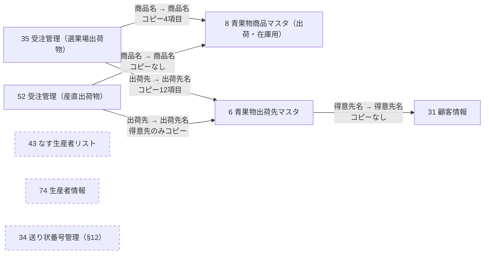

# 既存kintoneアプリ MCP As-Is調査（2026-11-06）

本書は、既存の本番kintoneアプリ8件を **kintone MCP経由で読み取り専用で** 調査した結果の記録である（As-Is）。

| 範囲 | 対象 | 記載箇所 |
|---|---|---|
| 一括調査 | 7アプリ（35・52・43・74・6・8・31） | §0〜§10 |
| 追加調査 | 出荷lot、送り状番号、選果場DX対象 | §11 |
| 追加調査 | アプリ34「送り状番号管理」、送り状番号の現行運用 | §12 |

- V2の仕様ではない。V2の業務仕様は [BASIC_ARCHITECTURE.md](../00_project/BASIC_ARCHITECTURE.md) 第I部、[DECISION_LOG.md](../00_project/DECISION_LOG.md)、[ORDER_SHIPPING_V2_DATA_MODEL.md](../20_design/ORDER_SHIPPING_V2_DATA_MODEL.md) を優先する。
- 既存のAs-Is資料（[KINTONE_APP_MAP.md](KINTONE_APP_MAP.md) ほか）は書き換えていない。本書との差異は §8 にまとめた。正式資料への反映要否は、ユーザー・ChatGPTの検討後に判断する。
- 個人名・住所・電話番号・請求先顧客コードの値は転記していない。
- §6.1 の出荷lotの記述は §11.1、§11.2 の送り状番号の「記録先不明」は §12 で更新されている。§8〜§10 の一覧は、§11・§12 の結果を反映済み。
- 「業務確認済」は、2026-11-06 にユーザーへ確認した事項を指す。

## 0. 調査概要

| 項目 | 内容 |
|---|---|
| 調査日時 | 2026-11-06（JST） |
| 方法 | Claude Code から kintone MCP（`@kintone/mcp-server` 1.11.2）で読み取りAPIを実行 |
| 使用ツール | `kintone-get-app`、`kintone-get-form-fields`、`kintone-get-form-layout`、`kintone-get-process-management`、`kintone-get-general-settings`、`kintone-get-records`（取得項目を限定し、1回あたり最大3件）、`kintone-get-record-comments`（§11.2） |
| 使用しなかったツール | 書き込み系（add / update / delete / deploy / update-statuses / add-record-comment 等）は一切使用していない。`kintone-download-file` は1回試行したが、MCPの保存先設定がなく実行されなかった（§12.1）。添付ファイルの取得・閲覧はしていない |
| 取得対象 | 本番環境（preview=false） |

### 表記

- **【MCP確認】**：今回MCPで直接取得した事実
- **【既存資料】**：docs/10_as_is/ 等の既存資料に記載の事実
- **【推定】**：取得結果からの推測。未確定
- **【未確認】**：MCPでは取得できない、または今回取得していない

### MCPで取得できないもの【未確認】

今回のMCPサーバー（1.11.2）には次を取得するツールがない。本書では扱わず、既存資料（テンプレート調査）の記載を参照する。

- 一覧（ビュー）、グラフ
- JavaScript / CSS カスタマイズ、プラグイン
- アクセス権（アプリ・レコード・フィールド）
- 通知、アクション、CSV取込設定

## 1. 対象アプリと接続結果

| ID | アプリ名 | スペースID | get-app | get-form-fields | layout | process | general | revision | 作成日 | 最終更新（UTC） |
|---|---|---|---|---|---|---|---|---|---|---|
| 35 | 受注管理（選果場出荷物） | 3 | ✅ | ✅ | ✅ | ✅ | ✅ | 198 | 2022-11-29 | 2026-11-06 01:13 |
| 52 | 受注管理（産直出荷物） | 9 | ✅ | ✅ | ✅ | ✅ | ✅ | 86 | 2022-12-10 | 2026-11-06 02:06 |
| 43 | なす生産者リスト | 11 | ✅ | ✅ | ✅ | ✅ | ✅ | 9 | 2022-12-01 | 2026-11-06 02:08 |
| 74 | 生産者情報 | 11 | ✅ | ✅ | ✅ | ✅ | ✅ | 13 | 2023-02-06 | 2026-11-06 02:10 |
| 6 | 青果物出荷先マスタ | 11 | ✅ | ✅ | ✅ | ✅ | ✅ | 32 | 2022-11-26 | 2026-11-06 02:11 |
| 8 | 青果物商品マスタ（出荷・在庫用） | 11 | ✅ | ✅ | ✅ | ✅ | ✅ | 24 | 2022-11-26 | 2026-11-06 02:13 |
| 31 | 顧客情報 | 11 | ✅ | ✅ | ✅ | ✅ | ✅ | 10 | 2022-11-27 | 2026-11-06 02:14 |
| 34 | 送り状番号管理（§12） | 3 | ✅ | ✅ | 未実施 | 未実施 | 未実施 | 12 | 2022-11-28 | 2026-11-06 02:48 |

- アプリ34は、APIトークン追加後に別途調査した（§12）。layout・process・general は取得していない。§2〜§10 の「7アプリ」はアプリ34を含まない。
- 7アプリすべて取得に成功した。権限エラー・取得エラーはなかった【MCP確認】。
- 7アプリとも、最終更新日時が 2026-11-06 01:13〜02:14 UTC（JST 10:13〜11:14）に集中している【MCP確認】。
  - 本日のAPIトークン追加・アプリ更新の操作によるものと【推定】。フィールド構成は既存資料（2026-09〜10のテンプレート）とほぼ一致しており（§8.1）、業務項目の変更は見当たらない。
- 7アプリとも、作成者・最終更新者は同一ユーザー（プロジェクトオーナー）である。

### レコード件数（`totalCount`）【MCP確認】

| ID | アプリ | 総件数 | 補足 |
|---|---|---|---|
| 35 | 受注管理（選果場出荷物） | 37,279 | うち 出荷＝出荷済 35,547 |
| 52 | 受注管理（産直出荷物） | 1,984 | うち 発注≠未発注 682 |
| 43 | なす生産者リスト | 12 | |
| 74 | 生産者情報 | 8 | |
| 6 | 青果物出荷先マスタ | 267 | |
| 8 | 青果物商品マスタ（出荷・在庫用） | 181 | うち 選果場DX対象＝対象 3 |
| 31 | 顧客情報 | 43 | |
| 34 | 送り状番号管理 | 58 | レコード番号は878まで（§12.3） |

## 2. 全アプリ共通の設定【MCP確認】

| 項目 | 7アプリ共通の値 |
|---|---|
| プロセス管理 | 無効（`enable: false`）。ステータス・作業者フィールドも無効 |
| カテゴリー | 無効 |
| コメント | 有効 |
| レコード再利用 | 有効 |
| 一覧でのインライン編集 | 有効 |
| 一括削除 | 無効 |
| 数値精度 | 全体16桁・小数4桁・HALF_EVEN |
| 年度開始月 | 4月 |
| 関連レコード一覧（REFERENCE_TABLE） | 7アプリとも存在しない |
| 計算フィールド | アプリ35の `計算` のみ |
| サブテーブル | アプリ74・31の `テーブル_0` のみ |
| フィールドコード | `senkajo_dx_target`・`出荷先名`・`使用量`・`計算` 以外は、kintoneの自動採番コード |

- 表の「システム項目」は、レコード番号・作成者・作成日時・更新者・更新日時・ステータス・作業者・カテゴリーの8つを指す。以下のフィールド表では省略する。

## 3. アプリ別フィールド定義【MCP確認】

表の凡例：必須＝必須入力、重複禁止＝値の重複禁止。空欄は設定なし。

### 3.1 アプリ35 受注管理（選果場出荷物）

全47フィールド（業務項目39＋システム項目8）。タイトル項目：`文字列__1行_`（得意先）。

**受注・出荷の基本項目**

| 表示名 | フィールドコード | 型 | 必須 | 初期値・選択肢・設定 |
|---|---|---|---|---|
| 受注日 | `日付` | DATE | | 初期値：当日 |
| 出荷先 | `ルックアップ` | ルックアップ（文字列） | | → アプリ6 `出荷先名`（§4） |
| 得意先 | `文字列__1行_` | SINGLE_LINE_TEXT | | 出荷先ルックアップのコピー先 |
| 商品名 | `ルックアップ_0` | ルックアップ（文字列） | | → アプリ8 `文字列__1行_`（§4） |
| 商品Lot | `数値_1` | NUMBER | | 商品名ルックアップのコピー先 |
| 受注数量 | `数値` | NUMBER | | 単位「c/s」（後置） |
| 個口数(発行枚数） | `数値_0` | NUMBER | | 表示小数2桁 |
| 出荷予定日 | `日付_0` | DATE | | |
| 納品日 | `日付_1` | DATE | | |
| 物流業者 | `ラジオボタン` | RADIO_BUTTON | ✅ | 佐川（初期値）／クロネコヤマト／福通／その他 |
| 出荷 | `ラジオボタン_0` | RADIO_BUTTON | ✅ | 未出荷（初期値）／出荷済／キャンセル／追加 |
| 出荷lot | `文字列__1行__0` | SINGLE_LINE_TEXT | | |

**資材**

| 表示名 | フィールドコード | 型 | 設定 |
|---|---|---|---|
| 使用資材 | `文字列__1行__10` | SINGLE_LINE_TEXT | 商品名ルックアップのコピー先 |
| 資材使用量（c/s） | `使用量` | NUMBER | 商品名ルックアップのコピー先 |
| 計算 | `計算` | CALC | 式 `数値*使用量`（受注数量×資材使用量）、数値形式 |

**送り状（佐川使用欄）**

| 表示名 | フィールドコード | 型 | 初期値・設定 |
|---|---|---|---|
| 住所コード区分 | `文字列__1行__6` | SINGLE_LINE_TEXT | `0` |
| 住所録コード | `文字列__1行__8` | SINGLE_LINE_TEXT | 出荷先ルックアップのコピー先 |
| 依頼主コード区分 | `文字列__1行__7` | SINGLE_LINE_TEXT | `0` |
| 依頼主コード | `文字列__1行__9` | SINGLE_LINE_TEXT | 出荷先ルックアップのコピー先 |
| 荷姿コード | `文字列__1行__2` | SINGLE_LINE_TEXT | `001` |
| 品名１（佐川ヤマト共用） | `文字列__1行__1` | SINGLE_LINE_TEXT | 商品名ルックアップのコピー先 |
| スピード指定 | `文字列__1行__3` | SINGLE_LINE_TEXT | `000` |
| クール便指定 | `文字列__1行__4` | SINGLE_LINE_TEXT | `001` |
| 配達時間帯指定 | `文字列__1行__5` | SINGLE_LINE_TEXT | `01` |

**送り状（ヤマト使用欄）**

| 表示名 | フィールドコード | 型 | 初期値・設定 |
|---|---|---|---|
| お届け先名 | `文字列__1行__11` | SINGLE_LINE_TEXT | 出荷先ルックアップのコピー先 |
| お届け先郵便番号 | `数値_2` | NUMBER | 同上（数値型） |
| お届け先住所 | `文字列__1行__12` | SINGLE_LINE_TEXT | 同上 |
| お届け先会社・部門１ | `文字列__1行__13` | SINGLE_LINE_TEXT | 同上 |
| お届け先電話番号 | `文字列__1行__14` | SINGLE_LINE_TEXT | 同上 |
| ご依頼主電話番号 | `文字列__1行__15` | SINGLE_LINE_TEXT | 同上 |
| ご依頼主郵便番号 | `数値_3` | NUMBER | 同上（数値型） |
| ご依頼主住所 | `文字列__1行__16` | SINGLE_LINE_TEXT | 同上 |
| ご依頼主名 | `文字列__1行__17` | SINGLE_LINE_TEXT | 同上 |
| 請求先顧客コード | `文字列__1行__19` | SINGLE_LINE_TEXT | 初期値あり（値は転記しない） |
| 運賃管理番号 | `文字列__1行__20` | SINGLE_LINE_TEXT | `'01` |
| 送り状種類 | `数値_7` | NUMBER | `0` |
| 配達時間帯 | `文字列__1行__21` | SINGLE_LINE_TEXT | `'0812` |
| 敬称 | `文字列__1行__18` | SINGLE_LINE_TEXT | `御中` |
| 個口数表示フラグ | `数値_8` | NUMBER | `1` |

**フォームレイアウト（行順）**：作成者・レコード番号・受注日 ／ 出荷先・得意先 ／ 商品名・商品Lot・受注数量・個口数・使用資材・資材使用量・計算 ／ 出荷予定日・納品日・物流業者 ／ 出荷 ／ 出荷lot ／ ラベル「佐川使用欄」 ／ 佐川項目（3行） ／ ラベル「ヤマト使用欄」 ／ ヤマト項目（6行）。グループ・スペースはない。

- 送り状番号を保持するフィールドは存在しない【MCP確認】。

### 3.2 アプリ52 受注管理（産直出荷物）

全18フィールド（業務項目10＋システム項目8）。タイトル項目：`文字列__1行_`（得意先）。

| 表示名 | フィールドコード | 型 | 必須 | 初期値・選択肢・設定 |
|---|---|---|---|---|
| 受注日 | `日付` | DATE | | 初期値：当日 |
| 出荷先 | `ルックアップ` | ルックアップ（文字列） | | → アプリ6 `出荷先名`（§4） |
| 得意先 | `文字列__1行_` | SINGLE_LINE_TEXT | | 出荷先ルックアップのコピー先 |
| 商品名 | `ルックアップ_0` | ルックアップ（文字列） | | → アプリ8 `文字列__1行_`（コピー項目なし） |
| 備考 | `文字列__1行__0` | SINGLE_LINE_TEXT | | |
| 受注数量 | `数値` | NUMBER | | 単位「c/s」（後置） |
| 出荷予定日 | `日付_0` | DATE | | |
| 納品日 | `日付_1` | DATE | | |
| 発注 | `ラジオボタン_0` | RADIO_BUTTON | ✅ | 未発注（初期値）／発注済／キャンセル（未手配）／キャンセル（手配済） |
| 出荷確認 | `ラジオボタン` | RADIO_BUTTON | ✅ | 出荷未確認（初期値）／出荷確認済／キャンセル |

**フォームレイアウト**：作成者・レコード番号・受注日 ／ 出荷先・得意先 ／ 商品名・備考・受注数量 ／ 出荷予定日・納品日 ／ 発注 ／ 出荷確認。

### 3.3 アプリ43 なす生産者リスト

全15フィールド（業務項目7＋システム項目8）。タイトル項目：`文字列__1行_`。

| 表示名 | フィールドコード | 型 | 必須 | 設定 |
|---|---|---|---|---|
| 生産者氏名 | `文字列__1行_` | SINGLE_LINE_TEXT | | 重複禁止、最大64文字 |
| コンテナサイズ | `数値_1` | NUMBER | | 単位「kgコンテナ」 |
| 生産者番号 | `数値_2` | NUMBER | | 重複禁止なし |
| 作付品種（夏秋） | `文字列__1行__0` | SINGLE_LINE_TEXT | | |
| 作付面積 | `数値` | NUMBER | | 単位「a」。レイアウト上は夏秋の行 |
| 作付品種（促成） | `文字列__1行__1` | SINGLE_LINE_TEXT | | |
| 作付面積 | `数値_0` | NUMBER | | 単位「a」。レイアウト上は促成の行 |

**フォームレイアウト**：生産者氏名・コンテナサイズ・生産者番号 ／ 作付品種（夏秋）・作付面積(`数値`) ／ 作付品種（促成）・作付面積(`数値_0`)。

- 「作付面積」のラベルが2つあり、レイアウトの行から夏秋＝`数値`、促成＝`数値_0` と読める【MCP確認（配置）／意味は推定】。

### 3.4 アプリ74 生産者情報（既存資料に記載なし）

全14フィールド（業務項目6＋システム項目8、サブテーブル内2項目）。タイトル項目：`文字列__1行_`。

| 表示名 | フィールドコード | 型 | 必須 | 設定 |
|---|---|---|---|---|
| 生産者名 | `文字列__1行_` | SINGLE_LINE_TEXT | ✅ | 重複禁止、最大64文字 |
| 担当者 | `文字列__1行__0` | SINGLE_LINE_TEXT | | |
| 電話番号 | `リンク_0` | LINK（電話） | | |
| FAX番号 | `リンク_1` | LINK（電話） | | |
| メールアドレス | `リンク` | LINK（メール） | | |
| 取引先 | `テーブル_0` | SUBTABLE | | 下記2項目 |
| └ 農産物 | `文字列__1行__1` | SINGLE_LINE_TEXT | | |
| └ 商品提案書 | `添付ファイル` | FILE | | |

**フォームレイアウト**：生産者名・担当者 ／ 電話番号・FAX番号・メールアドレス ／ サブテーブル「取引先」（農産物・商品提案書）。

- フィールドコード・型・サブテーブル構成がアプリ31「顧客情報」と同一で、ラベルだけが異なる（§3.7）。アプリ31をコピーして作られたと【推定】。
- 生産者番号・生産者Lotに当たる項目はない。
- 他の6アプリとのルックアップ関係はない（参照する側・される側とも）【MCP確認（7アプリの範囲）】。

### 3.5 アプリ6 青果物出荷先マスタ

全23フィールド（業務項目15＋システム項目8）。タイトル項目：`出荷先名`。

| 表示名 | フィールドコード | 型 | 必須 | 設定 |
|---|---|---|---|---|
| 出荷先名 | `出荷先名` | SINGLE_LINE_TEXT | ✅ | 重複禁止、最大64文字。受注2アプリのルックアップキー |
| 得意先名 | `ルックアップ_0` | ルックアップ（文字列） | ✅ | → アプリ31 `文字列__1行_`（コピー項目なし） |
| 住所録コード（※半角数字入力） | `文字列__1行__1` | SINGLE_LINE_TEXT | | 佐川用 |
| 依頼主コード（※半角数字入力） | `文字列__1行__2` | SINGLE_LINE_TEXT | | 佐川用 |
| 担当者名 | `文字列__1行__0` | SINGLE_LINE_TEXT | | |
| お届け先郵便番号（数字のみ） | `数値` | NUMBER | | 単位「〒」（前置） |
| お届け先住所 | `文字列__1行_` | SINGLE_LINE_TEXT | | |
| お届け先電話番号 | `文字列__1行__5` | SINGLE_LINE_TEXT | | |
| お届け先名 | `文字列__1行__4` | SINGLE_LINE_TEXT | | |
| お届け先会社・部門１ | `文字列__1行__3` | SINGLE_LINE_TEXT | | |
| ご依頼主電話番号 | `文字列__1行__6` | SINGLE_LINE_TEXT | | |
| ご依頼主郵便番号 | `数値_0` | NUMBER | | |
| ご依頼主住所 | `文字列__1行__7` | SINGLE_LINE_TEXT | | |
| ご依頼主名 | `文字列__1行__8` | SINGLE_LINE_TEXT | | |
| メモ | `リッチエディター` | RICH_TEXT | | |

**フォームレイアウト**：レコード番号・出荷先名・得意先名 ／ ラベル「佐川使用欄」 ／ 住所録コード・依頼主コード・担当者名 ／ ラベル「ヤマト使用欄」 ／ ヤマト項目（4行） ／ メモ。

### 3.6 アプリ8 青果物商品マスタ（出荷・在庫用）

全17フィールド（業務項目9＋システム項目8）。タイトル項目：`文字列__1行_`。

| 表示名 | フィールドコード | 型 | 必須 | 初期値・選択肢・設定 |
|---|---|---|---|---|
| 商品名 | `文字列__1行_` | SINGLE_LINE_TEXT | | 重複禁止、最大64文字。受注2アプリのルックアップキー |
| 規格 | `文字列__1行__0` | SINGLE_LINE_TEXT | | |
| 仕入れ単価 | `数値_1` | NUMBER | | 単位「￥」（前置）、桁区切りあり |
| 選果場DX対象 | `senkajo_dx_target` | RADIO_BUTTON | ✅ | 対象外（初期値）／対象 |
| 使用資材（ラベル袋） | `文字列__1行__1` | SINGLE_LINE_TEXT | | |
| 資材使用量 | `数値_0` | NUMBER | | |
| Lot番号 | `数値` | NUMBER | | 商品Lot。重複禁止なし |
| 品名１（佐川） | `文字列__1行__2` | SINGLE_LINE_TEXT | | |
| メモ | `リッチエディター` | RICH_TEXT | | |

**フォームレイアウト**：商品名 ／ 規格 ／ 仕入れ単価・選果場DX対象 ／ 使用資材・資材使用量 ／ Lot番号 ／ 品名１（佐川） ／ メモ。

**アプリ説明欄**【MCP確認】：商品名の先頭に半角の分類番号（1.筑陽なすA品、2.筑陽なすA品以外、3.とろとろ炒めなす、4.選果場出荷その他野菜果物、5.産地直送野菜果物、6.その他）を付けるルールが書かれている。既存資料のとおり、このルールは実データで守られていない【既存資料】。分類キーとして使わない（CLAUDE.md）。

### 3.7 アプリ31 顧客情報

全14フィールド（業務項目6＋システム項目8、サブテーブル内2項目）。タイトル項目：`文字列__1行_`。

| 表示名 | フィールドコード | 型 | 必須 | 設定 |
|---|---|---|---|---|
| 得意先名 | `文字列__1行_` | SINGLE_LINE_TEXT | ✅ | 重複禁止、最大64文字。アプリ6のルックアップキー |
| 担当者 | `文字列__1行__0` | SINGLE_LINE_TEXT | | |
| 電話番号 | `リンク_0` | LINK（電話） | | |
| FAX番号 | `リンク_1` | LINK（電話） | | |
| メールアドレス | `リンク` | LINK（メール） | | |
| 取引先 | `テーブル_0` | SUBTABLE | | 下記2項目 |
| └ 文字列 (1行) | `文字列__1行__1` | SINGLE_LINE_TEXT | | ラベル初期名のまま |
| └ 添付ファイル | `添付ファイル` | FILE | | |

**フォームレイアウト**：得意先名・担当者 ／ 電話番号・FAX番号 ／ メールアドレス ／ サブテーブル「取引先」。

## 4. アプリ間の参照関係【MCP確認】

### 4.1 関係図

- アプリ43・74は、7アプリの中では参照する側にも参照される側にもなっていない（破線）。
- アプリ34も、ルックアップ・関連レコード一覧を持たず、他アプリからも参照されていない（§12.2）。アプリ35とは、日付（出荷日／出荷予定日）が業務上対応するだけで、データ上の関連はない。
- 関連レコード一覧による参照は、7アプリとも存在しない。
- 7アプリ以外のアプリからの参照の有無は【未確認】（MCPに逆引きの手段がない）。

### 4.2 ルックアップ一覧

いずれも、ルックアップピッカーの表示項目・絞り込み条件の設定なし、ソートは「レコード番号 降順」。

| 参照元 | フィールド | 参照先 | キー（参照先） | コピー（参照先 → 参照元） |
|---|---|---|---|---|
| 35 | 商品名 `ルックアップ_0` | 8 | 商品名 `文字列__1行_` | Lot番号 `数値` → 商品Lot `数値_1` 品名１（佐川） `文字列__1行__2` → 品名１（佐川ヤマト共用） `文字列__1行__1` 使用資材（ラベル袋） `文字列__1行__1` → 使用資材 `文字列__1行__10` 資材使用量 `数値_0` → 資材使用量（c/s） `使用量` |
| 35 | 出荷先 `ルックアップ` | 6 | 出荷先名 `出荷先名` | 得意先名 `ルックアップ_0` → 得意先 `文字列__1行_` 住所録コード `文字列__1行__1` → `文字列__1行__8` 依頼主コード `文字列__1行__2` → `文字列__1行__9` お届け先名 `文字列__1行__4` → `文字列__1行__11` お届け先住所 `文字列__1行_` → `文字列__1行__12` お届け先郵便番号 `数値` → `数値_2` お届け先会社・部門１ `文字列__1行__3` → `文字列__1行__13` お届け先電話番号 `文字列__1行__5` → `文字列__1行__14` ご依頼主電話番号 `文字列__1行__6` → `文字列__1行__15` ご依頼主住所 `文字列__1行__7` → `文字列__1行__16` ご依頼主名 `文字列__1行__8` → `文字列__1行__17` ご依頼主郵便番号 `数値_0` → `数値_3` |
| 52 | 商品名 `ルックアップ_0` | 8 | 商品名 `文字列__1行_` | なし |
| 52 | 出荷先 `ルックアップ` | 6 | 出荷先名 `出荷先名` | 得意先名 `ルックアップ_0` → 得意先 `文字列__1行_` |
| 6 | 得意先名 `ルックアップ_0` | 31 | 得意先名 `文字列__1行_` | なし |

- **ルックアップのキーはすべて名称文字列**（商品名・出荷先名・得意先名）。参照先ではいずれも重複禁止。
- アプリ35の出荷先ルックアップのコピーは12項目（得意先＋佐川2＋ヤマト9）。
- 受注の「得意先」は、顧客情報 → 出荷先マスタ → 受注 の2段コピーで入る値である。

## 5. 同じフィールドコードで意味が異なる項目【MCP確認】

自動採番コードのため、同じコードでもアプリごとに意味がまったく異なる。**コード名で同一項目と判断してはいけない。** 移行・照合では「アプリID＋フィールドコード」で扱う必要がある。

| フィールドコード | 35 選果場受注 | 52 産直受注 | 43 なす生産者 | 74 生産者情報 | 6 出荷先 | 8 商品 | 31 顧客 |
|---|---|---|---|---|---|---|---|
| `文字列__1行_` | 得意先 | 得意先 | 生産者氏名 | 生産者名 | お届け先住所 | 商品名 | 得意先名 |
| `文字列__1行__0` | 出荷lot | 備考 | 作付品種（夏秋） | 担当者 | 担当者名 | 規格 | 担当者 |
| `文字列__1行__1` | 品名１ | — | 作付品種（促成） | └ 農産物（表内） | 住所録コード | 使用資材 | └ 文字列(1行)（表内） |
| `数値` | 受注数量 | 受注数量 | 作付面積（夏秋） | — | お届け先郵便番号 | Lot番号 | — |
| `数値_0` | 個口数 | — | 作付面積（促成） | — | ご依頼主郵便番号 | 資材使用量 | — |
| `数値_1` | 商品Lot | — | コンテナサイズ | — | — | 仕入れ単価 | — |
| `数値_2` | お届け先郵便番号 | — | 生産者番号 | — | — | — | — |
| `ラジオボタン` | 物流業者 | 出荷確認 | — | — | — | — | — |
| `ラジオボタン_0` | 出荷 | 発注 | — | — | — | — | — |
| `ルックアップ_0` | 商品名 | 商品名 | — | — | 得意先名 | — | — |

- 受注2アプリ間で意味が一致するのは、`日付`・`日付_0`・`日付_1`・`ルックアップ`・`ルックアップ_0`・`文字列__1行_`・`数値` のみ。
- 出荷先マスタ（6）と受注（35）では、同じ「お届け先住所」がそれぞれ `文字列__1行_` と `文字列__1行__12` であり、同じ意味でもコードが異なる。

## 6. サンプルレコードの確認【MCP確認】

取得項目を限定し、1回あたり最大3件とした。個人情報を含む項目は取得していない。件数確認は `limit: 1` と `totalCount` で行った。

### 6.1 アプリ35：出荷済の最新3件

取得項目：レコード番号、出荷予定日、物流業者、出荷、出荷lot、商品Lot、受注数量、個口数。

| レコード番号 | 出荷予定日 | 物流業者 | 出荷 | 出荷lot | 商品Lot | 受注数量 | 個口数 |
|---|---|---|---|---|---|---|---|
| 38179 | 2026-11-04 | クロネコヤマト | 出荷済 | `1308` | 63 | 1 | （空） |
| 38178 | 2026-11-04 | クロネコヤマト | 出荷済 | `1308` | 63 | 1 | （空） |
| 38177 | 2026-11-04 | クロネコヤマト | 出荷済 | `1308` | 63 | 1 | （空） |

- **事実**：出荷lotは4文字 `1308` で入力されている。6桁ではない。商品Lotは別項目 `数値_1` に 63 が入っている。
- **事実**：個口数は空欄のまま出荷済になっている。
- **推定**：出荷lotには「日付Lot 2桁＋生産者Lot 2桁」だけを入力し、商品Lotは別項目で持っている運用の可能性がある。ただし、出荷予定日 11/04 に「日付＋10」を当てると `14` になり、先頭 `13` と合わない（製造日・選果日が11/03の可能性等）。3件だけでは判断できない。
- 出荷lotに区切り文字（`,` `、` `/`）を含むレコードは、`like` 検索では0件だった。kintoneの全文検索は記号の扱いに制約があるため、「複数Lotの記入例がない」とは断定しない。
- → §11.1 で更新：現在の区切り文字はピリオド「.」で、複数Lotの明細は多数ある。4桁の構成・入力形式の変遷も §11.1 を参照。

### 6.2 アプリ52：最新3件

取得項目：レコード番号、出荷予定日、出荷確認、発注、受注数量。

| レコード番号 | 出荷予定日 | 出荷確認 | 発注 | 受注数量 |
|---|---|---|---|---|
| 2071 | 2026-09-29 | 出荷未確認 | 未発注 | 13 |
| 2070 | 2026-09-26 | 出荷未確認 | 未発注 | 17.5 |
| 2069 | 2026-09-22 | 出荷未確認 | 未発注 | 5 |

- **事実**：最新3件は「発注」「出荷確認」とも初期値のまま。既存資料の「現在は使われていない」と整合する。
- **事実**：全1,984件のうち682件は「発注」が未発注以外。過去には使われていた（既存資料の「アプリ作成当初は使われていた」と整合）。
- **事実**：受注数量に小数（17.5）がある。
- **事実**：レコード番号最大の受注の出荷予定日が 2026-09-29。それ以降の産直受注がこのアプリに登録されていない理由（季節、運用変更等）は【未確認】。

### 6.3 アプリ8：選果場DX対象＝対象のレコード（全3件）

| レコード番号 | 商品名 | 規格 | Lot番号 |
|---|---|---|---|
| 193 | 5.筑陽なすＡ小（70本）5～6月 | 70本入り | 9 |
| 192 | 1.筑陽なすA長（35本×2袋入） | ベジロジ | 1 |
| 191 | 1.筑陽なすA長（60本）ラベル20枚 | ベジロジ | 64 |

- **事実**：181件中「対象」は3件のみで、残りは「対象外」。
- **事実**：「規格」に得意先名と思われる文字列（「ベジロジ」）が入っている商品がある。規格欄は純粋な規格情報ではない。
- **事実**：レコード番号は最大193、総件数は181（削除済みレコードがある）。

### 6.4 アプリ43・74

- アプリ43：取得項目はレコード番号・生産者番号・コンテナサイズのみ。総件数12で、2026-10-04のCSV（12件）と一致。最新3件のうち2件は生産者番号が空欄。
- アプリ74：取得項目はレコード番号・作成日時・更新日時のみ。総件数8。最新3件は 2023-02-28 に作成・更新されたまま。以降の更新は【未確認】だが、最新3件からは活発に使われていないと【推定】。

### 6.5 アプリ6・31

件数のみ確認（出荷先 267件、顧客 43件）。値は取得していない。

## 7. 主要な業務上の特徴（As-Is）

1. **受注は2アプリに分かれ、同じマスタ（6・8）を共有している**【MCP確認】。既存資料では「同じ本番アプリと推定」だったが、実アプリID（6・8）で確定した。
2. **マスタ連携は名称キー＋コピー型ルックアップ**。マスタの名称変更・住所変更は既存受注に反映されない（kintone標準仕様）。
3. **選果場受注は送り状データの保持を兼ねている**。出荷先マスタから送り状用の住所・コード12項目を受注にコピーし、佐川・ヤマトの固定値を初期値で持つ。送り状番号の保存先はない。
4. **状態管理はラジオボタンのみ**。プロセス管理は7アプリとも無効。
5. **生産者のアプリが2つある**。43「なす生産者リスト」（生産者番号・コンテナサイズ）と74「生産者情報」（連絡先・取扱農産物）。どちらも他アプリと連携していない。
6. **郵便番号が数値型**（6・35）。先頭0が保持されない。
7. **商品Lotは商品マスタのフィールド**で、重複禁止はない。

## 8. 既存資料との照合

### 8.1 既存資料と一致している事項

| 事項 | 既存資料 |
|---|---|
| 受注2アプリ・マスタ4アプリのフィールド構成（コード・型・必須・初期値・選択肢）。アプリ35は業務項目39、52は10 | ORDER_APP_AS_IS §3、DIRECT_SHIPPING_ORDER_APP_AS_IS §1・§3、各マスタAs-Is |
| ルックアップのキー・コピー項目 | KINTONE_APP_MAP §2 |
| `ラジオボタン_0`・`ラジオボタン`・`文字列__1行__0` の意味の衝突 | DIRECT_SHIPPING_ORDER_APP_AS_IS §6 |
| プロセス管理・カテゴリー未使用、一括削除無効、コメント有効 | KINTONE_APP_MAP §4、各As-Is §1 |
| 関連レコード一覧なし | KINTONE_APP_MAP §2 |
| 商品Lotは商品マスタのフィールド「Lot番号」で、独立マスタはない | PRODUCT_MASTER_AS_IS §5 |
| `senkajo_dx_target`（必須、対象外／対象、初期値 対象外） | PRODUCT_MASTER_AS_IS §2.1 |
| 商品マスタの説明欄の番号接頭辞ルール | PRODUCT_MASTER_AS_IS §1 |
| なす生産者リストの7項目、生産者番号が一部空欄、12件 | PRODUCER_MASTER_AS_IS §2・§5 |
| 受注管理に送り状番号フィールドがない | ORDER_APP_AS_IS §14、BASIC_ARCHITECTURE §25.4 |
| 産直の「発注」「出荷確認」は現在使われていない（最新レコードが初期値のまま） | DIRECT_SHIPPING_ORDER_APP_AS_IS §5 |
| 物流業者の選択肢4つ（旧選択肢「ヤマト」はAPIでは返らない＝無効化済みと整合） | ORDER_APP_AS_IS §3.1 |

### 8.2 新しく判明した事項

1. **実環境のアプリID**（既存資料ではすべて【未取得】）：35 / 52 / 43 / 74 / 6 / 8 / 31、および 34（送り状番号管理）。スペースID：受注（選果場）・送り状番号管理 3、受注（産直）9、マスタ類 11。
2. **2つの受注管理が参照するマスタは同じ本番アプリ（6・8）**（既存資料では【推定】）。
3. **アプリ74「生産者情報」の存在**。既存資料のアプリ一覧に記載がない。顧客情報（31）と同構造で、連絡先と取扱農産物・商品提案書を持つ。8件。
4. **レコード件数**：選果場受注 37,279件（出荷済 35,547）、産直受注 1,984件、出荷先 267件、商品 181件、顧客 43件、生産者情報 8件。
5. **選果場DX対象＝対象は3商品のみ**（既存資料では値の設定状況が【未取得】）。
6. **出荷lotの実データは4文字（`1308`）** で、商品Lotは別項目に入っている（§6.1）。
7. **出荷済でも個口数が空欄のレコードがある**（§6.1）。
8. **商品マスタの「規格」に得意先名と思われる値が入っている**（§6.3）。
9. **産直の「発注」は682件で未発注以外の値**。過去の利用実績が数字で確認できた。
10. **産直受注の最新の出荷予定日が 2026-09-29**（§6.2）。
11. **kintoneの出荷lot入力は、2024年夏ごろに6桁から4桁へ変わっている**（§11.1）。
12. **送り状番号は、アプリ34「送り状番号管理」に運送会社システム画面のスクリーンショットとして出荷日単位で保管されている**（§12）。
13. **「選果場DX対象」は初期検討時の項目で、V2では使用しない**【業務確認済】（§11.3）。

### 8.3 既存資料と食い違う、または注意が必要な事項

| # | 事項 | 既存資料 | 今回の確認 | 評価 |
|---|---|---|---|---|
| 1 | 出荷lotの桁数 | 6桁＝商品Lot2＋日付Lot2＋生産者Lot2（ORDER_APP_AS_IS §6.2、BASIC_ARCHITECTURE §26、ORDER_SHIPPING_V2_DATA_MODEL §8.5） | kintoneへの入力は2024年夏ごろまで6桁、以降は4桁（§11.1） | 既存資料の6桁は現物スタンプの記述。kintone入力値とは区別が必要（§11.1）。4桁の構成は推定のため**要業務確認** |
| 2 | 生産者マスタ | 既存の生産者マスタ＝なす生産者リスト【業務確認済】（KINTONE_APP_MAP §1、BASELINE §3.1） | 別に「生産者情報」（74）がある | 食い違いではないが、資料の網羅性の不足。74の位置づけは要確認 |
| 3 | 日付Lot | 日付＋10（BASIC_ARCHITECTURE §26） | 4桁の先頭2桁は、出荷予定日の0〜6日前の「日＋10」と一致することが多い（§11.1） | 「日付」は出荷日ではなく選果日等と推定。**要業務確認** |
| 4 | 送り状番号の記録先 | 現場確認では「現在のkintoneでは最若番のみ記録」（BASIC_ARCHITECTURE §25.4） | アプリ34にスクリーンショットとして保管（§12） | 記録先は判明。番号はデータとしては持っていない。画像の中身（最若番だけか等）は未確認 |
| 5 | 選果場DX対象 | V2商品マスタへ送る属性の一つとして記載（BASIC_ARCHITECTURE §8.4、ORDER_SHIPPING_V2_DATA_MODEL §10.1） | 初期検討時の項目で、V2では使用しない【業務確認済】（§11.3） | **正式資料との差異**。本書では正式資料を変更していない。反映要否はユーザー・ChatGPTで判断 |

- 正式な設計文書の内容（V2仕様）と矛盾する既存アプリの設定は見つからなかった。V2の仕様は既存アプリの設定に合わせる必要はない（CLAUDE.md）。
- #5 は既存アプリの設定ではなく、正式資料の記述とユーザー確認結果の差異である。

### 8.4 まだ確認できていない事項

1. 一覧・グラフ・JS・プラグイン・アクセス権・通知の現状（MCPに取得手段がない。既存資料はテンプレート時点の情報）。
2. 7アプリ以外から 43・74 などへの参照の有無。
3. 出荷lot 4桁の構成（日付Lotの基準日、末尾2桁と生産者番号の対応）、6桁から4桁へ変えた理由（§11.1）。
4. アプリ74「生産者情報」の用途、運用状況、43との関係、いちご生産者を含むか。
5. アプリ43の生産者番号が空欄の生産者の扱い。
6. アプリ34の画像に写っている画面の内容（最若番だけか、全番号か）。画像確認はユーザー指示で中止（§12）。
7. 個口数が空欄のまま出荷済になるケースの意味（ヤマトは別途入力等）。
8. 産直受注が 2026-09-29 以降に登録されていない理由。
9. 商品マスタ「規格」の記入ルール。
10. 本日（2026-11-06）の8アプリの更新内容（APIトークン追加以外の変更有無）。

- 「選果場DX対象」を3商品だけ「対象」にした意図は、§11.3 のユーザー確認（初期検討時の項目、V2では使用しない）で解消した。

## 9. V2技術設計時の注意点

V2の業務仕様は正式設計文書に従う。以下は、既存アプリの実態から見た技術設計・移行上の注意である。仕様の決定ではない。

1. **フィールドコードの照合は「アプリID＋コード」で行う**（§5）。旧コードはV2で再利用しない方針（CLAUDE.md）と整合。
2. **マスタ移行時のID化**：既存は名称キーで連携しているため、V2の「ID連携＋名称スナップショット」へ移す際、名称の揺れ（全角半角、接頭辞番号等）のクレンジングと、旧名称→V2 IDの対応表が必要。
3. **郵便番号は文字列で扱う**：既存の数値型（6・35）は先頭0が欠落している可能性がある。
4. **商品マスタV2の属性設計**：既存の `senkajo_dx_target` は初期検討時の項目で、V2では使用しない【業務確認済】（§11.3）。V2の判定・移行に既存値を使わない。「規格」も規格以外の値を含む。Lot番号は重複がある（既存資料）。
5. **出荷Lotの入力・表現**：V2の出荷Lot設計（ORDER_SHIPPING_V2_DATA_MODEL §8.5）の前提「なす現行6桁」（現物スタンプ）と、現在のkintone入力（4桁、商品Lotなし）の関係を業務確認する必要がある（§11.1）。V2で6桁を入力させるのか、商品Lotを商品マスタから補完するのかに影響する。
6. **生産者マスタV2の出発点**：43と74のどちら（または両方）をクレンジング元にするか。43は生産者番号、74は連絡先を持ち、共通キーがない（名称のみ）。
7. **送り状番号**：既存では画像（アプリ34）としてしか残っておらず、データとしての移行元はない（旧受注は0件移行の方針とも整合）。V2では現場の入力負担を増やさないことが重要【業務確認済】で、発行済データCSVの取り込みは未決定の検討案（§12.6）。
8. **産直の状態**：既存の発注・出荷確認は移行しない（V2では廃止・未使用）。過去データ参照時、682件の発注値は当時の運用値として扱う。
9. **件数規模**：選果場受注は約3.7万件（2022-11以降）。V2の一覧・集計・API取得量の設計で、年間件数の目安になる。

## 10. 未解決事項・追加調査が必要な事項（優先度順）

| 優先 | 事項 | 確認先 | 手段 |
|---|---|---|---|
| 高 | 出荷lot 4桁の構成と、現物6桁との使い分け（§11.1 の現場確認事項） | 現場 | ヒアリング |
| 高 | 送り状番号の取り込み方法（発行済データCSV等、未決定。§12.6） | ユーザー・ChatGPT | 運送会社システムの出力仕様の確認、技術設計 |
| 高 | アプリ74「生産者情報」の用途と、生産者マスタV2の出発点 | ユーザー | ヒアリング |
| 中 | 「選果場DX対象」をV2で使用しないことの正式資料への反映要否（§8.3 #5） | ユーザー・ChatGPT | 資料同期の判断 |
| 中 | 出荷済で個口数が空欄のケース | 現場 | ヒアリング |
| 中 | 産直受注が9/29以降登録されていない理由 | ユーザー | ヒアリング |
| 中 | 一覧・グラフ・JS・アクセス権の最新状態 | — | kintone画面またはテンプレート再エクスポート（MCP対象外） |
| 低 | 調査対象外のアプリからの参照の有無 | — | スペース内アプリの棚卸し |
| 低 | 本日の8アプリ更新の内容 | ユーザー | アプリの更新履歴確認 |

## 11. 追加調査（2026-11-06）

対象は、出荷lot（4桁／6桁）、送り状番号の記録先、選果場DX対象フラグの3点。

### 11.0 追加調査の方法

| 種別 | 内容 |
|---|---|
| 資料 | `docs/` 配下の正式資料・As-Is資料、`CLAUDE.md`、`README.md` を全文検索 |
| 既存JS | `src/existing/order/sf_shipping_export.js`、`sf_yamato_template.js` |
| MCP（読み取りのみ） | アプリ35の `kintone-get-records`（日付・商品を変えて9回、各2〜3件。取得項目はレコード番号・出荷予定日・商品名・商品Lot・出荷lot・受注数量・出荷のみ）。`kintone-get-record-comments`（3レコード、各最大3件） |
| ローカルデータ（Git管理外） | `local-data/受注管理（選果場出荷物）_20261009T174806+0900.csv`（10,500件、出荷予定日 2025-10-01〜2026-10-31）、`local-data/受注管理（産直出荷物）_20261009T174913+0900.csv`（416件）。集計値だけを使い、個別の値は転記しない |
| ローカルの作業資料（正式資料ではない） | `local-data/analysis/2026-10-29_product_master_v2_stage1_*.csv`、`local-data/SENKAJO_DX_BASIC_ARCHITECTURE_v0.5_DRAFT_2026-10-09.md` |

- 上記2つの受注CSV（2026-10-09出力）は、既存As-Is資料の出典一覧には載っていない新しいエクスポートである。

### 11.1 出荷lot：4桁と6桁

#### 現物Lotとkintone入力値の区別

「出荷lot」には、性質の違う2つがある。本節では混同しない。

| 区分 | 形式 | 根拠 | 確度 |
|---|---|---|---|
| 現物Lot（箱に貼るスタンプ） | 6桁＝商品Lot 2桁＋日付Lot 2桁＋生産者Lot 2桁。「こづち」で貼付 | 既存資料（業務ヒアリング。BASELINE §8.1・§8.3） | 既存資料の業務確認事項。今回は現物を確認していない |
| kintone入力値（アプリ35「出荷lot」`文字列__1行__0`） | 2024-06-14 までは6桁、2024-09-13 以降は4桁。複数Lotは区切り文字で連結 | kintone実データ（MCP）、ローカルCSVの集計 | データで確認済み。4桁の各桁の意味は推定 |

- 既存資料の「6桁」は現物Lotの記述であり、kintone入力値の形式を定めたものではない。
- 現物Lotが今も6桁かどうかは、今回確認していない（現場確認事項1）。

#### 確認済みの事実

**(1) 既存の設計資料**

- 6桁＝商品Lot 2桁＋日付Lot 2桁＋生産者Lot 2桁、日付Lot＝日付＋10（BASELINE §8.1〜8.2、ORDER_APP_AS_IS §6.2、BASIC_ARCHITECTURE §26）。
- 「こづち」でアナログ6桁スタンプを貼付（同上）。
- 「現場表示は商品Lot2桁＋日付Lot2桁＝4桁を使用可能。ただし4桁自体をDB一意キーにしない」（DECISION_LOG「なす在庫Lot」、BASELINE §14.4、DATA_MODEL）。これは**在庫の現場表示についての記述**であり、kintoneへの出荷lot入力値の説明ではない。
- 出荷lotのkintone入力形式（桁数、区切り文字）を説明した資料はない。

**(2) 既存JavaScript**

- `sf_shipping_export.js` は出荷lot（`文字列__1行__0`）と商品Lot（`数値_1`）を読み書きしない。フィールド定義表（F）にも含まれない。
- JSは出荷lotの形式チェックも生成もしていない。出荷lotは人の手入力である。

**(3) kintone実データ（MCP、アプリ35・出荷済）**

| 出荷予定日 | 出荷lotの例（形式） | 商品Lot（`数値_1`） | 読み取れる形式 |
|---|---|---|---|
| 2023-11-15 | `042306・042308・…`（5件） | 4 | 6桁、中黒「・」区切り。先頭2桁＝商品Lot |
| 2023-11-15 | `482307・482301` | 48 | 同上 |
| 2023-11-15 | `522305・…` | （空） | 6桁。商品Lot欄が空でも先頭2桁に番号あり |
| 2024-06-14 | `462307・462202・…`（6件） | 46 | 6桁、「・」区切り |
| 2024-09-13 | `2206・2308・…`（5件） | 17 | **4桁**、「・」区切り |
| 2024-11-15 | `2208/2207/…`（7件） | 46 | 4桁、「/」区切り |
| 2024-11-15 | `2208・2302・2102` | 4 | 4桁、「・」区切り |
| 2025-01-15 | `2302` | （空） | 4桁 |
| 2025-07-15 | `2201.2001.…`（9件） | 14 | 4桁、ピリオド「.」区切り |
| 2026-06-15 | `2502` ／ `2301.2401` ／ `2401` | 64 ／ 36 ／ 8 | 4桁、「.」区切り |
| 2026-11-04 | `1308` | 63 | 4桁 |
| 2026-11-02〜05 | （空欄）とろとろ炒めなす 3件 | 27・29 | 出荷lotなしで出荷済 |

- 2024-06-14 までは6桁、2024-09-13 以降は4桁で入力されている。**入力形式の切替は 2024-06-14〜2024-09-13 の間**（MCPで確認できた範囲）。
- 6桁時代の先頭2桁は、確認した例ではすべて商品Lot欄と一致した（商品Lot欄が空の例を除く）。
- 対象レコードにコメントはなかった（3件確認）。

**(4) ローカルCSVの集計（出荷予定日 2025-10-01〜2026-10-31、出荷済 9,902件）**

| 項目 | 値 |
|---|---|
| 出荷lot入力あり | 7,647件（うち複数Lot 2,654件） |
| 出荷lot空欄で出荷済 | 2,255件。上位は「3.とろとろ炒めなす」系などの加工品・その他商品 |
| 区切り文字 | ピリオド「.」のみ。`,` `、` `/` 空白 `-` `・` は0件 |
| 1明細あたりのLot数（複数の場合） | 2個 1,780件、3個 426件、4個 185件 … 最大15個程度 |
| Lot 1個あたりの桁数 | 4桁 12,067個（98.6%）。それ以外は 3桁・5桁・8桁（区切り忘れと推定）・空要素など170個 |
| 6桁のLot | 0件 |
| 4桁の先頭2桁を日付Lot（日＋10）と見たとき、出荷予定日との差 | 0日 2,988、1日 3,075、2日 1,657、3日 1,338、4日 777、5日 1,092、6日 391、7〜10日 685、11日以上 少数 |
| 4桁の末尾2桁 | 01〜10 のみ（01 3,048、02 2,178、08 1,968、05 1,823、03 1,445、07 851、04 575、06 110、10 64、09 2）。00 は0件 |
| 4桁の先頭2桁＝商品Lotの一致 | 単独4桁 4,986件中 7件のみ（偶然一致の水準） |

#### 推測

1. **現在（2024年後半以降）のkintone入力は「日付Lot 2桁＋生産者Lot 2桁」の4桁**で、商品Lotは入力していない。
   - 根拠：先頭2桁が出荷予定日の0〜10日前の「日＋10」とよく一致し、末尾2桁がなす生産者リストの生産者番号の範囲（1〜9）とほぼ重なる。商品Lotとはほぼ一致しない。
   - 商品Lotは商品マスタからルックアップで受注に入るため、入力を省いたと考えられる。
2. **日付Lotの日付は出荷予定日ではなく、選果・箱詰め日（＝在庫の実日付）**と考えられる。出荷予定日との差は0〜6日が大半で、在庫からの出荷（FIFO）を示す。
   - §6.1 で `1308`（出荷予定日11/04）の先頭が `13` だった件は、11/03選果分の出荷として説明できる。
3. 末尾2桁（生産者Lot）は、なす生産者リストの「生産者番号」と同じ番号体系である可能性が高い。ただし `10` は生産者リスト（最大9）にない。
4. 詰め替え時の生産者番号 `00`（BASELINE §14.4）は、kintoneの出荷lot入力には現れない。
5. 現物の6桁スタンプ（商品Lot付き）と、kintone入力の4桁は**用途が異なる**可能性がある。現物ラベル＝箱単位の識別、kintone入力＝出荷記録として日付・生産者だけを残す、という使い分け。
6. 出荷lotが空欄の商品は、出荷lotを付けない商品（加工品等）と考えられる。V2の「出荷Lot管理対象／対象外」属性の初期値を決める材料になる。

#### 現場確認が必要な事項

1. 現物のスタンプは今も6桁か。kintoneに4桁だけ入力するようになった時期と理由（2024年夏ごろ）。
2. 4桁の先頭2桁の日付は、選果日・箱詰め日・出荷日のどれか。
3. 末尾2桁は生産者番号と同じか。`10` はどの生産者か。詰め替え品（`00`）はkintoneにどう入力しているか。
4. 複数Lotの区切り文字は「.」で統一しているか（過去には「・」「/」も使用）。
5. 出荷lotを入力しない商品の範囲（加工品等）。
6. V2では、現物6桁とkintone入力4桁のどちらを「出荷Lot」とするか、商品Lotをシステムで補完してよいか（業務判断。ChatGPT・ユーザーで検討）。

### 11.2 送り状番号の記録先

> 本節は7アプリの範囲の調査結果である。その後、送り状番号はアプリ34「送り状番号管理」に画像として保管されていることが判明した（§12）。本節の推測1・2は §12 と矛盾しない。推測3と現場確認事項は §12.4〜§12.5 で更新されている。

#### 確認済みの事実

- **既存JS**：`sf_shipping_export.js` は送り状データ（佐川CSV・ヤマトxlsx）を出力するだけで、送り状番号を読み込む処理・kintoneへ書き戻す処理はない。kintone APIの呼び出しは、レコード取得用のカーソル（`records/cursor.json`）のみ。ヤマトxlsxの出力19列（A〜S）にも送り状番号の列はない。
- **kintoneのフィールド**：7アプリのどこにも送り状番号・伝票番号のフィールドはない（§3）。
- **レコードの値**：ローカルCSV 2件（選果場 10,500件・40列、産直 416件・11列）のすべての列で、12桁の伝票番号形式（`9999-9999-9999` / `999999999999`）の値を探した。該当は出荷lot列の1件（Lotの区切り忘れと推定）だけで、送り状番号らしい値は見つからなかった。
- **コメント**：確認した3レコード（ヤマト便を含む）にコメントはなかった。
- **リポジトリ内の資料**：「現在のkintoneでは最若番のみ記録している」（2026-10-08 現場確認）という記述はあるが、記録先のアプリ・フィールドを示す記述はない。BASELINE §3.5・§22、BASIC_ARCHITECTURE §25.4、DATA_MODEL「確認事項」、DECISION_LOG「後工程に残す事項（2026-10-09時点）」で、いずれも「記録先は確認事項」とされている。

#### 推測

1. 送り状番号は、調査した7アプリのフィールド・コメントには記録されていない。
2. 「kintoneに記録している」とすれば、7アプリ以外のkintoneアプリ、または運送会社側システム（送り状発行システム）・紙・Excel を指している可能性がある。
3. 現場の説明が「運送会社システム上で最若番を控えている」等の意味だった可能性もある。

#### 現場確認が必要な事項

1. 送り状番号（ヤマト最若番、佐川1件）を、今どこに、誰が、いつ記録しているか。
2. 7アプリ以外に送り状・出荷記録用のkintoneアプリがあるか（スペース内アプリの棚卸しでも確認可能）。
3. 記録した送り状番号を、問い合わせ対応などで実際に参照しているか。

### 11.3 選果場DX対象（`senkajo_dx_target`）が3件だけ「対象」の件

#### ユーザー確認結果【業務確認済（2026-11-06）】

- 「選果場DX対象」フィールドは**初期検討時の項目であり、今後のV2では使用しない**。
- これにより、下記「推測」「確認が必要な事項」は解消した。3件だけ「対象」になっている状態は、V2の設計・移行の前提にしない。
- 正式資料（BASIC_ARCHITECTURE §8.2・§8.4、ORDER_SHIPPING_V2_DATA_MODEL §10.1、BASELINE §11.3、DECISION_LOG、CLAUDE.md）は、このフィールドを既存の項目またはV2属性の候補として記載している。本書ではこれらを変更していない。反映要否はユーザー・ChatGPTで判断する（§8.3 #5）。

以下は、ユーザー確認前に資料から調べた内容の記録である。

#### 確認済みの事実

- **正式資料の記述**（DECISION_LOG「選果場DX対象フィールド」、BASIC_ARCHITECTURE §8.2、BASELINE §11.3、PRODUCT_MASTER_AS_IS §2.1、CLAUDE.md）は、いずれも次の範囲に限られる。
  - ユーザーが意図的に追加した項目である。
  - フィールド名、コード、選択肢（対象外／対象）、初期値（対象外）。
  - 追加時期（2026-10-04〜10-06）と、同時に一覧「選果場DX設定用」が追加されたこと。
- **フラグの目的（何を「対象」とするか）、判定基準、どの商品に設定するか、設定作業の予定は、どの資料にも書かれていない。**
- V2の商品マスタ属性候補（BASIC_ARCHITECTURE §8.4、DATA_MODEL §10.1）には「選果場DX対象」が、「モニター集計対象」「選果場在庫管理対象」「出荷Lot管理対象」「受注受付可」とは**別の属性として並んでいる**。正式資料では「選果場DX対象」の役割と他属性との関係が定義されていない。
- PRODUCT_MASTER_AS_IS §2.1 は、レコードの値を【未取得】としている。
- **MCP（§6.3）**：181件中「対象」は3件（レコード番号191・192・193）。3件ともなす商品。
- **ローカル作業資料**（正式資料ではない）：`local-data/analysis/2026-10-29_product_master_v2_stage1_classification.csv` に「V2初期対象判定」列がある。181件の内訳は 対象 27件・要確認 32件・対象外 122件。kintone上で「対象」の3件（191〜193）は、この作業資料でも「対象」になっている。

#### 推測

1. kintone上の3件は、2026-10-29の商品マスタV2初期分類作業（作業資料で「対象」27件）の一部だけを先行設定した状態、または試験設定と考えられる。全商品の設定はまだ終わっていない。
2. 作業資料の「V2初期対象判定」とkintoneの「選果場DX対象」が同じ意味かどうかは、資料からは判断できない。

#### 確認が必要とした事項（ユーザー確認により解消）

1. 「選果場DX対象」の目的と判定基準（V2移行対象の商品か、モニター対象か、在庫対象か、等）。
2. 3件だけ「対象」にした意図（試験か、設定作業の途中か）。残りの設定予定があるか。
3. 2026-10-29の作業資料の「V2初期対象判定」（対象27件）との関係。
4. V2で「選果場DX対象」を、モニター集計対象・選果場在庫管理対象・出荷Lot管理対象とどう分けるか（属性定義は商品マスタ詳細設計の範囲）。

### 11.4 本追加調査で使用した操作

- kintoneへの書き込み操作は行っていない（レコード取得とコメント取得のみ）。
- ローカルCSVは読み取りと集計のみで、ファイルは変更していない。
- 正式設計資料・DECISION_LOGは変更していない。

## 12. 送り状番号管理（アプリ34）と送り状番号の現行運用（2026-11-06 追記）

### 12.1 調査の範囲

- 対象：アプリ34「送り状番号管理」（APIトークン追加後の8つ目のアプリ）。
- MCPで実行したのは `kintone-get-app`、`kintone-get-form-fields`、`kintone-get-records`（直近3件。出荷日・添付ファイル情報・作成日時・更新日時だけ）。
- 添付画像のダウンロード・閲覧はしていない。`kintone-download-file` を1回試したが、MCPの保存先設定（`KINTONE_ATTACHMENTS_DIR`）がなく実行されなかった。その後、ユーザーの指示で画像確認は中止した。保存先の設定もしていない。
- kintoneへの書き込みはしていない。

### 12.2 アプリ構造【MCP確認】

| 項目 | 値 |
|---|---|
| アプリ名 / ID | 送り状番号管理 / 34 |
| スペースID | 3（アプリ35 受注管理（選果場出荷物）と同じ） |
| 作成日 | 2022-11-28（アプリ35の1日前） |
| アプリ説明 | kintone標準「ファイル管理」テンプレートの説明文のまま |
| revision | 12 |
| フィールド | 業務項目2つ＋システム項目8つ |

| 表示名 | フィールドコード | 型 | 設定 |
|---|---|---|---|
| 出荷日 | `日付` | DATE | 必須、初期値：当日 |
| ファイル | `File` | FILE | 必須なし |

- 送り状番号を入力するフィールドはない。
- 他アプリとのルックアップ・関連レコード一覧はない。
- システム項目の一部が英字コード（`Createdby`、`Createdtime`）で、7アプリとは作り方が異なる（テンプレート由来と推定）。

### 12.3 レコードの実態【MCP確認】

直近3件（出荷日の新しい順）：

| レコード番号 | 出荷日 | 添付数 | 形式 | ファイル名の形 | 登録日時（JST） |
|---|---|---|---|---|---|
| 878 | 2026-11-05 | 5 | PNG | `スクリーンショット 2026-11-05 時刻.png` | 11/05 16:23 |
| 877 | 2026-11-03 | 5 | PNG | `スクリーンショット 2026-11-03 時刻.png` | 11/03 14:08 |
| 876 | 2026-11-02 | 5 | PNG | `スクリーンショット 2026-11-02 時刻.png` | 11/03 14:07 |

- 総件数58件、レコード番号は878まで（古いレコードは削除されていると推定）。
- 1レコード＝1出荷日。出荷先・物流業者・受注明細の単位には分かれていない。
- ファイル名はWindowsのスクリーンショットの自動命名のまま。送り状番号・運送会社名はファイル名にない。
- 直近3件に 2026-11-04 のレコードはない（アプリ35には 11/04 出荷済のヤマト便がある）。

### 12.4 ユーザー確認済みの業務事実【業務確認済（2026-11-06）】

1. 送り状番号をスクリーンショットで保存しているのは、**現場で番号を入力する手間を省くため**である。
2. 送り状の発行には、**ヤマト運輸と佐川急便それぞれのクラウドシステム**を使っている。
3. V2でも、**送り状番号の記録によって現場の入力負担を増やさないこと**が重要である。

### 12.5 整理

**確認済みの事実**

- 送り状番号は、kintone上では検索・集計できるデータとしては記録されていない。アプリ34に、運送会社システムの画面のスクリーンショットとして、出荷日単位で保管されている。
- アプリ35とアプリ34は、データ上はつながっていない（共通するのは日付だけ）。
- アプリ35の送り状出力JSは、送り状データ（佐川CSV・ヤマトxlsx）を運送会社システムへ渡す方向だけで、送り状番号の戻り（取り込み）はない（§11.2）。

**推測**

- 現行の流れは「アプリ35で送り状データ出力 → 各社クラウドシステムに取り込み・発行 → 発行後の画面をスクリーンショットしてアプリ34に添付」と考えられる。
- 現場の「kintoneに最若番を記録している」という説明（BASELINE §3.5）は、アプリ34に画面を残していることを指していると考えられる。画像の中身は未確認のため、最若番だけが写っているか、全番号が写っているかは不明。
- 11/04 のようにレコードのない出荷日があり、毎日の記録ではない可能性がある。

**未確認**

- 画像に写っている画面の種類、項目、番号の並び（画像確認は中止）。
- 出荷日のレコードがない日の扱い。
- 古いレコードを削除している理由と保存期間。

### 12.6 今後の検討事項：発行済データCSVによる送り状番号の取り込み【未決定】

> 本節は検討事項の記録であり、V2の仕様ではない。方式・要否は未決定。V2の業務ルール（1物理発送につき代表送り状番号を最大1件、ヤマト複数個口は最若番。DATA_MODEL §8.1）は変更しない。

**背景**

- 現場は番号を手入力しないためにスクリーンショットで保存している（§12.4-1）。
- V2では送り状番号を出荷管理V2のデータとして持つ方針だが、現場の入力負担を増やさないことが重要（§12.4-3）。
- 既存の正式資料では、タブレットカメラでのバーコード読取が第一候補とされている（DECISION_LOG「送り状番号」）。発行済データの取り込みは、それとは別の、現場入力を伴わない候補である。

**検討する案**

- ヤマト運輸・佐川急便の各クラウドシステムから「発行済データ」をCSV等で出力し、V2に取り込んで、出荷管理V2の物理発送レコードへ送り状番号を自動で入れる。

**未決定・要調査の事項**

1. 各社クラウドシステムが、発行済データ（送り状番号を含む）をCSV等で出力できるか。出力できる項目、文字コード、形式、取得手順。
2. 取り込んだ行を、V2の物理発送（出荷ID）に結び付ける照合キー。
   - 候補：V2が送り状データ出力時に出荷IDを「お客様管理番号」等の項目に入れておき、発行済データで戻ってくることを利用する、など。各社の項目仕様の確認が必要。
   - 出荷日・お届け先・個口数での照合は、一意にならない可能性がある。
3. ヤマト複数個口の番号から、代表送り状番号（最若番）を選ぶ処理を、取り込み時に自動で行えるか。
4. 取り込みの操作者・タイミング（事務所PCでの一括取り込み等）と、照合できなかった行の例外処理（現場を止めない原則との整合）。
5. 再発行・個口数の変更・キャンセル時の扱い（佐川は修正・再発行、ヤマトは減った分を廃棄。BASELINE §9）。
6. 福通・その他便など、2社以外の扱い（伝票番号がない場合は空欄可。DATA_MODEL §8.1）。
7. 取り込み処理の実装方式（kintone標準のCSV読み込み、JSカスタマイズ、外部処理等）。**技術設計で決める。現時点では未決定。**
8. スクリーンショット保存（アプリ34）を、V2移行後も続けるか、廃止するか。
