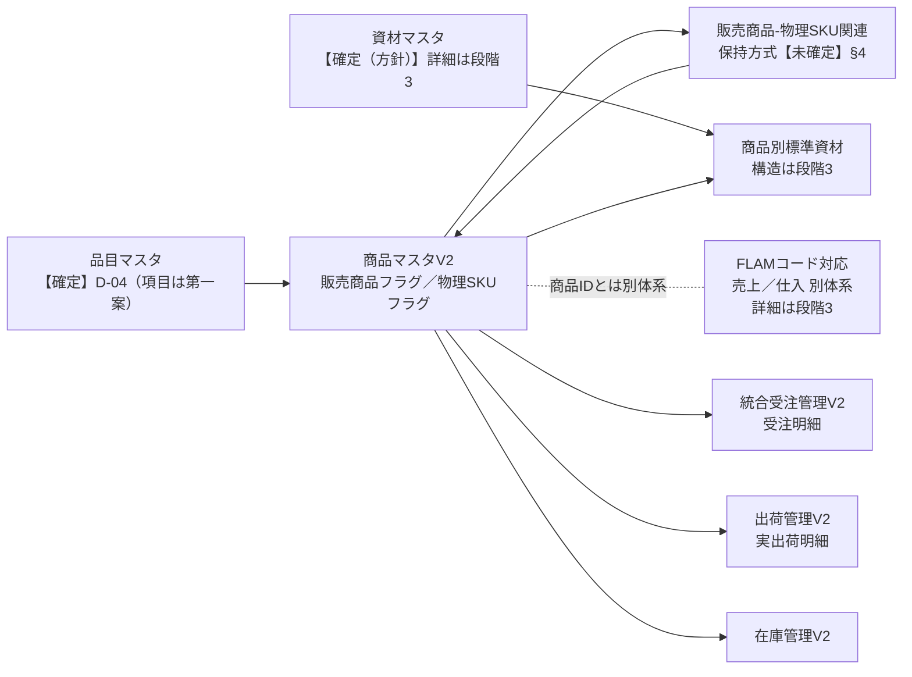
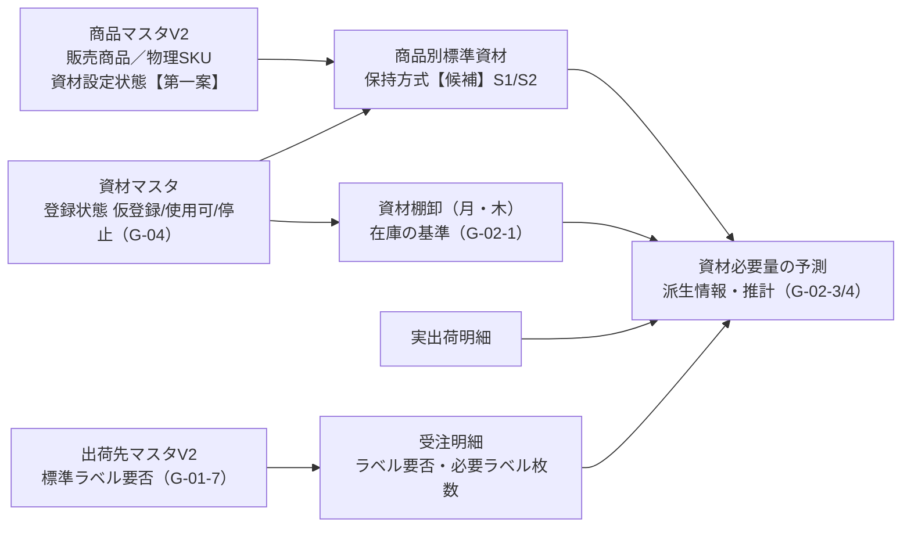
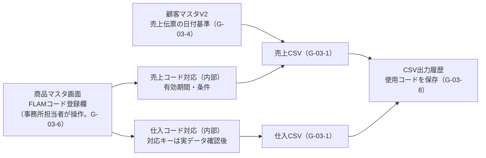

# 商品マスタV2 詳細設計（レビュー用草案）

- 文書名: `PRODUCT_MASTER_V2_DESIGN.md`
- 版: draft-0.11（レビュー用草案）
- 作成日: 2026-11-08（draft-0.1）／更新日: 2026-11-09（draft-0.11）
- 作成者: Claude Code（作業計画 r2 と承認時の補足、draft-0.1・draft-0.2 のレビュー指摘に基づく）
- 基準コミット: `408df77`（docs: sync product master V2 business decisions）
- 上位文書: [PROJECT_KNOWLEDGE_BASELINE.md](../00_project/PROJECT_KNOWLEDGE_BASELINE.md) v0.10 / [BASIC_ARCHITECTURE.md](../00_project/BASIC_ARCHITECTURE.md) v0.12 / [ORDER_SHIPPING_V2_DATA_MODEL.md](ORDER_SHIPPING_V2_DATA_MODEL.md) v0.9 / [DECISION_LOG.md](../00_project/DECISION_LOG.md)

> **この文書はレビュー用草案であり、正式仕様ではない。**
> ChatGPT・ユーザーのレビューと業務判断を経るまで、本書の【第一案】【候補】を確定仕様として扱わない。正式文書と食い違う場合は正式文書を正とする。
> 範囲は作業計画の段階1・2（§0〜§10：エンティティ・属性・品目・販売商品と物理SKUの関連、数量・換算・スナップショット）と、段階3（§11〜§13：資材・同梱ラベル・FLAMコード対応の構造）。段階3は draft-0.6 で草案化し、draft-0.7・0.8 で第3段のユーザー判断（G-01〜G-04、C-01の承認）を反映した。これらの判断は2026-11-08に正式文書へ同期済み（DL「2026-11-08（商品マスタV2第3段の業務判断）」、BL v0.8 §5.1・§11.8・§17.3〜§17.5、BA v0.10 §5.2・§8.8・§9・§16、DM v0.7 §3.1・§3.3・§10.2）であり、本書でも【確定】とした。本書全体を正式仕様に格上げしたものではなく、技術的な【第一案】【候補】【未確定】は維持している。
> 2026-11-09 に「業務上の設定値は現場がマスタで管理し、システムはその設定値に基づいて動作する」原則が確定した（DL「2026-11-09（設定値の現場管理の原則・旧No.22/128の確認）」、BL v0.9 §4.2）。本書の資材・ラベル枚数等の個別の値は、この原則に従い現場の初期設定事項として扱う。
> 同日、第4段の業務方針（DL「2026-11-09（商品マスタV2第4段の業務方針：初期登録・サンプル出荷・物理SKUの現場主導）」、BL v0.10 §11.11）として、受注実績のない商品の初期登録方針（M-1）、サンプル・イレギュラー出荷のV2での記録（M-2）、物理SKUの個別分類と販売商品との対応付けを現場が判断・登録すること（M-3）、個々の物理SKUの選果場在庫管理対象を現場が判断・設定すること（M-4）が確定した。本書は物理SKU・関連の**構造**を扱い、個々の商品の物理SKUの割当ては決めない。

### draft-0.11 での主な変更（第4段の業務方針：初期登録・サンプル出荷・物理SKUの現場主導）

2026-11-09 にユーザーが決めた方針（DL「2026-11-09（商品マスタV2第4段の業務方針：初期登録・サンプル出荷・物理SKUの現場主導）」、BL v0.10 §4.2・§5.2・§11.10・§11.11）を反映した。

| # | 内容 | 節 |
|---|---|---|
| 1 | 前提 P-27（旧No.22・128）の物理SKU構成を「現場確認事項」に変更。P-28（初期登録方針、M-1）・P-29（サンプル・イレギュラー出荷、M-2）・P-30（物理SKUの個別分類は現場主導、M-3）を追加 | §1 |
| 2 | 判断状況：D-06（両フラグtrueの具体的な商品・K4の実際の組合せ）を現場の確認・登録事項に、D-10（個別商品の登録・除外）を方針決定（M-1・M-2）＋事実確認に変更。D-16にM-2の注記を追加 | §8 |
| 3 | 段階4の残り事項を更新 | §10 |
| 4 | 前提 P-31（選果場在庫管理対象の設定は現場、M-4）を追加。§5.3 の「選果場在庫管理対象」の行に注記（個々の値は現場が設定、未設定時の扱いは技術設計） | §1、§5.3 |
| 5 | 受入条件33〜35を追加（現場が物理SKUの分類・対応付けを登録・変更できること、物理SKUの登録と在庫管理対象の区別、汎用ダミー商品に頼らない記録） | §13.5 |

販売商品と物理SKUの関連の保持方式（§4.2 の候補）、関係種別、入力チェック、変更履歴の方式等の技術的な【第一案】【候補】【未確定】は変更していない。個々の商品の物理SKUの割当て・統合は決めていない。

### draft-0.10 での主な変更（設定値の現場管理の原則・旧No.22/128）

2026-11-09 にユーザーが承認した原則（DL「2026-11-09（設定値の現場管理の原則・旧No.22/128の確認）」、BL v0.9 §4.2・§11.8・§11.10）を反映した。

| # | 内容 | 節 |
|---|---|---|
| 1 | 前提に P-26（設定値の現場管理）・P-27（旧No.22・128）を追加 | §1 |
| 2 | 第3段の判断に「設定値の現場管理」を追加し、A長の27枚/ケースを変更可能なマスタ設定値として扱うことを明記（G-01-8・G-01-10 に注記） | §11.1.3、§11.1.2 |
| 3 | 資材マスタ・商品別標準資材・ラベル枚数基準の値は現場がマスタで設定する値であり、プログラムに固定しないことを明記。ラベル枚数基準の持ち場所は引き続き第一案 | §11.4、§11.5.1、§11.6.3 |
| 4 | 残る未決定事項のうち、個別の設定値に当たる E-13・E-14・E-15・E-20 を「業務確認」から「現場の初期設定事項」に区分変更（ID・内容は残す）。設定のためのシステム機能を TV-21 として追加 | §13.3 |
| 5 | 受入条件30〜32を追加 | §13.5 |

技術的な【第一案】【候補】【未確定】（保持方式、計算方式、画面、変更履歴の方式等）は変更していない。個々の商品の資材の種類・数量は新たに決めていない。

### draft-0.9 での主な変更（第3段の判断の正式文書への同期）

第3段の判断（G-01〜G-04、C-01）を正式文書へ同期したことに合わせ、本書の判断状態と出典を更新した（【ユーザー判断済み・正式文書未反映】 → 【確定】、出典は DL「2026-11-08（商品マスタV2第3段の業務判断）」）。あわせて、§6.4 の受注集約条件の説明にラベル要否を加え、G-01-5（判断時の第一案）と G-01-12（集約条件への追加の承認）の関係を注記し、§13.4 を「同期済み」に改め、draft-0.8 の変更表の E-15 の記述を「削除」から「内容変更」に正した。技術的な【第一案】【候補】【未確定】、E-13〜E-20、TV-10〜TV-20 は変更していない。

### draft-0.8 での主な変更（draft-0.7 全文レビューの指摘への対応）

| # | 指摘 | 対応 | 節 |
|---|---|---|---|
| 1 | C-01を承認済みに | 受注集約条件にラベル要否を加えることをユーザー承認済み（G-01-12）として、承認待ちの記述を修正。指定物理SKUを含む従来の条件・発送元等の例外は維持、組み合わせは一意キーにしない、FLAMではラベル要否を超えて合算可 | §11.1.2、§11.6.2、§13.1、§13.4、§13.5、§10 |
| 2 | 実消費量と棚卸差の区別 | 棚卸数量＝確認値、必要量＝推計値、棚卸差＝入荷・使用・調整等が混在した差分、実消費量＝実績記録がない限り確定できない、に修正 | §11.7.1、§13.1 |
| 3 | 一部出荷と二重計上 | 出荷済数量と未出荷残数量を分けて計上する技術案に修正。AB/BCでも販売商品側の資材を重複計上しない。使用時点と出荷済み時点のずれは技術設計 | §11.7.2、§11.7.3、§13.3 |
| 4 | 未設定とゼロの区別 | 関連行がないだけでゼロとしない。販売商品側・物理SKU側を別々に判定。「自動計算対象外」と「使用しない」を別状態に。同じ資材を両方に登録する場合は技術設計 | §11.5.3、§11.5.4、§11.7.3 |
| 5 | FLAM連携の履歴管理 | 売上伝票日付基準を変えても確定済みCSV出力は変わらない。日付基準の履歴・スナップショットを技術設計事項に追加。仕入コードを商品単位で登録する構造を強制しない | §12.2、§12.3.2、§12.4、§13.3 |
| 6 | 旧商品名の扱い | 旧No.136等の商品名中の数量表現を計算根拠・判断事項として扱わない。E-15の内容を「旧No.136の枚数表現とA長の基準の関係」から「販売商品のラベル条件の値の設定（段階4）」に変更し、旧商品名の整理は段階4へ | §11.6.1、§13.3 |

### draft-0.7 での主な変更（第3段のユーザー判断の反映）

2026-11-08にユーザーがChatGPTと協議して判断した第3段の事項（draft-0.6 の E-01〜E-12）を、G-01（同梱ラベル）・G-02（資材在庫）・G-03（FLAM連携）・G-04（資材マスタ）として §11〜§13 に反映し、§11〜§13 を書き直した。判断内容は【ユーザー判断済み・正式文書未反映】、構造・計算方法は【第一案】【候補】、未決定は【未確定】として区別した。第3段のレビュー指摘 R3-1〜R3-5 への対応（§13.1）、E-01〜E-12 の判断状況（§13.2）、残る未決定事項 E-13〜E-20・TV-10〜TV-17（§13.3）、正式文書との整合で調整が必要な点 C-01〜C-09（§13.4）、受入条件案17〜28（§13.5）を追加した。（draft-0.8：受注集約条件にラベル要否を加えること（C-01）はユーザー承認済みに変更。） §0〜§10 の判断状況は変更していない（§0.3・§5.4・§10 の記述だけ更新）。

### draft-0.6 での主な変更（第3段の草案を追加）

作業計画r2の段階3として、資材マスタ・商品別標準資材・同梱ラベル（§11）、FLAM売上・仕入コード対応（§12）、関連の整理・判断事項・受入条件案（§13）を追加した。§0〜§10の内容は変更していない（§5.4・§10の参照先だけ更新）。第3段の構造案はすべて【第一案】【候補】であり、資材在庫方式・ラベル枚数基準・FLAMのコード対応等は【未確定】のまま。業務確認が必要な事項は E-01〜E-12（§13.2）。

### draft-0.5 での主な変更（ユーザー判断の同期）

2026-11-08にユーザーが決めた判断事項（D-01〜D-05・D-09・D-12〜D-15）を、正式文書（DL「2026-11-08（商品マスタV2の業務判断）」、BL v0.7 §5.1・§11.6・§11.7・§11.9、BA v0.9 §8、DM v0.6 §3）へ反映し、本書の状態表示を合わせた。**本書全体を正式仕様に格上げしたものではない。** 判断で決まった事項だけを【確定】とし、未検証の技術案（フィールド構成、関連の保持方式、入力チェックの区分と実装、ID採番等）は【第一案】【候補】のまま残す。判断の一覧は §8。

### draft-0.4 での主な変更（draft-0.3 レビュー指摘への対応）

| # | 指摘 | 対応 | 節 |
|---|---|---|---|
| 1 | 仕切り区分と包装内訳の分離 | 仕切り区分に「内訳あり」を加える案を撤回。包装内訳（内容物構成・内訳行）を仕切り区分と別項目にし、内訳行ごとに仕切り換算。「対象外」を混合商品の代用にしない。入力チェック S-1〜S-7 を第一案として追加 | §5.3、§6.3.3〜§6.3.5、D-13 |
| 2 | P-25の差異理由 | AB/BC混合の正常な分解では差異理由を求めない確定事項を明記 | P-25、§5.5.2 |
| 3 | D-08・D-17 | D-08から旧No.165を外し、新混合箱（J1）・旧No.113（J2）に限定。D-17を既存BC2本パックの換算基準に限定し、新混合箱と別論点と明記 | §8 |

### draft-0.3 での主な変更（draft-0.2 レビュー指摘への対応）

| # | 指摘 | 対応 | 節 |
|---|---|---|---|
| 1 | BC2本パック（旧No.165）への対応 | 決裁待ちのAB/BC新混合箱と区別。Q2の共通構造を維持し、必要な商品だけ「規格別内容物の内訳」を持てる拡張案（Q2＋内訳）を追加。C品の重量換算基準の適用条件は未確定のまま | §4.4、§6.3 |
| 2 | 仕切り換算の条件 | 「本またはkgになれば換算可能」を改め、内容物の仕切り区分が必要とする単位（A/B＝本、C＝kg）と一致する場合だけ換算可能とする方式に修正。A品10kgバラは固定本数に換算しない | §6.3 |
| 3 | 入力チェックと出荷例外 | 商品マスタの入力チェック（マスタの整合性）と、出荷管理側の例外処理（出荷した事実の記録）を区別。出荷時の例外処理方式は出荷管理V2の技術設計へ引継ぐ【未確定】 | §5.5、§8 |
| 4 | 商品の削除と停止 | 「削除せず停止」を原則とし、削除は「どこからも参照されていない仮登録商品の誤登録」に限る第一案に整理。参照されている商品の削除禁止は区分1 | §5.5、§6.6、§8 D-15 |
| 5 | 判断事項 | D-03を「入り数以外の仕様変更・誤登録の訂正」に限定。D-12はユーザー判断済み（正式文書未反映）。D-13は構造比較の結果を提示して保留。D-14は推奨候補を明記 | §4.5、§6.3、§8 |

### draft-0.2 での主な変更（draft-0.1 レビュー指摘への対応）

| # | 指摘 | 対応 | 節 |
|---|---|---|---|
| 1 | 入力チェックの区分 | 「保存禁止／仮登録＋使用時の整合性検証／警告・理由記録で続行」の3区分に整理。受入条件13を修正 | §5.5、§9 |
| 2 | 商品IDの採番と保護 | TV-05に同時登録・CSV取込・API登録・変更防止・環境移行でのID維持を追加。方式は未確定のまま | §2.2、§7 |
| 3 | 数量単位と包装構成 | 受注数量単位・1ケース内容数量・1パック内容数量・仕切り換算値を整理し、3例で保持方式を比較。重複属性を避ける第一案 | §6.3（新設） |
| 4 | 販売商品と物理SKUの関連 | K4を構造検証用の仮定と明記。R1・R2の比較を維持。両フラグ「いいえ」の扱いを検討事項に追加 | §4.1、§4.2、§8 |
| 5 | モニター集計 | 「保存しない」を「独立した正本にしない」に修正。販売商品側の集計規格を第一案として検討。キャッシュ・更新履歴は技術設計に残す。対象外ルールを明記 | §6.2、§6.5 |

---

## 0. 本書の位置づけ

### 0.1 正本とする範囲【第一案】

本書が正式化された場合、次の事項の正本とする。

- 商品マスタV2の属性の名称・意味・型・値・必須条件・入力チェックの区分
- 品目の構造
- 販売商品と物理SKUの関連の構造
- 数量・包装構成・換算・スナップショットの責務分担（商品マスタと、それを参照するアプリの間）
- 資材マスタ・FLAMコード対応との接点（構造の位置づけのみ。詳細は段階3）
- 初期登録の方針（段階4）

### 0.2 正本としない範囲

- 業務ルールそのもの。BASELINE §11（商品マスタ）・§12（商品Lot）・§13（なす仕切り）・§14（在庫）・§17（FLAM）、DATA_MODEL §3・§8・§9 を正とし、本書では節番号で参照する。本文の転記はしない（PROJECT_STATUS §7）。
- 統合受注管理V2・出荷管理V2の項目定義（DATA_MODEL が正本）。本書は商品マスタ側から見た接点と、接点に関わる判断事項だけを書く。

### 0.3 状態ラベル

| ラベル | 意味 | 付ける主体 |
|---|---|---|
| 【確定】 | 正式文書で確定済み。出典の節を併記する | 正式文書 |
| 【方向】 | 正式文書で方向として記載済み | 正式文書 |
| 【第一案】 | Claude Codeの技術設計上の提案。レビュー・技術検証の前 | 本書 |
| 【候補】 | 比較中の選択肢の一つ | 本書 |
| 【未確定】 | 判断待ち・データ待ち（判断者を併記） | 正式文書・本書 |
| 【ユーザー判断済み・正式文書未反映】 | ユーザーが承認したが、DECISION_LOG・BASELINE等への反映前。反映時は正式文書を正とする | 本書（draft-0.3〜0.4のD-12、draft-0.7〜0.8の第3段の判断 G-01〜G-04 で使用。draft-0.9時点で該当なし） |

出典の略記：BL＝PROJECT_KNOWLEDGE_BASELINE.md v0.10、BA＝BASIC_ARCHITECTURE.md v0.12、DM＝ORDER_SHIPPING_V2_DATA_MODEL.md v0.9、DL＝DECISION_LOG.md、ST＝PROJECT_STATUS.md、FC＝docs/10_as_is/FIELD_CONFIRMATION_STATUS_20261107.md、PM＝docs/10_as_is/PRODUCT_MASTER_AS_IS.md。「旧No.」は既存の青果物商品マスタ（アプリ8）のレコード番号。

---

## 1. 確定済みの前提（参照）

本書の設計が前提とする確定事項。内容は出典を正とする。

| # | 前提 | 状態 | 出典 |
|---|---|---|---|
| P-01 | 同じ商品マスタ内に販売商品フラグと物理SKUフラグを別々に持つ。両方trueも可 | 【確定】 | BL §11.6 |
| P-02 | 不変の商品IDを正式キーとする。商品名・先頭番号・商品Lotは一意キーにしない | 【確定】 | BL §11.6、§12 |
| P-03 | 商品名は表示用。名称文字列を数値計算のために解析しない | 【確定】 | BA §8.4 |
| P-04 | 数量単位は商品ごとの属性（なす＝ケース、いちご＝パック）。全SKUをケース固定にしない | 【確定】 | BL §4.2、§11.6、DM §3.2 |
| P-05 | 商品マスタV2は全品目が対象。品目を個別に識別し（トマトとミニトマトは別品目）、新しい品目を追加できる構造 | 【確定】 | BL §4.1、§11.6（P2） |
| P-06 | 全品目を受注・出荷で扱うことと、全商品の在庫・選果・仕切りを初期実装することは別。在庫・Lot管理は初期はなす・いちご中心。モニターはなす・いちごのみ | 【確定】 | BL §4.1、BA §4 |
| P-07 | なす：ケース入り数が違えば別物理SKU | 【確定】 | BL §11.4 |
| P-08 | A長70本入・80本入は営業上同じ販売商品。受注時の商品名は通年同じ。受注明細で実際の入り数を区別する。入り数と販売単価は時期・取引条件で変わる | 【確定】 | BL §11.7（P1）、DM §3.2 |
| P-09 | 旧No.1・54・136は販売商品3件を残し、同じ内容・入り数なら物理SKUを共有する | 【確定】 | BL §11.7 |
| P-10 | 2袋入りA長（旧No.70・192・100）、2本/3本パックは通常箱と別物理SKU。旧No.5と旧No.139の2本パックも別物理SKU | 【確定】 | BL §11.7 |
| P-11 | AB混合・BC混合は販売商品として継続。物理的な混合箱は作らない。商品マスタで許容実出荷商品を定義（AB→A・B、BC→B・C）。配分比率は固定しない | 【確定】（現行仕様） | BL §11.5、DM §8.4 |
| P-12 | AB/BC混合の運用見直し提案（混合箱を作る運用）は決裁待ち。結論まで新しい箱仕様・SKUを前提に設計しない | 【未確定】（営業・選果場→ユーザー。J1） | BL §11.5 注記、ST §5.2 |
| P-13 | 在庫減算は「選果場在庫管理対象」の実出荷物理SKUのみ | 【確定】 | BA §13.1、§13.5 |
| P-14 | モニター対象は出荷区分ではなく商品マスタの明示属性で判定。産直出荷は対象外。選果場出荷でも、選果・規格調整を行わない商品（完成品で持ち込みそのまま出荷する商品等）は対象外 | 【確定】 | BA §7.3、DM §9 |
| P-15 | 組み合わせ依存ルール（出荷先×商品の標準出荷区分、発送元×出荷先の標準物流業者）は商品マスタ単体に持たせない | 【確定】 | DM §10.3 |
| P-16 | マスタとはIDで紐付け、名称は登録時点のスナップショット。通常値はマスタ・ルールから自動設定してスナップショット保存 | 【確定】 | BL §4.2 |
| P-17 | 商品マスタV2のIDとFLAMの売上・仕入商品コードは別体系。売上と仕入を区別し、共通の有効期間を前提にしない。1対1対応の禁止 | 【確定】 | BL §17.4 |
| P-18 | 資材マスタは商品マスタから分離し、商品ごとに標準使用資材・標準使用量を関連付ける | 【確定（方針）】 | BL §11.8 |
| P-19 | `senkajo_dx_target`・商品名先頭番号は判定に使わない。既存アプリ8のレコード・フィールドは削除・変更しない | 【確定】 | BL §11.2、§11.3、§11.7 |
| P-20 | 丸なす（とろとろ炒めなす）はV2初期対象外。火の国なすは筑陽なすとして対象 | 【確定】 | BL §11.7 |
| P-21 | 業務を止めない原則：システム上の不整合を理由に現場業務を止めない。在庫不足・Lot未入力等は警告し、例外理由を記録すれば続行可能。重複ID・データ破壊・識別不能につながる操作のみ強く制限する | 【確定】 | BL §4.2 |
| P-22 | なす仕切り：A/Bは本数、C品はkg。完成品在庫は物理SKU別ケース。換算値はSKUの属性に従う。3本パックは1パック＝3本、1ケース＝20パック | 【確定】 | BL §13.1、§13.2、§14.8 |
| P-23 | モニターは人が手入力せず、Source of Truthにしない。受注等から自動生成する派生情報。計算根拠と更新時刻を追跡可能にする | 【確定】（前半）／【方向】（追跡） | BA §7.5 |
| P-24 | 旧No.165「BC2本パック30入」は既存の商品で、構成はB品1本＋C品1本の2本パック、30パック/ケース。C品は季節により110〜120g/本で換算している。継続販売予定との情報。換算の切替時期・仕切りへの算入は未決定。この換算をAB/BC混合バラに流用しない | 構成は【現行事実】／換算の適用は【未確定】 | BL §11.7、DL「2026-10-10〜2026-11-07」 |
| P-25 | 実際に出荷した事実の記録を優先し、システム上の不整合だけを理由に出荷業務を止めない。受注と異なる実出荷は差異区分・差異理由で記録する。**ただし、AB/BC混合の許容実出荷商品への分解（例：AB混合10cs→A品6cs＋B品4cs）は正常運用であり、差異理由の入力を求めない** | 【確定】 | BA §13.1、BL §4.2、§11.5、DM §8.3、§8.4 |
| P-26 | 業務上の設定値は現場が管理し、システムはその設定値に基づいて正しく動作する。商品ごとの使用資材・資材の種類・標準使用量・ラベル枚数などは現場担当者がマスタ上で設定・変更し、個別商品の使用数量をプログラムにハードコードしない。設定変更にプログラム改修を必要としない。システムは設定値の保存、必要量の計算、在庫不足の予測、未設定時の警告、変更履歴の管理を担う。設定変更で確定済みの過去の受注・出荷記録を無断で変えない。個別商品の資材数量は現場の初期設定・運用事項で、経営者へ逐次確認しない | 【確定】（2026-11-09） | BL §4.2、DL「2026-11-09（設定値の現場管理の原則・旧No.22/128の確認）」 |
| P-27 | 旧No.22・128（スティックブロッコリー40ｐ）は貼付ラベルが異なる別商品で、別の販売商品として維持する。茎ブロッコリーは発注に合わせて収穫し、出荷先が決まってから箱詰めする。個別の物理SKU構成は現場確認事項（P-30）。物理SKUを表す構造は技術設計。選果場在庫管理対象の設定も物理SKUの登録とは別に現場が判断・設定する（P-31） | 【確定】（販売商品の維持）／現行事実／現場確認（物理SKU構成・在庫管理対象の設定値） | BL §11.10、DL「2026-11-09（商品マスタV2第4段の業務方針：初期登録・サンプル出荷・物理SKUの現場主導）」 |
| P-28 | 直近約1年間に受注実績のない商品は、原則としてV2に初期登録しない。営業・事務所が継続販売または再開予定を確認した商品は初期登録候補に追加する。受注実績がないことを終売の根拠にしない。旧商品マスタのレコードは削除しない。運用開始後も「仮登録→使用可」で追加できる | 【確定】（M-1） | BL §11.7・§11.11 |
| P-29 | サンプル・イレギュラー出荷もV2で記録する。原則として汎用ダミー商品を作らず、必要な商品を実態に応じて登録する。出荷を記録することと、すべてのサンプル商品を初期登録することは区別する。旧No.131（丸なすのサンプル）は初期登録しない。通常受注と区別する方法、マスタ未登録商品の例外出荷の記録方法は技術設計 | 【確定】（M-2）／【未確定・技術設計】（区別・例外の方法） | BL §5.2・§11.11 |
| P-30 | 物理SKUの個別分類（同一の物理SKUとするか別にするか）と、販売商品と物理SKUの具体的な対応付けは、現場が実態を確認して判断・登録・変更する。開発側・システムは、それを表現できるデータ構造と画面、設定に従った受注・出荷・在庫の処理、不整合の警告・入力チェック、変更履歴を担う。確定済みの物理SKUの基本ルール（P1、D-03、§11.4・§11.5・§11.7）は維持する。物理SKUの登録と選果場在庫管理対象の判定は区別する | 【確定】（M-3） | BL §4.2・§11.11 |
| P-31 | 個々の物理SKUを選果場在庫管理対象とするかは、現場が判断し商品マスタ上で設定・変更する。システムは設定に従い、実出荷物理SKUを基準に在庫処理する。在庫減算の原則（SF所有在庫の管理対象のみ減算）は変更しない。対象外でも出荷完了・受注の出荷済更新は通常どおり行う。物理SKUの登録と在庫管理対象は別の概念。旧No.22・128を含め個々の設定値は開発側で決めない。設定画面・権限・入力チェック・未設定時の扱い・変更履歴・過去の確定記録の保護は技術設計 | 【確定】（M-4）／【未確定・技術設計】（設定の方式） | BL §11.11・§14.1 |

---

## 2. エンティティ構成

### 2.1 全体像

| 要素 | 役割 | 状態 | 出典・理由 |
|---|---|---|---|
| 商品マスタV2 | 販売商品と物理SKUを同じアプリで管理 | 【確定】 | BL §11.6 |
| 品目マスタ（別アプリ） | 品目の識別・追加と、品目単位の属性 | 【確定】（D-04） | 品目専用のマスタアプリを1つ設け、商品マスタV2から品目IDで参照。品目ごとに商品マスタアプリを作らない（BL §11.6）。項目は §3.3【第一案】 |
| 販売商品-物理SKU関連 | 1販売商品→複数物理SKU、複数販売商品→1物理SKU | 構造は【未確定】 | §4で候補比較・技術検証 |
| 資材マスタ・商品別標準資材 | 資材の分離と標準使用量の関連付け | 【確定（方針）】 | BL §11.8。詳細は段階3 |
| FLAMコード対応 | 売上・仕入のコード対応 | 別体系は【確定】、構造は段階3 | BL §17.4 |

### 2.2 商品IDの方式

| 事項 | 状態 | 備考 |
|---|---|---|
| 不変の商品IDを正式キーとする | 【確定】 | BL §11.6 |
| kintoneのレコード番号を正式な商品IDにしない | 【第一案】 | テスト環境から本番環境へアプリを作り直すと番号が変わり、アプリ間の参照が切れるため |
| 専用の文字列項目（例：`PRD-00001`）を作成時に自動採番し、重複禁止・作成後編集不可とする | 【第一案】 | 「重複禁止」はkintoneの項目設定で担保できる。採番・編集不可の実現方法は未検証 |
| 品目コード・販売商品か物理SKUかを商品IDの文字列に埋め込まない | 【第一案】 | フラグや品目を後で直してもIDを変えずに済むようにする |
| 採番・保護の実装方式（JS・プラグイン・採番用アプリ・運用手順等） | 【未確定】 | **TV-05の検証前に確定しない**（同時登録・CSV取込・API登録・変更防止・環境移行を含む） |

---

## 3. 品目分類

### 3.1 要件

| 要件 | 状態 | 出典 |
|---|---|---|
| 品目を個別に識別する（なす、いちご、トマト、ミニトマト、…） | 【確定】 | BL §11.6（P2） |
| トマトとミニトマトは別品目 | 【確定】 | BL §11.6（P2） |
| 新しい品目を追加できる | 【確定】 | BL §11.6（P2） |
| 出荷管理V2で、なす・いちごを同じ出荷レコードに混在させない（品目でグルーピング） | 【確定】 | DM §5、BA §6.2 |
| 他品目の混載条件・予定出荷のグルーピング・数量単位 | 【未確定】（詳細設計） | BL §22、DM §12 |
| 品目マスタを別アプリで持つ（品目ごとに商品マスタアプリを作らない） | 【確定】（D-04） | BL §11.6 |
| 品目コード体系・初期登録品目・品目別属性の詳細 | 【未確定】（技術設計・棚卸し） | BL §22 |

### 3.2 品目の持ち方の比較

| 案 | 内容 | 長所 | 短所 | 状態 |
|---|---|---|---|---|
| A | 商品マスタのドロップダウン | 単純 | 品目追加のたびにアプリ設定の変更・反映が必要。品目単位の属性を持てない | 【候補】 |
| B | 品目マスタ（別アプリ）を作り、商品マスタから品目IDで参照 | 品目追加がレコード登録だけで済む。品目単位の属性を持てる | アプリが1つ増える | **【確定】（D-04で採用）** |

### 3.3 品目マスタの項目【第一案】

| 項目（候補名） | 型（案） | 内容 | 状態 |
|---|---|---|---|
| 品目ID | 文字列（自動採番・重複禁止） | 不変の正式キー。採番方式はTV-05と同じ検証対象 | 【第一案】 |
| 品目コード | 文字列（重複禁止） | 表示・並び替え用の短いコード。体系は未確定 | 【未確定】（BL §22） |
| 品目名 | 文字列 | なす、いちご、トマト、ミニトマト 等 | 【第一案】 |
| 品目グループ | ドロップダウン | 業務機能の分岐用（例：なす／いちご／その他）。在庫・仕切り・モニターなど品目固有機能の対象判定に使う | 【第一案】 |
| 標準数量単位 | ドロップダウン | 商品登録時の初期値。商品ごとの数量単位が正（P-04） | 【第一案】 |
| 混載・グルーピング区分 | ドロップダウン | 出荷管理V2で同じ物理発送にできる品目の区分。値は未確定 | 項目は【第一案】、値は【未確定】（DM §12） |
| 使用状態 | ラジオ | 使用中／停止 | 【第一案】 |
| 表示順 | 数値 | | 【第一案】 |

注意：
- 「品目グループ」は、なす・いちごの品目固有機能を一律に分岐するための案である。品種（筑陽なす等）とは別の概念。品種は商品マスタV2の全品目共通の独立した任意属性とすることが確定している（D-05。§5.1）。
- 初期の品目一覧（他品目をどこまで分けるか）は段階4で候補を作り、確認に回す。トマトとミニトマトを分けることだけが確定（P-05）。

---

## 4. 販売商品と物理SKUの関連

### 4.1 表現すべきケース

| ケース | 例 | 状態 | 出典 |
|---|---|---|---|
| K1. 1販売商品 → 複数物理SKU（受注時に1つ指定） | A長 → A長80本入・A長70本入 | 【確定】 | BL §11.7（P1） |
| K2. 1販売商品 → 複数物理SKU（実出荷時に配分） | AB混合 → A品・B品、BC混合 → B品・C品 | 【確定】（現行仕様） | BL §11.5、DM §8.4 |
| K3. 複数販売商品 → 1物理SKU | 旧No.1・54・136 → 共通のA長物理SKU | 【確定】 | BL §11.7 |
| K4. 多対多（K1とK3の組合せ） | 例：旧No.1・54・136 の各販売商品 → A長80本入・A長70本入（3×2） | **構造検証用の仮定** | 下記注記 |
| K5. 販売商品フラグ・物理SKUフラグの両方true | 販売商品そのものが1つの物理SKUである商品 | 構造は【確定】（両方true可、BL §11.6）。**該当商品は【候補】** | 下記 |
| K6. 販売商品フラグ・物理SKUフラグの両方「いいえ」 | 登録途中の商品（仮登録中のみ） | 【確定】（D-12。BL §11.9） | §4.5 |

K4の注記：
- K4は「多対多を構造として表現できるか」を検証するために置いた仮定の例である。**3販売商品すべてに70本入・80本入の両方を許容することが承認済みという意味ではない。**
- 確定しているのは、旧No.1・54・136が同じ内容・入り数なら物理SKUを共有すること（K3、BL §11.7）と、A長70本入・80本入が同じ販売商品であること（K1、BL §11.7 P1）までである。旧No.54・136に70本入があるか等、実際の組合せは段階4の棚卸しと業務確認で決める（D-06）。

K5の候補（いずれも未確認。名称から推定せず、段階4・業務確認で確定する）：
- 旧No.99（3本パック）、旧No.5（Oisix向け2本パック）、旧No.139（マルスイ向け2本パック）：販売商品と物理SKUが1対1になる可能性があるが、販売商品を別に立てる（例：ラベル違いの販売商品が後で増える）可能性もある。
- 他品目（トマト等）の単純な商品：在庫・Lotの対象外でも、出荷管理V2の実出荷明細で「実出荷物理SKU」を持つため、物理SKUフラグを立てる必要があるかは §5.5 の検証事項。
- 産直専用商品：出荷管理V2・在庫の対象外（DM §4）で、物理SKUフラグが要るかは未確定。

### 4.2 関連の保持方式の候補（技術検証前は確定しない）

| 候補 | 内容 | K1〜K5の表現 | 確認すべき点 | 状態 |
|---|---|---|---|---|
| R1 | 販売商品レコード内のサブテーブル。行ごとに物理SKUを同アプリから参照 | K1・K2：行を複数。K3・K4：複数の販売商品がそれぞれ同じ物理SKUの行を持つ。K5：自分自身を指す行 | 同一アプリへの自己参照ルックアップの可否と絞込み条件（TV-01）、物理SKU側から「どの販売商品が使っているか」を引けるか（TV-02）、サブテーブル行の検索・集計（TV-04） | 【候補】 |
| R2 | 関連専用アプリ。1レコード＝1関連（販売商品ID×物理SKU ID） | すべて行の追加で表現。多対多を自然に表せる | 両側からの関連レコード一覧、受注・出荷側から関連を読む手間（JS）、二重登録防止 | 【候補】 |
| R3 | K5（両方true）の扱い：関連行を明示するか、暗黙に「自分自身」とみなすか | — | 受注・出荷の処理を一律にできるか。明示すれば一律、暗黙なら登録の手間が減る | 【候補】（R1・R2のどちらとも組合せ可） |

- 現時点の見立て：K3・K4（多対多）と逆引きを重視すると R2 が素直だが、kintone上の操作性・JSの量は R1 が有利な可能性がある。**R1・R2のどちらも、技術検証（§7 TV-01〜TV-04）の前に決定しない。**

### 4.3 関連行に持たせる情報【第一案】

| 項目（候補名） | 内容 | 状態 |
|---|---|---|
| 販売商品ID | | 【第一案】 |
| 物理SKU ID | | 【第一案】 |
| 関係種別 | 例：単一／入り数選択（K1）／分解許容（K2）。K1は受注時に1つ指定、K2は実出荷時に配分、という性質の違いを表すための案 | **【第一案】**（要否・値は検証後。単一の「許容実出荷商品」で足りる可能性もある） |
| 標準フラグ | K1で受注時の初期値にする行 | 【候補】。初期値の方針（登録済みの標準値を自動設定し例外時だけ変更、得意先・出荷先による違いを考慮）は【確定】（D-09、BL §11.7）。標準値の保持場所・優先順位は【未確定】で、関連行だけでは得意先・出荷先別の違いを表せないため、別の置き場所も含めて詳細設計で比較する |
| 有効開始日・有効終了日 | 季節による切替を将来表す場合の枠 | 【候補】。初期版では固定した季節切替日による自動変更は行わない【確定】（D-09） |
| 表示順・備考 | | 【第一案】 |

### 4.4 AB/BC混合への対応（検証目標）

- 現行の確定仕様（P-11：物理混合箱を作らない、許容実出荷商品で分解）を前提に、K2として表現する。
- 新運用の提案（混合箱を作る、P-12）は決裁待ち。新しい混合箱SKU、分解先SKU（2026-10-29分類のP20〜P24相当）は**どちらも登録・確定しない**。
- **検証目標**：新旧どちらの結論でも、商品マスタの構造変更なし（関連行の追加・差し替え、物理SKUレコードの追加）で対応できること。
  - 現行仕様：AB混合（販売商品）→ A品・B品（物理SKU）の関連行2件。
  - 新運用案の場合の想定：AB混合の物理箱を物理SKUとして登録し、関連は「単一」1件。ただし新運用では、混合箱の中身（ロット別のB品・C品本数）の記録、在庫減算の対象、出荷Lotの扱いが変わり（BL §11.5 注記）、これらは在庫管理V2・なす仕切り管理V2・出荷管理V2側の論点である。
  - 現時点の評価：**商品マスタの構造だけで見れば両方を表現できる見込みだが、確定ではない**。新運用で「混合箱の内訳（B何本・C何本）」を固定で持つ必要が出た場合、§6.3 の「規格別内容物の内訳」（Q2＋内訳）が使える可能性があるが、新運用を前提にした設計はしない。決裁内容（1箱あたりの本数を固定するか等）が分かった時点で再評価する。
- **旧No.165「BC2本パック30入」は、この新混合箱とは別の論点である。** 既存の確認済み商品（P-24）であり、販売商品と物理SKUの関係は通常のパック商品と同じ形（K5候補）で扱える。1パックにB品1本・C品1本が入るという内容物の構成は §6.3（Q2＋内訳）で表す。C品の重量換算基準の適用条件は【未確定】のまま（U09）。

### 4.5 両フラグ「いいえ」（K6）の扱い【確定】（D-12）

**ユーザー判断（2026-11-08。DL「2026-11-08（商品マスタV2の業務判断）」、BL §11.9 に反映済み）**
- 仮登録中は、販売商品フラグ・物理SKUフラグの両方を「いいえ」にできる。
- 「使用可」にする際は、少なくとも一方を「はい」にする。
- 未選別なす等の管理方法は、在庫管理V2で別途検討する。

検討した候補（記録として残す）：

| 候補 | 内容 | 結果 |
|---|---|---|
| H1 | 保存禁止（どちらかは必ず「はい」） | 採用しない |
| H2 | 仮登録状態（§5.5 区分2）でのみ許容し、使用可では少なくとも一方を「はい」にする | **採用（ユーザー判断済み）** |
| H3 | 別用途の区分（在庫・作業用の管理項目等）として許容 | 採用しない。未選別なす等は在庫管理V2で検討 |

- 背景：既存アプリ8には、販売にも物理的な出荷にも当たらない可能性のあるレコードがある（例：旧No.43「未選別筑陽なす」＝未選別なすのコンテナ数、旧No.187「A長（在庫）」、汎用コードの旧No.34・59。FC §2、BL §11.7）。これらを商品マスタV2に置くかは、在庫管理V2の検討と段階4の棚卸しで扱う。
- 入力チェック：「登録状態＝使用可」かつ両フラグ「いいえ」の保存は区分1（保存禁止）とする（§5.5）。

---

## 5. 商品マスタV2の属性

### 5.1 共通属性（全品目）

| 属性（候補名） | フィールドコード（案） | 型（案） | 入力チェック区分（§5.5） | 状態 | 出典・備考 |
|---|---|---|---|---|---|
| 商品ID | `product_id` | 文字列（自動採番・重複禁止・編集不可） | 区分1 | 属性は【確定】、方式は【第一案】 | BL §11.6、§2.2 |
| 商品名 | `product_name` | 文字列 | 区分1（空欄禁止） | 【確定】（表示用） | BL §11.6、BA §8.4。重複禁止にするかは【候補】（旧アプリは重複禁止でルックアップキーだった。V2はIDで紐付けるため必須ではない） |
| 品目 | `item_id`（品目マスタ参照） | ルックアップ（§3） | 区分1（存在しない品目IDは禁止）。未設定は区分2 | 属性は【確定】、参照方式は【第一案】 | BL §11.6 |
| 販売商品フラグ | `is_sales_product` | ラジオ（はい／いいえ） | 区分1（値は必ず入る。使用可で両方「いいえ」は保存禁止。§4.5） | 【確定】／両方「いいえ」の扱いも【確定】（D-12） | BL §11.6。チェックボックスは未選択と「いいえ」を区別できないためラジオ【第一案】 |
| 物理SKUフラグ | `is_physical_sku` | ラジオ（はい／いいえ） | 同上 | 【確定】 | 同上 |
| 数量単位 | `qty_unit` | ドロップダウン（ケース／パック／kg／…） | 区分2（受注・出荷に使う前に必須） | 【確定】 | BL §11.6、P-04。選択肢の一覧は【第一案】（他品目の単位は【未確定】） |
| 受注受付可 | `order_acceptable` | ラジオ | 区分2 | 属性は【方向】 | BL §11.6。受注の商品選択の絞込みに使う【第一案】 |
| 登録状態 | `registration_status` | ラジオ（仮登録／使用可／停止） | 区分1（値は必ず入る） | 仮登録・使用可・停止の区別は【確定】（D-12・D-14・D-15、BL §11.9）。項目の形・名称・型は【第一案】 | §5.5、§5.7。受注受付可と統合できるかは A-6 |
| 品種 | `variety` | 文字列または参照 | 任意（全品目共通。空欄でも受注・出荷・在庫等の通常業務を妨げない） | 全品目共通の独立した任意属性とすることは【確定】（D-05）。型・保持場所は【第一案】 | BL §11.6 |
| 表示順 | `sort_order` | 数値 | 任意 | 【第一案】 | |
| 備考 | `remarks` | 複数行文字列 | 任意 | 【第一案】 | |

### 5.2 出荷に関わる属性

| 属性（候補名） | コード（案） | 型（案） | 入力チェック区分（§5.5） | 状態 | 出典・備考 |
|---|---|---|---|---|---|
| 標準発送元 | `default_ship_from` | 参照（発送元の参照方式は【未確定】） | 区分2（産直出荷で受注され得る販売商品）。存在しない発送元IDは区分1 | 属性は【方向】 | BL §11.6、DM §3.8（選果場出荷→選果場、産直出荷→商品等から標準発送生産者）。発送元IDの参照方式は【未確定】（DM §12） |
| 許容実出荷商品 | — | §4の関連で表す | 区分2（選果場出荷で使う販売商品）。存在しない物理SKUの参照は区分1 | 属性は【方向】、保持方式は【未確定】 | BL §11.5、§4 |
| 個口計算グループ | `parcel_group` | ドロップダウンまたは参照 | 区分2（未設定なら自動計算せず確定個口数の手入力に委ねる） | 属性は【方向】 | DM §7。値・グループの持ち方は段階3以降 |
| 標準ケース数/個口 | `cases_per_parcel` | 数値 | 同上 | 属性は【方向】 | DM §7。商品側かグループ側かは【候補】 |
| 出荷Lot管理対象 | `lot_managed` | ラジオ | 区分2（選果場出荷で実出荷される物理SKU）。他品目は「対象外」を初期値【第一案】 | 属性は【確定】（DM §8.5「商品ごとに持つ」） | Lot管理対象商品の出荷時のLot未入力は区分3 |
| 商品Lot | `product_lot` | 数値または文字列 | 任意 | 【確定】（一意キーにしない） | BL §12。型は【第一案】（旧アプリは数値。先頭0の扱いを TV-07 で検証） |

### 5.3 なす・いちご中心の属性（在庫・仕切り・加工・モニター）

他品目には必須にしない（ST §7、P-06）。数量・包装構成の属性は §6.3 で整理する。品種は全品目共通の任意属性のため §5.1 に置く。

| 属性（候補名） | コード（案） | 型（案） | 対象・入力チェック区分（§5.5） | 状態 | 出典・備考 |
|---|---|---|---|---|---|
| 選果場在庫管理対象 | `inventory_managed` | ラジオ | 物理SKUで区分2。他品目は「対象外」を初期値【第一案】（未設定時の扱いは技術設計。M-4） | 属性は【確定】（明示属性で判定）。個々の物理SKUの値は現場が判断・設定【確定】（M-4、P-31） | BA §13.5、BL §11.11 |
| 包装構成・内容数量 | §6.3 | §6.3 | なす・いちごの物理SKUで区分2 | 方式（Q2＋内訳）は【確定】（D-13）、フィールド構成は【第一案】 | BL §11.6、§11.9 |
| 半端在庫用の規格 | `leftover_grade` | 参照または選択 | なすの物理SKUで区分2（対応する物理SKUから自動設定） | 構造化し物理SKUから自動設定、商品名から推定しない、モニター集計規格と役割を区別することは【確定】（D-05）。属性名・保持場所・関連付け・入力方式は【第一案】 | BL §11.6、§14.3（管理軸・単位・FIFOは変更しない） |
| 加工後取扱区分 | `post_process_handling` | ラジオ（SF買取／生産者返却） | いちごの物理SKUで区分2 | 【確定】 | BL §11.6、§16 |
| 仕切り区分 | `shikiri_class` | ドロップダウン（A／B／C／対象外） | なすの物理SKUで内容物構成＝単一のとき区分2。内訳ありのときは空欄（§6.3.5） | 属性・値は【方向】 | BL §11.6。サイズ別在庫SKUとは区別。包装内訳の有無（内容物構成）とは別概念【確定】（D-13、BL §11.9） |
| モニター集計対象 | `monitor_target` | ラジオ | なす・いちごの販売商品で区分2。他品目は対象外を初期値 | 属性は【確定】（明示属性で判定） | BA §7.3、§7.4。置き場所は §6.5 |
| モニター集計規格 | `monitor_grade` | 文字列または参照 | モニター集計対象の商品で区分2 | 属性は【方向】 | DM §9。値の一覧は【未確定】。置き場所は §6.5 |
| モニター集計単位 | `monitor_unit` | ドロップダウン（ケース／パック） | 同上 | 属性は【方向】 | DM §9 |

### 5.4 FLAM・資材との接点（構造の位置づけのみ。第3段の草案は §11〜§13）

| 事項 | 状態 | 出典 |
|---|---|---|
| 商品マスタにFLAMコード列を1対1で持たない。別の対応表で持つ | 【確定】（1対1禁止）／対応表の形は段階3 | BL §17.4 |
| 売上側と仕入側で異なる対応キーを持てる構造とする。売上側は「販売商品×得意先×日付（取引先別基準）」を基本の変換軸とする | 売上の変換軸は【方向】 | BL §17.3 |
| 仕入側の対応先（なすの仕切り区分か、物理SKUか、いちご買取の扱いか等） | **【未確定】**（販売商品IDとは決めつけない） | BL §17.4 |
| 販売単価を商品マスタの固定属性にしない | 【確定】（単価は時期・取引条件で変わる） | BL §11.7、§17.3（単価はFLAM側＝【候補】） |
| 資材マスタは別アプリ。商品ごとに標準使用資材・標準使用量を関連付ける | 【確定（方針）】 | BL §11.8 |
| 資材を物理SKUに関連付けるか販売商品に関連付けるか | 箱・袋は物理SKU【第一案】。同梱ラベルは標準資材に含めず受注明細のラベル要否と枚数基準で計算【第一案】（§11.5.3・§11.6） | — |
| 資材在庫方式・ラベル枚数基準 | 棚卸数量を基準・受注から予測（G-02）、A長は27枚/ケース（G-01）は【確定】（DL「2026-11-08（商品マスタV2第3段の業務判断）」）。ロールの在庫管理単位・他商品の枚数基準は【未確定】（§11.6・§11.7） | BL §11.8 |
| FLAMコードの登録 | 商品マスタ画面から新コード＋適用開始日で登録・履歴管理、売上・仕入は独立、初期版から売上・仕入CSV（G-03）は【確定】（DL「2026-11-08（商品マスタV2第3段の業務判断）」）。仕入の対応キー・CSVレイアウトは【未確定】（§12） | BL §17 |

### 5.5 入力チェックの区分

#### 5.5.1 3区分

業務を止めない原則（P-21）に合わせ、入力チェックを3区分に分ける。区分と主な対象は【第一案】。どのチェックをどの区分に置くかは、レビューで調整する。

**本節の区分1・区分2は「商品マスタ（品目マスタ・関連を含む）を保存するとき」のチェックである。** 受注・出荷の現場で起きる例外（マスタにない商品を実際に出荷した等）の扱いは §5.5.2 で区別し、出荷管理V2の技術設計へ引き継ぐ。

| 区分 | 扱い | 主な対象（案） | 根拠 |
|---|---|---|---|
| 区分1：保存禁止 | 保存させない（エラー） | 商品IDの重複・欠落・変更、商品名の空欄、販売商品・物理SKUフラグの未選択、**登録状態＝使用可で両フラグ「いいえ」**（§4.5）、存在しない品目ID・物理SKU ID・発送元IDへの参照、関連の二重登録（同じ販売商品×物理SKU）、参照されている商品の削除（§5.7） | 重複ID・データ破壊・識別不能につながる操作のみ強く制限する（BL §4.2） |
| 区分2：仮登録を許容し、使用時に整合性を検証 | 業務用属性が未設定でも「仮登録」として保存できる。その商品を受注・出荷・仕切り・加工・在庫に使う時点で、用途に必要な属性がそろっているかを検証する | 数量単位、受注受付可、標準発送元、許容実出荷商品、個口計算、出荷Lot管理対象、選果場在庫管理対象、包装構成・内容数量、加工後取扱区分、仕切り区分、モニター属性 | 段階的な登録を可能にし、全品目に不要な入力を強制しない（作業計画 r2 補足3） |
| 区分3：警告し、理由を記録して続行 | 業務処理（受注・出荷等）の中で警告し、例外理由を記録すれば続行できる | Lot管理対象商品のLot未入力、在庫不足、送り状番号未入力 等（いずれも各業務アプリ側のチェック） | BL §4.2（例示どおり） |

区分2の「使用時の整合性検証」の第一案と論点：

| 用途 | 検証する属性（案） | 不足時の扱い |
|---|---|---|
| 受注の商品選択 | 登録状態＝使用可、販売商品、受注受付可、数量単位 | **a：仮登録の商品は通常の受注商品選択から除外する【確定】（D-14、BL §11.9）**。商品登録が間に合わない場合などの例外受付は統合受注管理V2で別途設計する【未確定】。**数量単位が未設定だと受注数量の意味が決まらないため、少なくとも数量単位は使用可にする前に必須とする案**【第一案】 |
| 選果場出荷（予定出荷・実出荷明細） | 許容実出荷商品、出荷Lot管理対象、個口計算 | 個口計算グループ未設定は自動計算せず手入力（DM §7）。Lot管理対象の判定ができない場合は警告【第一案】 |
| 産直出荷 | 標準発送元 | 未設定なら担当者が受注明細で発送元を選ぶ（標準値がないだけ）【第一案】 |
| 在庫・仕切り・加工 | 選果場在庫管理対象、包装構成、仕切り区分、加工後取扱区分 | 在庫イベント・仕切り計算・買取候補生成の正しさに直結するため、使用前に必須とする案【第一案】。ただし実際の出荷記録は止めない（BL §4.2） |

- 区分2で「使用前に必須」とすることと、区分3（業務を止めない）の関係：マスタ側の未整備で現場の出荷記録を止めない。区分2の不足は、マスタ担当者が商品を「使用可」にする時点で解消するのが基本で、その商品が受注に出る前に整う運用を想定する。使用可にした後に属性が欠けた場合（運用中の修正等）の扱いは TV-06 で検討する。
- 「選果場出荷で使う商品か」は出荷区分ルール（出荷先×商品）で決まり、商品マスタの属性ではない（P-15）。そのため、出荷用属性の不足は受注明細の出荷区分が決まった時点で検証する（商品マスタ保存時には判定できない）。
- 他品目を出荷管理V2で扱うために「販売商品＝物理SKU（両方true）」として登録する案は【候補】（§4.1 K5）。在庫・Lot・包装構成の属性は対象外・空欄でよいようにする。

#### 5.5.2 商品マスタの入力チェックと、出荷管理側の例外処理の区別

二つの方針を両立させるため、チェックする場所と目的を分ける。

| | 商品マスタの入力チェック（本書の範囲） | 出荷管理側の例外処理（出荷管理V2の技術設計） |
|---|---|---|
| 目的 | マスタの識別性・参照整合性を守る（重複ID・存在しないIDへの参照を作らない） | 現場で実際に出荷した事実を、マスタの未整備があっても記録する（P-25） |
| 対象 | 商品マスタ・品目マスタ・関連の保存 | 受注明細・予定出荷・実出荷明細・在庫イベントの記録 |
| 扱い | 区分1は保存禁止 | 原則として止めず、警告・差異区分・理由記録で続行（区分3） |
| 状態 | 【第一案】 | 方式は**【未確定】**（出荷管理V2の技術設計へ引継ぎ。D-16） |

出荷管理V2の技術設計へ引き継ぐ論点（本書では決めない）：
1. 許容実出荷商品に含まれない物理SKUを実際に出荷した場合：DM §8.3 の差異区分・差異理由で記録する方向は確定済み（P-25）。許容実出荷商品の範囲内でのAB/BC混合の分解は差異ではなく、差異理由を求めない（P-25、DM §8.4）。差異区分の値・警告の出し方は【未確定】（DM §8.3）。
2. 商品マスタに存在しない（未登録の）商品を実際に出荷した場合：実出荷明細は商品IDで参照するため、存在しないIDは記録できない。両立させる方法の【候補】として、(a) その場で商品を仮登録して参照する、(b) 実出荷明細に「マスタ未登録」の例外区分と自由記述を残し、後でマスタ登録して紐付ける、等が考えられる。いずれも在庫イベント・FLAM出力・Lotへの影響の検証が必要。**方式は未確定。**
3. 仮登録・停止の商品が受注・出荷で必要になった場合の扱い（D-14、§5.7 と関連）。
- 本書の受入条件13(a)の「存在しないIDへの参照の禁止」は、マスタ側のデータを壊さないための条件であり、現場の出荷記録を拒否してよいという意味ではない（受入条件13(c)）。

### 5.6 確認事項（属性の要否・重複）

| # | 事項 | 状態 | 備考 |
|---|---|---|---|
| A-1 | 等級区分・在庫商品区分の要否 | **決定（D-05）**：当面追加しない。等級区分は独立した用途が確認された場合に追加を検討 | BL §11.6 |
| A-2 | 半端在庫の「規格」をどの属性で表すか | **決定（D-05）**：半端在庫用の規格を構造化し、物理SKUから自動設定（§5.3）。属性名・保持場所は【第一案】 | BL §11.6、§14.3 |
| A-3 | 品種を属性に持つか | **決定（D-05）**：全品目共通の独立した任意属性（§5.1） | BL §11.6 |
| A-4 | 「ケース入り数」と「1ケース内容数量・単位」の重複 | **決定（D-13）**：包装構成（Q2＋内訳）で持ち、同じ意味の値を重複入力させない。具体的なフィールド構成は【第一案】 | BL §11.6、§11.9 |
| A-5 | パック内の本数（3本/P）の属性 | §6.3 で整理（第一案は2段目の内容数量） | BL §11.6 の例示に現れるが独立の属性名がない |
| A-6 | 受注受付可・使用状態・登録状態を1つにまとめるか | 【第一案】で整理予定 | 物理SKUのみの商品には受注受付可が不要 |
| A-7 | 旧項目（品名１〈送り状品名〉・使用資材・資材使用量・Lot番号・規格・仕入れ単価）の扱い | 段階4で整理 | 送り状品名に店舗独自の指定はない（FC §2）。規格・仕入れ単価は現場未使用（BL §11.6） |

### 5.7 商品の停止と削除（D-15。原則は【確定】、実装は【第一案】）

「削除せず停止する」原則と、「参照されている商品の削除禁止」の関係を次のように整理する。

| 状況 | 扱い（案） | 状態 |
|---|---|---|
| 一度「使用可」になった商品 | **削除しない。** 新規の選択を止めるときは登録状態を「停止」にする。停止しても過去の受注・出荷・在庫との参照を維持する | 【確定】（D-15、BL §11.9） |
| 誤登録した仮登録商品のうち、どこからも参照されていないもの | 削除できる。削除前に参照の有無を確認する | 【確定】（D-15）。確認方法は【第一案】（TV-09） |
| 参照されている商品（受注明細・実出荷明細・在庫イベント・関連・資材・FLAM対応等から参照） | 削除禁止（区分1） | 【確定】（D-15の帰結）。実装は【第一案】 |
| 物理仕様を変えない訂正（商品名の誤字等） | 既存SKUを修正できる。過去レコードのスナップショットは変えない | 【確定】（D-03） |
| 数値の誤登録の訂正など、既存の取引・在庫へ影響する訂正 | 手順は詳細設計 | 【未確定】（D-03） |

- 削除できるのは「仮登録の誤登録で、どこからも参照されていないもの」だけであり、「参照されていなければ使用可の商品も削除してよい」という意味ではない。
- 参照の有無を、受注・出荷・在庫・関連・資材・FLAM対応の各アプリをまたいで判定する方法は技術検証（TV-09）。**参照がないことを確認できない場合は、管理者であっても削除できない**（D-15「削除前に参照の有無を確認する」）。誰が削除操作を行えるか（管理者権限等）と、参照がないことの確認は別の条件であり、削除には両方が必要になる。削除操作の権限設定は技術設計【未確定】。

---

## 6. 数量・換算・スナップショット

### 6.1 原則

| 原則 | 状態 | 出典 |
|---|---|---|
| マスタはIDで紐付け、名称は登録時点のスナップショット | 【確定】 | BL §4.2 |
| 通常値はマスタ・ルールから自動設定し、レコードにスナップショット保存。例外だけ人が修正 | 【確定】 | BL §4.2 |
| 在庫を減らすのは受注商品ではなく実出荷の物理SKU | 【確定】 | DM §8.3 |
| 販売単価は時期・取引条件で変わる（商品マスタの固定属性にしない） | 【確定】（変わること）／置き場所は【未確定】 | BL §11.7、§17.3 |
| 230g換算Pは配分・公平性比較専用（実パック数×公称重量÷230） | 【確定】 | BA §11.3 |
| 商品名を数値計算のために解析しない（換算値は属性で持つ） | 【確定】 | BA §8.4 |

### 6.2 保持場所の責務

| 情報 | 正（保持場所） | 参照・スナップショット | 状態 | 出典 |
|---|---|---|---|---|
| 受注数量単位 | 商品マスタ（販売商品）の数量単位 | 受注明細に作成時スナップショット | 【確定】 | DM §3.2、§3.3 |
| 物理SKUの数量単位・包装構成・内容数量 | 商品マスタ（物理SKU）。§6.3 | 実出荷明細・在庫イベント・仕切り・加工実績に必要なものをスナップショット【第一案】 | 属性は【方向】 | BL §11.6 |
| 受注数量 | 受注明細（確定値） | — | 【確定】 | DM §3.2 |
| 指定物理SKU（入り数） | 受注明細 | 名称・入り数のスナップショットの方法は【第一案】 | 受注明細に指定物理SKUを保持し、集約条件に加えることは【確定】（D-01、DM §3.1・§3.3）。スナップショットの方法・UI・標準値の保持場所等の技術詳細は【未確定】（§6.4） | DM §3.2 |
| 実出荷物理SKU・実出荷数量 | 実出荷明細（出荷管理V2） | 名称・単位をスナップショット | 【確定】 | DM §8.3 |
| 在庫増減の物理SKU・数量 | 在庫イベント（在庫管理V2） | 単位をスナップショット【第一案】 | 【確定】（軸） | BL §14.3 |
| 仕切り数量（A/B本数、C品kg） | なす仕切り管理V2 | 換算に使った値（ケース当たり本数等）を記録するか【候補】 | 【確定】（単位） | BL §13.1、§13.2 |
| モニター集計規格・単位・対象 | 商品マスタ（置き場所は §6.5） | モニターの集計結果は**独立した正本にしない**（受注等から作る派生情報）。計算結果のキャッシュ・計算根拠・更新時刻・更新履歴を保持するかは技術設計 | 属性は【方向】、正本にしないことは【確定】、追跡は【方向】 | BA §7.5、DM §9 |
| 販売単価 | 商品マスタには持たない | FLAM側で管理＝【候補】 | 【未確定】 | BL §17.3 |
| 230g換算P | 計算値 | 計算時の公称重量を記録するかは【候補】 | 【確定】（式） | BA §11.3 |

### 6.3 数量単位と包装構成

#### 6.3.1 整理する数値

| 数値 | 意味 | 使う場面 | 正式文書での扱い |
|---|---|---|---|
| 受注数量単位 | 受注・出荷・在庫で数える単位（なす＝ケース、いちご＝パック） | 受注明細・実出荷明細・在庫 | 【確定】（BL §11.6、DM §3.2） |
| 1ケース内容数量＋単位 | 1ケースに入る量（本・kg・パック） | 仕切り換算、表示 | 属性は【方向】（BL §11.6） |
| ケース入り数 | なすの1ケースの本数 | 仕切り換算 | 属性は【方向】（BL §11.6） |
| 1パック内容数量 | 1パックの中身（3本パック＝3本） | 仕切り換算（パック商品） | BL §11.6 の例示「3本/P」。独立の属性名はない |
| 1パック内容重量(g) | いちごの公称重量 | 230g換算 | 属性は【方向】（BL §11.6、BA §11.3） |
| 仕切り換算値 | 1数量単位を仕切り単位（本・kg）に直した値 | なす仕切り（完成ケースの換算本数・C品kg） | 換算値はSKUの属性に従う【確定】（BL §13.1） |

#### 6.3.2 例

| 例 | 受注数量単位 | 中身 | 仕切り換算（§6.3.4 の条件による） | 出典 |
|---|---|---|---|---|
| A長80本入／A長70本入 | ケース | 1ケース＝80本／70本 | A品：必要単位＝本、内容単位＝本 → 80本／70本 | BL §11.4、§11.7 |
| 3本パック（20P/ケース） | ケース | 1ケース＝20パック、1パック＝3本 | A品：本＝本 → 60本（20×3） | BL §14.8 |
| C品10kg/ケース | ケース | 1ケース＝10kg | C品：必要単位＝kg、内容単位＝kg → 10kg | BL §13.1 |
| BC2本パック30入（旧No.165） | ケース | 1ケース＝30パック、1パック＝B品1本＋C品1本 | B品：本＝本 → 30本。C品：必要単位＝kg、内容単位＝本 → **単位不一致のため換算不可**（重量換算基準110〜120g/本の適用条件は【未確定】、U09） | BL §11.7（P-24） |
| A品10kgバラ（旧No.178） | ケース | 1ケース＝10kg。本数不定 | A品：必要単位＝本、内容単位＝kg → **単位不一致のため換算不可**。固定本数に換算しない。仕切り用A品本数の把握方法は【未確定】（BL §11.7、U13） | BL §11.7 |
| （参考）いちご230gパック | パック | 1パック＝230g（公称） | 仕切り換算の対象外。230g換算に重量を使う | BA §11.3 |

#### 6.3.3 保持方式の比較（D-13：Q2＋内訳方式の採用を【確定】。具体的なフィールド構成は【第一案】）

| 案 | 保持する項目 | A長80本 | 3本パック | C品10kg | BC2本パック | 長所 | 短所 | 状態 |
|---|---|---|---|---|---|---|---|---|
| Q1：属性リストどおり個別に持つ | ケース入り数、1ケース内容数量＋単位、1パック内容数量、1パック内容重量 | ケース入り数＝80、1ケース内容数量＝80本 | 1ケース内容数量＝20パック、1パック内容数量＝3本、ケース入り数＝60? | 1ケース内容数量＝10kg、ケース入り数＝空 | **表せない**（1パック内容数量＝2本としても、BとCの内訳が持てない） | BL §11.6 の属性名に忠実 | 「ケース入り数」と「1ケース内容数量」が二重。3本パックでケース入り数の意味（20か60か）があいまい | 【候補】 |
| Q2：包装構成を2段で持つ | 1段目：1数量単位あたり内容数量＋単位。2段目（任意）：その内容単位1つあたり内容数量＋単位 | 1段目＝80本 | 1段目＝20パック、2段目＝3本 | 1段目＝10kg | 1段目＝30パック、2段目＝2本。**B・Cの内訳は表せない** | 重複がない。パック商品も同じ形 | 混合内容を表せない | 【候補】 |
| **Q2＋内訳：Q2に、必要な商品だけ「規格別内容物の内訳」を追加**（D-13で採用） | Q2＋（任意）内訳行：内容物の仕切り区分（A/B/C）・数量・単位。内訳は最下段（パック等）1つあたりで持つ | 内訳なし（商品の仕切り区分＝A） | 内訳なし（A） | 内訳なし（C） | 1段目＝30パック、2段目＝2本、内訳＝B品1本・C品1本（1パックあたり） | 共通構造（Q2）はそのまま。混合内容の商品だけ内訳を持つ。確認済みの構成を表現できる | 内訳の有無で換算処理が分岐する。内訳の合計と2段目の数量の一致を検査する必要（区分2） | **【確定】（方式。D-13）** |
| Q3：Q2（＋内訳）に仕切り換算値を明示的に持つ | 上記＋仕切り換算値（区分ごとの数値＋単位） | A：80本 | A：60本 | C：10kg | B：30本、C：空欄（換算基準未確定） | 仕切りアプリが単純。換算できない商品・内容物は空欄にできる | 計算できる値を二重に持つ。不一致の検査が必要 | 【候補】 |

Q2＋内訳の補足（方式は【確定】（D-13）、具体的なフィールド構成は【第一案】）：
- 受注数量単位は「数量単位」1項目で持つ（§5.1）。包装構成の1段目は「その数量単位1つに何が入っているか」、2段目は「1段目の内容単位1つに何が入っているか」を表す。
- **仕切り区分と包装内訳の有無は別の概念として持つ**【確定】（D-13「仕切り区分と内容物構成は別概念」、BL §11.9）。仕切り区分の値（A／B／C／対象外。BL §11.6【方向】）に「内訳あり」等の値は加えない。以下の項目の持ち方・具体的なフィールド構成は【第一案】。
  - 内容物が単一規格の商品（内訳なし）：商品の「仕切り区分」に A／B／C／対象外 のいずれかを設定する。
  - 内容物が複数規格の商品（内訳あり。例：BC2本パック＝1ケース30パック、1パック2本、内訳B品1本＋C品1本）：商品全体に単一の仕切り区分を指定できないため、商品の仕切り区分は空欄とし、内訳行ごとに仕切り区分（A／B／C）を持つ。仕切り換算は内訳行ごとに行い（§6.3.4）、商品全体の仕切り数量は内訳行の換算結果から計算する。
  - 「対象外」は「その商品は仕切りの対象にしない」という意味に限る。混合内容の商品の代用にしない。
  - 入力チェックの構造は §6.3.5。
- 「ケース入り数」は、なすの通常箱では1段目（本）と同じ値になるため、独立項目にしない（A-4）【第一案】。BL §11.6 の「ケース入り数」「1ケース内容数量とその単位」「1パック内容重量(g)」等を包装構成（Q2＋内訳）で持つことは決定済み（D-13、BL §11.6・§11.9）。具体的なフィールド構成は技術設計。
- いちごの1パック内容重量(g)を1段目（1パック＝230g）で兼ねるか、230g換算専用の項目として残すかは【未確定】（技術設計。必要な情報を失わず、同じ意味の値を重複入力させない、というD-13の条件で決める）。
- 内訳は旧No.165のような**確認済みの既存商品**のために置く拡張である。決裁待ちのAB/BC新混合箱（P-12）を前提にした設計ではない（§4.4）。
- C品の重量換算基準（110〜120g/本）を、商品の属性・季節の有効期間付きのルール・仕切り時の入力のどれで持つか、またその適用条件は【未確定】（U09、P-24）。本書では置き場所を決めず、換算不可（§6.3.4）として扱う。
- Q3を採る場合でも、換算値の不一致検査（区分2）が必要になる。

#### 6.3.4 仕切り換算の条件【第一案】

仕切り単位は確定済み：A/B品は本数、C品はkg（BL §13.1、P-22）。換算の可否は、**内容物の仕切り区分が必要とする単位と、包装構成から求まる単位が一致するか**で判定する。単に計算結果が「本」または「kg」になることでは判定しない。

| 手順 | 内容 |
|---|---|
| 1 | 内容物ごとに仕切り区分を決める（内訳がなければ商品の仕切り区分、あれば内訳行の区分） |
| 2 | 仕切り区分から必要単位を決める：A・B → 本、C → kg、対象外 → 換算しない |
| 3 | 包装構成（1段目×2段目、内訳がある場合は内訳の数量）から、1数量単位あたりの内容物の量と単位を求める |
| 4 | 3の単位が2の必要単位と一致すれば換算可能。一致しなければ換算不可（単位をまたぐ換算はしない） |
| 5 | 換算不可の場合、仕切り側で実数を入力するか、別途決める換算ルールを使う。どちらにするかは、なす仕切り管理V2の設計と各商品の未決定事項（U09・U13）で決める |

- 例：A品10kgバラ（旧No.178）は A＝本が必要だが内容単位は kg のため換算不可。**固定本数（80本等）に換算しない**（BL §11.7）。
- 例：BC2本パックのC品は C＝kg が必要だが内容単位は本のため換算不可。重量換算基準の適用が決まった場合も、本書の構造を変えずにルールとして追加できるようにする（置き場所は【未確定】）。
- 仕切り換算はなすの物理SKUだけが対象。いちご・他品目は対象外。
- 内訳がある商品は、手順1〜5を内訳行ごとに行う。例：BC2本パックは B品行（30本、換算可）と C品行（換算不可）を別々に判定し、商品全体を一つの区分で判定しない。

#### 6.3.5 仕切り区分と包装内訳の入力チェック【第一案】

構造：

| 項目（候補名） | 内容 | 状態 |
|---|---|---|
| 内容物構成 | 単一／規格別内訳。包装内訳の有無を明示する項目。仕切り区分とは別項目 | 【第一案】（行の有無から自動判定する方式も【候補】） |
| 仕切り区分（商品） | A／B／C／対象外。内容物構成＝単一のときに使う | 属性・値は【方向】（BL §11.6） |
| 規格別内容物の内訳（行） | 仕切り区分（A／B／C）・数量・単位。最下段の包装単位1つあたり | 【第一案】 |

チェック（区分は §5.5。マスタ保存時・使用可にする時点の検証であり、現場の出荷記録は止めない）：

| # | 条件 | 扱い（案） |
|---|---|---|
| S-1 | 内容物構成＝単一 で、内訳行がある | 使用可にできない（区分2）。仮登録では保存可 |
| S-2 | 内容物構成＝規格別内訳 で、内訳行がない、または1行だけ | 使用可にできない（区分2） |
| S-3 | 内容物構成＝規格別内訳 で、商品の仕切り区分に値（対象外を含む）が入っている | 使用可にできない（区分2）。「対象外」を混合商品の代用にしない |
| S-4 | 内訳行の仕切り区分が空欄、または「対象外」 | 使用可にできない（区分2） |
| S-5 | 内訳行の数量の合計（同じ単位）が、最下段の内容数量（例：1パック＝2本）と一致しない | 使用可にできない（区分2） |
| S-6 | なすの物理SKUで内容物構成＝単一 なのに、商品の仕切り区分が空欄 | 使用可にできない（区分2） |
| S-7 | 内訳行の単位が、その区分の必要単位（A/B＝本、C＝kg）と一致しない | エラーにしない。換算不可として扱う（§6.3.4。例：BC2本パックのC品行） |

- S-1〜S-6 を区分2（仮登録は可、使用可にする時点で検証）とするか、区分1（保存禁止）とするかはレビューで調整する。いずれもマスタ側の整合性チェックであり、出荷・仕切りの現場記録を止める根拠にはしない（§5.5.2）。
- 実装方法は TV-08 で検証する。

### 6.4 P1（入り数の区別）と受注明細の集約ルール

**前提**
- 受注集約【確定】：得意先×出荷先×出荷予定日×納品日×商品×出荷区分が同じなら、別レコードを作らず数量を集約する。この組合せは一意キーにしない（DM §3.1）。（本節のD-01の判断で指定物理SKUが、第3段のC-01でラベル要否が集約条件に加わった。現在の集約条件は §11.6.2・DM §3.1 を参照）
- P1【確定】：A長70本入・80本入は同じ販売商品。受注明細で実際の入り数を区別して保持する。項目の追加方法は、下記のとおりD-01で「指定物理SKU」に決まった（DM §3.2・§3.3）。

**論点**：同じ得意先・同じ条件で「A長 80本入 10cs」と「A長 70本入 5cs」の注文が来た場合、DM §3.1 の「商品」を販売商品と読むと1明細に集約され、入り数別の数量が失われるおそれがある。

**判断結果【確定】（D-01、2026-11-08。DM §3.1・§3.2・§3.3、BL §5.1・§11.7）**：X案を採用する。受注明細に指定物理SKUを保持し、既存の集約条件に加えて指定物理SKUが同じ場合に集約する。異なる場合は別明細とする。AB/BC混合は受注時に単一の物理SKUへ固定せず、許容実出荷商品へ実出荷時に分解する既存方針を維持する。入り数変更時の履歴、既存明細との重複・集約、予定出荷への追従の具体的方法は技術設計に残す。

**現行事実（D-02）**：同じ得意先・同じ出荷先・同じ出荷日に、A長70本入と80本入の注文が混在することはない（ユーザー確認）。将来の混在をシステムで禁止する仕様にはしない。

**構造の比較（判断前の比較記録）**：以下はD-01の判断前に作成した比較の記録であり、**D-01でX案が承認され、DM §3.1 の集約ルールの解釈確認は終了している**（集約条件に指定物理SKUを加えることを DM §3.1・BL §5.1 に反映済み）。表中の「確認が必要」「想定される判断者」は判断前の記述として残している。Y案は採用しない。

| | X案：入り数ごとに別明細 | Y案：販売商品で集約し、明細内に入り数別の内訳 | Z案（参考） |
|---|---|---|---|
| 構造 | 受注明細に「指定物理SKU」を1つ持つ。入り数が違えば別の受注明細 | 受注明細は販売商品で集約。明細内に物理SKU別数量の内訳（サブテーブル等）。受注数量＝内訳の合計 | 受注明細は販売商品と数量だけ。入り数は出荷管理で決める |
| DM §3.1 との関係 | 集約キーの「商品」を「販売商品＋指定物理SKU」と読む必要がある → 判断前は業務ルールの解釈の確認が必要とした（**D-01で確認済み。集約条件に指定物理SKUを追加**） | 文字どおり維持 | — |
| P1との関係 | 満たす | 満たす | **満たさない**（受注明細で区別しない）→ 不採用 |
| 実出荷明細（DM §8.3「通常1受注明細→1実出荷明細」） | 通常どおり1対1 | 内訳行ごとに実出荷明細（1対多）。AB混合の分解と同じ形 | — |
| 受注変更履歴（DM §3.12） | 「商品」変更と同様に指定物理SKUの変更を記録。入り数変更で集約先が変わると明細の付け替えが起きる | 内訳行の数量変更として記録。内訳の変更履歴の持ち方が追加で必要 | — |
| 予定出荷の自動生成・追従（DM §4） | 明細単位で単純 | 内訳の変更も追従対象 | — |
| モニター（DM §9） | 販売商品（または指定物理SKU）の規格で集計。A長はどちらも同じ規格 | 販売商品の規格で集計 | — |
| FLAM出力（物理SKUは原則連携しない、BL §17.3） | 同じ販売商品の明細が複数になるため、出力時に販売商品で合算するか、入り数別に出すか（70/80本でFLAMコードが別の現行事実あり、FC §5 Q10）の判断が必要 | 販売商品単位のまま。入り数別のコード対応が必要なら内訳を参照 | — |
| kintone上の実装 | 単純（明細の項目追加） | サブテーブルの集計・検索・一覧の制約を検証（TV-04） | — |
| 想定される判断者（判断前） | ユーザー・ChatGPT（DM §3.1 の解釈）→ **D-01で承認済み** | ユーザー・ChatGPT（明細の複雑化の許容）→ 不採用 | — |

- 入り数の初期値【確定（方針）】（D-09）：登録済みの標準値を自動設定し、例外時だけ担当者が変更する。得意先・出荷先による違いを考慮する。初期版では固定した季節切替日による自動変更は行わない。標準値を変更しても登録済みの受注を無断で書き換えない。標準値の保持場所・適用の優先順位・切替の担当と手順・UIは【未確定】（詳細設計。§4.3 の標準フラグは候補の一つ）。

### 6.5 モニター集計

**確定・方向として維持するルール**
- 産直出荷は集計しない【確定】（BA §7.3、DM §9）。
- 選果場出荷でも、選果・規格調整を行わない商品（完成品で持ち込みそのまま出荷する商品等）は集計しない【確定】。出荷区分だけで判定せず、商品マスタの明示属性（モニター集計対象）で判定する【確定】（BA §7.3、§7.4）。
- モニターはなす・いちごのみ、別画面【確定】（DM §9、BL §4.1）。
- モニターの集計結果は人が手入力せず、独立した正本（Source of Truth）にしない。受注等から作る派生情報とする【確定】。計算根拠と更新時刻を追跡可能にする【方向】（BA §7.5）。
- 計算結果をキャッシュとして保存するか、更新履歴を残すか、どのアプリ・画面で持つかは技術設計（モニターの設計時）に残す。本書では決めない。

**集計規格・対象の置き場所**

| 置き場所 | A長（入り数違いを同じ規格にまとめる） | AB混合（混合規格名のまま表示） | 状態 |
|---|---|---|---|
| 販売商品側 | 販売商品A長に「A長」を設定すれば足りる | 販売商品AB混合に「AB混合」を設定 | **【第一案】（検討中）** |
| 物理SKU側 | 80本入・70本入の両方に「A長」を設定 | AB混合は物理SKUを持たない（現行仕様）ため表せない | 【候補】 |
| 両方（販売商品を優先し、なければ物理SKU） | 可 | 可 | 【候補】 |

- 販売商品側を第一案とする理由：モニターは受注明細から作り（DM §9）、受注時点では実出荷物理SKUが決まっていない。AB混合（現行仕様）は販売商品でしか表せない。
- 検討を続ける点：K3（旧No.1・54・136）のように同じ物理SKUを共有する複数の販売商品に、同じ規格を個別に設定する手間と不一致のおそれ。X案で指定物理SKUを持つ場合に物理SKU側の規格が使えるか。D-01でX案（受注明細に指定物理SKU）に決まったため、指定物理SKU側の規格を使う方式も比較対象に含めて技術設計で決める。

### 6.6 マスタ変更で過去の意味が変わらないための方式（原則は【確定】、方法は【第一案・要検証】）

1. 受注明細・実出荷明細・在庫イベントに、作成時点の名称・数量単位・入り数等をスナップショットで保存し、以後マスタから自動で再取得しない。過去の受注・出荷・在庫記録をマスタ変更で自動上書きしないことは【確定】（D-03）、保存方法は【第一案】。
2. 物理的な仕様が変わる変更（ケース入り数・内容量・包装・内訳等）は、新しい物理SKUで表す【確定】（D-03、BL §11.4・§11.9）。販売価格やC品重量換算基準の変更だけでは新SKUを作らない【確定】（D-03）。
3. 商品名の誤字など、物理的な仕様を変えない訂正は既存SKUの修正を認める【確定】（D-03）。過去レコードのスナップショットは変えない。数値の誤登録の訂正など既存の取引・在庫へ影響する訂正の手順は【未確定】（詳細設計）。
4. 一度使用可になった商品は削除せず停止する。削除は参照されていない仮登録商品の誤登録に限る【確定】（D-15、§5.7）。既存アプリ8のレコードは削除・変更しない（P-19、【確定】）。
5. kintoneのルックアップは選択時に値をコピーするが、レコード編集時の「再取得」や一括更新で上書きされる可能性がある。スナップショットの保護方法を技術検証する（TV-03）。

---

## 7. 技術検証項目

検証前は確定しない。検証は、承認を得た検証用アプリで行うか、kintoneの公式仕様の確認で代える。**本番アプリでは行わない。**

| ID | 検証内容 | 関係する節 |
|---|---|---|
| TV-01 | 同一アプリへの自己参照ルックアップ、サブテーブル内ルックアップの絞込み条件（物理SKU＝はい等） | §4.2 R1 |
| TV-02 | 物理SKU→販売商品の逆引き（関連レコード一覧、検索）。R1とR2の比較 | §4.2 |
| TV-03 | ルックアップの再取得・一括更新・CSV読込でスナップショットが上書きされるか、その防止方法 | §6.6 |
| TV-04 | サブテーブル行の集計・一覧・検索の制約（Y案、R1） | §4.2、§6.4 |
| TV-05 | 商品ID・品目IDの採番と保護。次の各経路で、IDの一意性・不変性が保たれるか：(a) 複数人の同時登録、(b) CSV取込による登録・更新（ID列の扱い、空欄時の採番）、(c) REST API等による登録・更新、(d) 画面・CSV・APIのいずれからもIDを変更できないこと、(e) テスト環境から本番環境へのアプリ移行・データ移行でIDが維持されること（レコード番号が変わってもIDが変わらない）。実装方式（JS・プラグイン・採番用アプリ・運用手順等）は未確定 | §2.2、§3.3 |
| TV-06 | 入力チェック3区分（§5.5）の実現方法：区分1の保存禁止（画面・CSV・APIのすべての経路）、区分2の仮登録と使用時検証、使用可にした後に属性が欠けた場合の扱い | §5.5 |
| TV-07 | 商品Lotの型（先頭0の扱い。旧アプリは数値型） | §5.2 |
| TV-08 | 包装構成（Q2＋内訳）からの仕切り換算の計算方法、内訳合計と2段目数量の一致検査、仕切り区分の必要単位との一致による換算可否の判定（§6.3.4） | §6.3 |
| TV-09 | 商品が他アプリ（受注・出荷・在庫・関連・資材・FLAM対応）から参照されているかの判定と、参照されている商品の削除防止 | §5.7 |

---

## 8. 判断事項と判断状況

2026-11-08時点（2026-11-09に D-06・D-10・D-16 を更新）。「決定」は DL「2026-11-08（商品マスタV2の業務判断）」（D-06・D-10・D-16 の更新は DL「2026-11-09（商品マスタV2第4段の業務方針：初期登録・サンプル出荷・物理SKUの現場主導）」）に記録し、BL・BA・DM へ反映済み。決定した事項でも、【未確定】と書いた部分（保持場所・UI・手順等）は技術設計・詳細設計に残る。

| ID | 事項 | 状況 | 決定内容／本書での扱い |
|---|---|---|---|
| D-01 | DM §3.1 の集約キーと指定物理SKUの関係 | **決定（X案）** | 受注明細に指定物理SKUを保持し、集約条件に加える。異なれば別明細。AB/BC混合は実出荷時の分解を維持。入り数変更時の履歴・集約・予定出荷への追従は【未確定】（技術設計）。§6.4 |
| D-02 | 同じ得意先・同条件で入り数違いの注文が起きるか | **確認済み（現行事実）** | 同じ得意先・出荷先・出荷日での70本／80本の混在はない。システムで禁止はしない。§6.4 |
| D-03 | 物理仕様の変更と訂正 | **決定** | 物理仕様の変更は新しい物理SKU。物理仕様を変えない訂正は既存SKUを修正可。販売価格・C品重量換算基準の変更だけでは新SKUを作らない。過去記録をマスタ変更で自動上書きしない。数値の誤登録の訂正手順は【未確定】（詳細設計）。§5.7・§6.6 |
| D-04 | 品目マスタ | **決定（B案）** | 品目マスタアプリを1つ設け、商品マスタV2から品目IDで参照。品目コード体系・初期登録品目・品目別属性は【未確定】（技術設計・棚卸し）。§3 |
| D-05 | 品種・等級区分・在庫商品区分・半端規格 | **決定** | 品種は任意属性。等級区分・在庫商品区分は当面追加しない。半端在庫用の規格を構造化し物理SKUから自動設定（モニター集計規格と区別）。属性名・保持場所・入力方式は【第一案】。§5.3・§5.6 |
| D-06 | 両フラグtrueにする具体的な商品（K5候補）、K4の実際の組合せ | **担当決定（現場）**（2026-11-09、M-3） | 個々の商品を同一の物理SKUとするか、販売商品と物理SKUをどう対応付けるかは、現場が実態を確認して登録・変更する（P-30）。開発側は決めない。§4.1 は構造検証用の候補・仮定のまま |
| D-07 | 他品目の数量単位・混載条件・グルーピング | 未決定 | 詳細設計＋業務確認。項目だけ用意 |
| D-08 | AB/BC混合バラの運用見直し（選果場長提案の混合箱を作る運用。J1）と、旧No.113「BC規格70本」の正体（J2） | 未決定（決裁待ち） | 現行仕様（物理混合箱を作らない・許容実出荷商品で分解）を維持。§4.4 は検証目標。**旧No.165「BC2本パック30入」はこの対象ではない**（既存の確認済み商品。P-24、D-17） |
| D-09 | 入り数の初期値 | **決定（方針）** | 登録済みの標準値を自動設定し、例外時だけ変更。得意先・出荷先による違いを考慮。初期版は固定の季節切替日による自動変更なし。標準値の変更で登録済み受注を書き換えない。保持場所・優先順位・切替の担当と手順・UIは【未確定】（詳細設計）。§4.3・§6.4 |
| D-10 | 個別商品の登録・除外（J3・U14・U17） | **方針決定**（2026-11-09、M-1・M-2） | 受注実績のない商品は原則として初期登録せず、継続・再開予定を確認した商品は候補に追加（P-28）。サンプル・イレギュラー出荷はV2で記録し、汎用ダミー商品は原則作らない（P-29）。個々の商品の登録は営業・事務所・現場の事実確認後（段階4） |
| D-11 | 仕入側のFLAM対応キー、資材の関連先 | 未決定 | 段階3（FLAM実データ確認後）。§5.4 で位置づけのみ |
| D-12 | 両フラグ「いいえ」 | **決定** | 仮登録中のみ両方「いいえ」可。使用可では少なくとも一方を「はい」。未選別なす等は在庫管理V2で検討。§4.5 |
| D-13 | 包装構成 | **決定（方式：Q2＋内訳）** | 二段階の包装構成＋必要な商品だけ規格別内訳。仕切り区分と内容物構成は別概念。同じ意味の値を重複入力させない。換算条件未確定の数量をゼロとして扱わない。具体的なフィールド・保持方式・入力チェック（§6.3.5 S-1〜S-7）の実装は【第一案】。§6.3 |
| D-14 | 仮登録商品の受注選択 | **決定（a）** | 仮登録商品は通常の受注商品選択から除外。例外受付は統合受注管理V2で別途設計【未確定】。§5.5 |
| D-15 | 停止と削除 | **決定** | 使用可になった商品は削除せず停止。参照されていない仮登録の誤登録だけ削除可、削除前に参照を確認。確認方法は【第一案】（TV-09）。§5.7 |
| D-16 | 出荷時の例外処理（許容外の物理SKU、マスタ未登録商品の出荷、仮登録・停止商品が必要になった場合） | 未決定 | 出荷管理V2・統合受注管理V2の技術設計へ引継ぎ。§5.5.2。2026-11-09（M-2）：マスタ未登録商品の例外出荷の記録方法は、業務を止めない原則に従い技術設計で扱う（方針のみ。方式は未確定） |
| D-17 | 既存商品・旧No.165「BC2本パック30入」のC品の重量換算基準（110〜120g/本）の置き場所・季節の切替時期・仕切りへの算入（U09） | 未決定（なす仕切り管理V2の設計・業務確認） | 構成（1ケース30パック、1パック＝B品1本＋C品1本）は表現する（§6.3）。C品行は換算不可として扱う。**決裁待ちのAB/BC新混合箱（D-08）とは別の論点**。この換算基準をAB/BC混合バラに流用しない（BL §11.7） |

---

## 9. 受入条件（案）

1. A長を受注するとき、販売商品は1件のまま、70本入／80本入を受注明細で区別でき、実出荷・在庫は指定した物理SKUで動く（P1）。
2. 旧No.1・54・136の3販売商品が、同じ内容・入り数なら1つの物理SKUを共有する。
3. トマトとミニトマトが別品目として選べる。新しい品目を、既存データを壊さずに追加できる（P2）。
4. なす・いちご以外の商品は、在庫系の属性を入力しなくても受注・出荷に使える。
5. 商品IDは作成後に変わらず、商品名を変えても受注明細の参照が切れない。同時登録・CSV取込・API登録・環境移行でも一意性と不変性が保たれる（TV-05）。
6. 商品マスタにFLAMコードを1対1で持たない。売上側・仕入側で異なる対応キーと、それぞれ異なる有効期間を持てる構造である（仕入側の対応先は未確定のまま扱える）。対応がない場合はFLAM出力だけが止まる。
7. 商品ごとに標準使用資材・数量を関連付けられ、資材の追加で商品マスタの項目変更が要らない。
8. **（検証目標）** AB/BCの結論が新旧どちらになっても、商品マスタの構造変更なしに（行・レコードの追加・差し替えで）対応できる。困難な場合は理由と影響範囲を報告し、仕様を確定しない（§4.4）。
9. `senkajo_dx_target`・商品名先頭番号・商品Lotを判定キーに使っていない。
10. 同じ得意先・出荷先・出荷予定日・納品日・販売商品・出荷区分で入り数の異なる注文があっても、受注の集約で物理SKU別（入り数別）の数量が失われない（D-01：指定物理SKUが異なれば別明細）。
11. 1販売商品→複数物理SKU、複数販売商品→1物理SKU（多対多を含む）、販売商品フラグと物理SKUフラグの両方trueを、同じ構造で表現できる。
12. 商品マスタの名称・単位・入り数・関連等を変更しても、過去の受注明細・実出荷明細・在庫イベントで確定した値（商品名、数量単位、指定物理SKU・入り数、実出荷物理SKU）が変わらない。
13. 入力チェックが3区分で動く：
    - (a) **商品マスタの保存時**、商品IDの重複・欠落・変更、識別不能、存在しないIDへの参照、使用可で両フラグ「いいえ」、参照されている商品の削除は、画面・CSV・APIのどの経路でも保存できない。
    - (b) 業務用属性が未設定の商品は仮登録として保存でき、使用可にする時点、および受注・出荷・仕切り・加工・在庫に使う時点で、用途に必要な属性の整合性が検証される。全品目に不要な入力を強制しない。
    - (c) Lot未入力等、業務上許容できる例外は警告と理由記録で続行でき、マスタの未整備や出荷区分ルールの未登録を理由に現場の出荷記録を止めない（BL §4.2）。マスタにない商品・許容外の商品を実際に出荷した場合の記録方式は出荷管理V2の技術設計で決め（D-16）、(a) のマスタ側チェックを理由に出荷の事実の記録を拒否しない。
14. 1ケース内容数量・1パック内容数量・仕切り換算に使う値を、同じ意味の属性を二重に持たずに表現でき、商品名を解析せずに次が求まる（§6.3）：
    - 3本パック（20P×3本＝A品60本）、A長70本／80本、C品10kg/ケースの仕切り換算。
    - BC2本パック30入（1ケース＝30パック、1パック＝B品1本＋C品1本）の構成を表現でき、B品は30本に換算できる。C品は重量換算基準の適用条件が未確定のため換算不可として扱える。
    - 換算の可否は、内容物の仕切り区分が必要とする単位（A/B＝本、C＝kg）との一致で判定され、A品10kgバラ等の単位が一致しない商品を固定本数に換算しない。
15. 一度使用可になった商品は削除されず停止で扱われ、停止後も過去の受注・出荷・在庫からの参照と表示が維持される。削除できるのは参照されていない仮登録商品の誤登録に限られ、削除前に参照の有無が確認される（§5.7、D-15）。
16. 仮登録商品は通常の受注商品選択に表示されない（D-14）。換算条件が未確定の数量はゼロとして扱われない（D-13）。

---

## 10. 段階3以降に残す事項

- ~~資材マスタ・商品別標準資材の詳細構造、ラベル枚数計算の参照情報（段階3）~~ → draft-0.6 で草案化、draft-0.7 で判断（G-01・G-02・G-04）を反映（§11）。E-13〜E-15・E-19・E-20 が残る
- ~~FLAMコード対応表の構造案と検証事項（段階3。コード・有効期間・適用条件は確定しない）~~ → draft-0.6 で草案化、draft-0.7 で判断（G-03）を反映（§12）。E-16〜E-18（FLAM実データ確認後）が残る
- ~~第3段の判断（G-01〜G-04、C-01の承認）の正式文書への同期（§13.4）~~ → 2026-11-08に同期済み（draft-0.9）
- 旧商品名の整理（商品名に含まれる数量表現等。段階4のマスタ移行・名称整理として扱う）
- 既存データの棚卸しと初期登録候補（段階4。`local-data/` の作業ファイル）。2026-11-09 に判断事項を整理し、M-1〜M-3 の方針が確定。残りは営業・事務所・現場の事実確認（継続・再開予定、旧No.34・59・180の登録内容、個々の商品の物理SKUの分類と対応付け）
- 保留点・受入条件の最終整理と、統合受注管理V2・出荷管理V2の技術設計への引き渡し（段階5）
- モニター集計結果のキャッシュ・更新履歴の要否（モニターの技術設計）

## 11. 第3段：資材・同梱ラベルとの関連（レビュー用草案）

### 11.0 第3段の範囲と進め方

**範囲**（作業計画r2 段階3）：

1. 商品マスタV2と資材マスタの関連構造
2. 商品ごとの標準使用資材・標準使用量の保持方法
3. 同梱ラベルの管理構造
4. FLAM売上・仕入コードとの対応構造（§12）
5. 販売商品・物理SKUと、資材・FLAMとの関連の整理（§13）

**第3段の判断の扱い**：draft-0.6 の業務確認事項 E-01〜E-12 について、2026-11-08にユーザーがChatGPTと協議して判断した（本書では **G-01〜G-04** としてまとめる。§11.1・§12.1）。これらは2026-11-08に正式文書へ同期済みであり（DL「2026-11-08（商品マスタV2第3段の業務判断）」）、本書では **【確定】** とする。同期で調整した正式文書の記述は §13.4 に挙げる。判断で決まっていない構造・フィールド・計算方法は、引き続き【第一案】【候補】【未確定】とする。

**範囲外**：資材在庫の入出庫の都度記録（初期版では導入しない。G-02）、ロール状ラベルの在庫管理単位、A長以外のラベル枚数基準（この2つは2026-11-09に現場の初期設定事項とした。§11.1.3）、FLAMの具体的なコード・仕入側の対応キー・CSVレイアウト（FLAM実データ確認後）、仕入伝票の日付基準、いちご加工料の伝票の扱い、kintoneアプリの作成・実装。

**進め方**：正式文書の確定事項とユーザー判断（G-01〜G-04）を前提として整理し（§11.1・§12.1）、既存アプリの現状（§11.2）を踏まえて構造案を示す。レビュー指摘（§13.1）への対応と、正式文書との整合（§13.4）を最後にまとめる。

### 11.1 前提（資材・ラベル）

#### 11.1.1 正式文書で確定済みの前提

| # | 前提 | 状態 | 出典 |
|---|---|---|---|
| M-01 | 資材マスタは商品マスタから分離する。商品ごとに標準使用資材・標準使用量を関連付ける | 【確定（方針）】 | BL §11.8、DL「2026-10-10〜2026-11-07」 |
| M-02 | 出荷に使う資材は原則すべて対象とする意向。目的の一つは資材在庫の不足・異常の早期発見 | 【方向】（G-04で具体化） | BL §11.8 |
| M-03 | 標準使用量＝実消費量と決めつけない | 正式文書の注意事項（BL §11.8） | BL §11.8 |
| L-01 | ラベルの要否は基本的に出荷先店舗で決まるが、同じ店舗でも注文単位の例外がある | 【現行事実】 | BL §11.8 |
| L-02 | 受注時に「ラベルあり／なし」を選択し、必要ラベル枚数を自動計算する | 【確定（方針）】 | BL §11.8 |
| L-03 | 要否の標準は店舗の設定から自動で入れ、例外だけ変更する | 【方向】（G-01で具体化） | BL §11.8 |
| L-05 | 旧No.1・54・136は販売商品3件を残し物理SKUを共有する。ラベルは箱内同梱 | 【確定】 | BL §11.7 |

#### 11.1.2 第3段のユーザー判断（2026-11-08）【確定】

**G-01 同梱ラベル（draft-0.6 の E-01〜E-04）**

| # | 判断内容 |
|---|---|
| G-01-1 | 旧No.1・54・136の販売商品3種類は維持する |
| G-01-2 | ラベルの要否は、受注明細で指定された内容を優先する |
| G-01-3 | 販売商品名のラベル条件と受注時の指定が矛盾した場合は、警告を表示し、例外変更として記録する |
| G-01-4 | ラベルあり／なしの数量は、選果場への作業指示で必ず区別する |
| G-01-5 | 受注明細をラベル要否別に分ける方式を第一案とする。既存の受注集約条件との整合性を検討する（§11.6.2）（判断時の表記。この方式は G-01-12 で集約条件へのラベル要否の追加が承認され、確定した） |
| G-01-6 | FLAMではラベル要否が違っても同一商品コードを使用し、他の伝票・集約条件が一致すれば数量を合算できる |
| G-01-7 | 「店舗」は出荷先と同じ概念として扱う。出荷先マスタV2に標準ラベル要否を持たせ、受注時に初期設定する |
| G-01-8 | 対象となるA長70本入・80本入の同梱ラベルは、どちらも1ケースあたり27枚（2026-11-09：確認済みの現行設定値として維持し、変更可能なマスタ設定値として扱う。プログラムに固定しない。§11.1.3） |
| G-01-9 | ラベルはロール状で、27枚ずつ事前に切り分け、1ケースに1組を同梱する |
| G-01-10 | 必要ラベル枚数は「ラベルありの対象ケース数 × 27枚」で計算する（2026-11-09：27はマスタの設定値。計算式は「ラベルありの対象ケース数 × 枚数基準（設定値）」） |
| G-01-11 | ロールの在庫管理単位、他商品のラベル枚数基準は未確定（2026-11-09：現場がマスタに設定する初期設定事項とした。§11.1.3） |
| G-01-12 | 受注集約条件に「ラベル要否」を追加する（承認済み）。ラベル要否が異なる受注は別明細とする。指定物理SKUを含む従来の集約条件と、発送元の違い等による従来の例外は維持する。FLAM出力では、同一商品コード・同一伝票条件ならラベル要否の違いを超えて合算できる。集約条件の組み合わせ自体を一意キーにはしない |

**G-02 資材在庫（E-05）**

| # | 判断内容 |
|---|---|
| G-02-1 | 毎週月曜・木曜の棚卸数量を資材在庫管理の基準とする |
| G-02-2 | 初期版では、入荷・使用の都度入力する運用を導入しない |
| G-02-3 | 受注情報から今後の資材必要量を予測し、不足の可能性を知らせる |
| G-02-4 | 推計値を実在庫の確定値として扱わない |
| G-02-5 | 既存の棚卸アプリを再利用するかは、現物調査後に判断する |

**G-04 資材マスタ（E-10〜E-12）**

| # | 判断内容 |
|---|---|
| G-04-1 | 出荷で使用する資材は原則すべて登録対象とする |
| G-04-2 | 標準使用量が分かる資材から必要量の自動計算を始め、段階的に対象を増やす |
| G-04-3 | 使用量が一定でない資材は、初期版では棚卸中心で管理する |
| G-04-4 | 資材の登録状態は「仮登録・使用可・停止」とする |
| G-04-5 | 一度使用可となった資材は削除せず停止で管理する |
| G-04-6 | 削除は、未使用・未参照であることを確認できた仮登録の誤登録に限る |
| G-04-7 | 資材必要量は「計算可能」「明示的に使用なし（0）」「未計算」を区別する |
| G-04-8 | 未計算の場合は警告するが、受注・出荷を止めない |

（G-03 はFLAM。§12.1.2）

#### 11.1.3 設定値の現場管理（2026-11-09）【確定】

出典：DL「2026-11-09（設定値の現場管理の原則・旧No.22/128の確認）」、BL v0.9 §4.2・§11.8。

| 区分 | 担い手 | 内容 |
|---|---|---|
| 設定値（現場が管理） | 現場担当者がマスタ上で設定・変更 | 商品ごとの使用資材、資材の種類、標準使用量、ラベル枚数（枚数基準）、販売商品のラベル条件、資材の単位（ロール等）、初期登録する資材の一覧 等 |
| システムの機能（開発が担う） | V2アプリ | 設定値の保存、必要量の計算、在庫不足の予測、未設定時の警告、変更履歴の管理。設定変更で確定済みの過去の受注・出荷記録を無断で変えない |

- 個別商品の使用数量をプログラムにハードコードしない。設定変更にプログラム改修を必要としない設計を基本とする。
- A長70本入・80本入の27枚/ケースは確認済みの現行設定値として維持し、マスタの設定値として持つ（初期値として登録する値）。
- 個別商品の資材数量・ラベル枚数は、開発時の経営判断事項ではなく現場の初期設定・運用事項とする。経営者へ逐次確認しない。本書でも個々の値を新たに決めない。
- 設定値の具体的な持ち方（項目・保持場所・変更履歴の方式・設定画面・権限）は【未確定・技術設計】（TV-21）。

### 11.2 現状（As-Is）の確認結果

正式資料と、ローカルの商品マスタCSV（`local-data/kintone/product-master/` 2026-10-04エクスポート。参考資料であり正式文書ではない）から確認した。draft-0.6 から変更なし。

| 項目 | 確認結果 | 出典 |
|---|---|---|
| 商品マスタ（アプリ8）の資材項目 | 「使用資材（ラベル袋）」（文字列）と「資材使用量」（数値）の2項目だけ | PM §2 |
| 受注アプリ（アプリ35）の資材項目 | 商品名ルックアップで「使用資材」「資材使用量（c/s）」をコピーし、計算項目「計算」＝受注数量×資材使用量 | ORDER_APP_AS_IS §3.2、MCP §3.1 |
| 資材の集計 | グラフ「出荷資材使用量（明日以降２週分）」「本日使用出荷資材」：使用資材別に「計算」を合計（出荷状態の条件なし） | ORDER_APP_AS_IS §11.2 |
| 値の設定状況（CSV、181件） | 使用資材が入っているのは21件。値は「11号R・SFラベル」「Oisix火の国なす印刷袋」「40枚切SFラベル」「２７枚切SFラベル」「三角袋・茶ラベル」等 | ローカルCSV（参考） |
| 値の特徴（CSVから読み取れること） | ① 1つの文字列に袋とラベルなど複数の資材が入っている。② 資材使用量は1ケースあたりの個数と見られる値（20・30・40等）と、ラベルの組数と見られる値（「40枚切SFラベル」「２７枚切SFラベル」で1）が混在。③ 資材の単位を項目として持っていない | ローカルCSV（参考）。推定を含む。「27枚切」はG-01-9の「27枚ずつ切り分け、1ケースに1組」と整合する |
| 資材の現行の記録 | 入荷記録なし。毎週月・木に選果場の担当者が専用アプリへ棚卸数量を入力し、選果場長がkintone画面で確認 | BL §11.8、FC §2（Q03） |
| 資材棚卸の専用アプリ | 実体（アプリID・項目）は未調査。再利用の可否は現物調査後に判断（G-02-5） | FC U19 |

### 11.3 エンティティ構成【第一案】

| 要素 | 役割 | 状態 | 根拠 |
|---|---|---|---|
| 資材マスタ（別アプリ） | 資材の識別・単位・登録状態 | アプリ分離は【確定（方針）】、登録状態の値と停止・削除の扱いは【確定】、その他の項目は【第一案】 | M-01、G-04-4〜6 |
| 商品別標準資材 | 商品と資材・標準使用量の関連（1商品に複数資材） | 関連付けは【確定（方針）】、保持方式は【候補】（§11.5.2） | M-01、§11.2 |
| 出荷先マスタV2の標準ラベル要否 | 受注のラベル要否の初期値 | 【確定】（G-01-7）。項目名・型は【第一案】 | G-01-7 |
| 受注明細のラベル要否・必要ラベル枚数 | 受注明細の指定を優先（G-01-2） | 【確定】。項目の持ち方は統合受注管理V2の技術設計 | G-01-2・G-01-10 |
| 資材棚卸 | 月・木の棚卸数量。資材在庫の基準 | 基準とすることは【確定】（G-02-1）。アプリ（既存の再利用か新設か）は【未確定】（G-02-5） | G-02 |
| 資材必要量の予測 | 受注・出荷から計算する推計。不足の可能性を知らせる | 予測し知らせることは【確定】（G-02-3）。計算方法は【第一案】（§11.7）。独立した正本にしない・実在庫の確定値として扱わない（G-02-4） | G-02-3・4 |

### 11.4 資材マスタの項目【第一案】

| 項目（候補名） | 型（案） | 内容 | 状態 |
|---|---|---|---|
| 資材ID | 文字列（自動採番・重複禁止・編集不可） | 不変の正式キー。採番方式は商品IDと同じ検証対象（TV-05） | 【第一案】 |
| 資材名 | 文字列 | 表示用。名称を解析して数量・区分を決めない | 【第一案】 |
| 資材区分 | ドロップダウン | 例：箱／袋／ラベル／トレー・パック／テープ／その他 | 項目は【第一案】、値は初期登録時に確認【未確定】 |
| 管理単位 | ドロップダウン | 棚卸・必要量を表す単位（枚・袋・箱・巻 等）。ラベル（ロール）の在庫管理単位は【未確定】（G-01-11） | 【第一案】 |
| 計算対象区分 | ラジオ（自動計算対象／棚卸のみ） | 標準使用量が分かる資材は「自動計算対象」、使用量が一定でない資材は「棚卸のみ」（必要量の予測に含めない） | 区分すること自体はG-04-2・3の具体化【第一案】 |
| 登録状態 | ラジオ（仮登録／使用可／停止） | 値は判断済み | 【確定】（G-04-4） |
| 表示順・備考 | | | 【第一案】 |

- 停止と削除（G-04-5・6）：一度「使用可」となった資材は削除せず「停止」。削除できるのは、未使用・未参照であることを確認できた仮登録の誤登録だけ。確認できない場合は削除できない（商品マスタの §5.7 と同じ考え方）。参照確認の方法は技術設計（TV-09 と同種。TV-16）。
- 資材の在庫数・入出庫は資材マスタに持たない。在庫の基準は棚卸数量（G-02-1。§11.7）。
- 資材区分・管理単位・計算対象区分等の各資材の値は、現場がマスタに設定する（§11.1.3）。開発側は項目と選択肢の枠を用意し、個々の資材の値を決めない。

### 11.5 商品別標準資材

#### 11.5.1 関連行の項目【第一案】

| 項目（候補名） | 内容 | 状態 |
|---|---|---|
| 商品ID | 販売商品または物理SKU（§11.5.3） | 【第一案】 |
| 資材ID | 資材区分「ラベル」の資材は、原則としてここに登録しない（§11.6.4。二重計上の防止） | 【第一案】 |
| 標準使用量 | 数値。**0を入れた行は「明示的に使用なし」**（G-04-7）。値は現場がマスタで設定・変更する（§11.1.3。プログラムに固定しない） | 項目は【第一案】、値は現場の初期設定事項。実消費量とは限らない（M-03） |
| 使用量の基準 | 何あたりの量か：数量単位1つ（例：1ケース）あたり／包装構成の2段目1つ（例：1パック）あたり 等 | 【候補】。§6.3 の包装構成と組み合わせて計算する |
| 有効開始日・有効終了日 | 資材の切替を表す枠 | 【候補】（必要性は業務確認。物理仕様が変わる場合は新SKU、D-03） |
| 備考 | | 【第一案】 |

#### 11.5.2 保持方式の比較（技術検証前は決めない）

| 案 | 内容 | 長所 | 短所・確認点 | 状態 |
|---|---|---|---|---|
| S1 | 商品マスタV2のサブテーブル | 商品画面で一覧できる | 資材側からの逆引き（TV-02と同種）、サブテーブル行の集計の制約（TV-04） | 【候補】 |
| S2 | 関連専用アプリ（1レコード＝商品×資材） | 資材・商品の両方から引ける。必要量予測の集計に使いやすい | アプリが増える | 【候補】 |

- 販売商品と物理SKUの関連（§4.2 R1／R2）と同じ技術検証（TV-01〜TV-04）の結果で決める。

#### 11.5.3 販売商品に付けるか物理SKUに付けるか

| 資材の種類（例） | 付け先の案 | 状態 |
|---|---|---|
| 箱・袋・トレー・印刷袋 | 物理SKU（物理的な包装。2袋入り・2本/3本パックは別物理SKU。P-10） | 【第一案】 |
| 販売商品にだけ付く資材（あれば） | 販売商品 | 【候補】（該当資材は初期登録時に確認） |
| 同梱ラベル | 商品別標準資材には付けず、受注明細のラベル要否と枚数基準で計算する（§11.6） | 【第一案】（G-01-2・G-01-10 に合わせる） |

- 同じ資材を販売商品と物理SKUの両方に登録する場合の扱い（一律に禁止するか、用途・計算対象が重ならない場合に限って許すか、重複時に警告するか）は、用途と計算対象の重複を考慮して技術設計で決める【未確定】（TV-18）。必要量は「販売商品の行＋物理SKUの行」の合計として計算する【第一案】ため、同じ用途の同じ資材を両方に登録すると二重計上になる点に注意する。

#### 11.5.4 資材設定状態（「使用なし」「自動計算対象外」「未登録」の区別）【第一案】

G-04-7（「計算可能」「明示的に使用なし（0）」「未計算」の区別）を表すための技術案。

**原則**
- **関連行がないことだけで、資材使用量をゼロと判断しない。** ゼロ（使用なし）は、担当者が明示的に登録した場合だけとする。
- 販売商品側に資材の設定がなくても、物理SKU側に設定されている場合がある。販売商品側と物理SKU側は **別々に** 設定状態を持ち、別々に判定する。
- 「自動計算対象外」（資材は使うが使用量が一定でないため棚卸中心で管理する。G-04-3）と「資材を使用しない」は別の状態とする。

**商品ごとの「資材設定状態」（候補名。販売商品・物理SKUそれぞれに持つ）**

| 状態 | 意味 | 関連行 |
|---|---|---|
| 未設定（初期値） | 資材の設定がまだ登録されていない | 問わない |
| 設定済み | 関連行に登録した資材がこの商品で使う資材のすべて（自動計算の対象として） | 1行以上 |
| 資材なし（確認済み） | この商品側では資材を使わないことを担当者が確認した | 0行（行がある場合は入力チェックで警告） |

**資材ごと・明細ごとの判定**

| 状況 | 必要量の扱い | 表示 |
|---|---|---|
| 該当側が「未設定」 | その側の分は計算しない | 「未計算」（警告。受注・出荷は止めない。G-04-8） |
| 該当側が「資材なし（確認済み）」 | その側の分は0 | 「使用なし（0）」 |
| 「設定済み」で、自動計算対象の資材の行があり計算できる | 計算する | 「計算可能」 |
| 「設定済み」で、標準使用量0の行 | その資材は0 | 「使用なし（0）」 |
| 関連行の資材が「棚卸のみ」（§11.4 計算対象区分） | 予測に含めない | 「自動計算対象外」（0とも未計算とも別に表示） |
| 「設定済み」だが使用量の基準・包装構成が欠けて計算できない | 計算しない | 「未計算」（警告） |
| 物理SKUがまだ決まらない（AB/BC混合の未出荷分。§11.7.3） | 物理SKU側の分は計算しない | 「未計算」（物理SKU未確定） |

- 受注明細1件の資材必要量は、販売商品側と物理SKU側（受注時は指定物理SKU、出荷後は実出荷物理SKU）の結果を合わせて求める。どちらかの側が「未計算」なら、その明細は「一部未計算」として表示し、計算できた分だけを合計しても0とはみなさない【第一案】。
- 販売商品の多くは資材を物理SKU側に持つと想定されるため、販売商品側を「資材なし（確認済み）」にする登録の手間が生じる。初期登録時に一括で設定する方法は段階4・技術設計で検討する【未確定】。

### 11.6 同梱ラベルの管理構造

#### 11.6.1 ラベル要否の決め方【確定】＋実装【第一案】

| 段階 | 内容 | 状態 |
|---|---|---|
| 1. 初期値 | 出荷先マスタV2の「標準ラベル要否」から受注明細へ自動設定（店舗＝出荷先） | G-01-7 |
| 2. 受注明細で指定 | 例外の場合に担当者が変更。**受注明細の指定が優先** | G-01-2 |
| 3. 販売商品のラベル条件との照合 | 販売商品が持つラベル条件（ラベルあり／なし。例：旧No.54「ラベルなし」のような販売商品）と、受注明細の指定が矛盾する場合は警告を表示し、例外変更として記録する。受注は止めない | G-01-3（警告・記録の方法は【第一案】） |

- 販売商品のラベル条件を照合に使うため、販売商品に「ラベル条件」（候補名。例：指定なし／ラベルあり／ラベルなし）を持たせる【第一案】。値の設定は段階4の棚卸しで確認する。商品名からは推定しない（P-03）。
- 「例外変更の記録」は、受注明細のラベル要否について、初期値（出荷先の標準）・販売商品のラベル条件・最終的な指定の3つを残す方式を【第一案】とする。受注変更履歴（DM §3.12）との関係は統合受注管理V2の技術設計。
- **旧商品名に含まれる数量表現（例：旧No.136の商品名中の枚数）を、ラベル枚数の計算根拠にしない。** ラベル枚数は、確認済みのA長の基準（27枚/ケース。G-01-8）と、今後確認する各商品の枚数基準だけで計算する。旧商品名の数量表現から枚数を推測して新たな判断事項にすることはしない。旧商品名の整理が必要な場合は、段階4のマスタ移行・名称整理として扱う（P-03：商品名は表示用で解析しない）。

#### 11.6.2 受注明細をラベル要否別に分ける方式と受注集約条件（G-01-5・G-01-12）

**方式**：同じ販売商品・同じ受注条件でも、ラベルあり分とラベルなし分は別の受注明細にする。1明細の中にあり／なしの内訳を持たない。

**既存の集約条件との関係**：

- 現行の確定事項：得意先×出荷先×出荷予定日×納品日×商品×出荷区分（＋指定物理SKU）が同じなら数量を集約する（BL §5.1、DM §3.1。D-01）。
- この条件のままでは、同じ条件のラベルあり分とラベルなし分が1明細に集約され、作業指示で区別できなくなる（G-01-4 に反する）。
- そこで、**集約条件に「ラベル要否」を加える**（指定物理SKUを加えたD-01と同じ形）。ユーザーが承認済み 【確定】（G-01-12。正式文書への同期は §13.4 C-01）。

**承認された集約条件**（【確定】）：

- 得意先 × 出荷先 × 出荷予定日 × 納品日 × 商品 × 出荷区分 × 指定物理SKU × **ラベル要否** が同じなら数量を集約する。ラベル要否が異なる受注は別明細とする。
- 指定物理SKUを含む従来の集約条件は維持する。発送元の違い等、同一物理発送にならない場合を別明細とする従来の例外も維持する。
- 集約条件の組み合わせ自体を一意キーにはしない。識別は受注明細IDで行う（BL §5.1）。
- FLAM出力では、同一商品コード・同一伝票条件なら、ラベル要否の違いを超えて数量を合算できる（§12.3.4）。

**比較のための参考案**（判断前の比較記録。採用しない）：

| 案 | 内容 | G-01-4（作業指示で区別） | 集約条件 |
|---|---|---|---|
| 採用：ラベル要否別に別明細 | 集約条件にラベル要否を追加 | 満たす（明細単位で区別） | 追加を承認済み（G-01-12、C-01） |
| 参考：1明細内にあり／なしの数量を持つ | 受注数量＝あり分＋なし分 | 満たす（内訳で区別） | 変更不要。ただし明細の中に数量が2つになり、実出荷明細・変更履歴・作業指示が複雑になる（D-01でY案を採らなかった理由と同種） |

**他の機能への影響**：

| 機能 | 影響 | 状態 |
|---|---|---|
| 作業指示（選果場への指示） | ラベルあり分・なし分を明細単位で区別して表示できる（G-01-4） | 【第一案】 |
| 予定出荷のグルーピング（出荷管理V2） | ラベル要否はグルーピング条件に含めない。あり分・なし分は同じ物理発送に入り得る（同じ箱ではなく同じ発送） | 【第一案】（グルーピングの最終条件は技術設計。DM §4） |
| モニター | 規格別の必要量に集計するため、明細が分かれても合計は変わらない | 影響なし（DM §9） |
| FLAM売上 | ラベル要否が違っても同一商品コード。他の伝票・集約条件が一致すれば数量を合算できる（G-01-6） | 【確定】 |
| 受注の取込（CSV・Excel） | 取込データにラベル要否がない場合は出荷先の標準を初期値にする | 【第一案】（取込仕様は技術設計） |

#### 11.6.3 必要ラベル枚数

| 項目 | 内容 | 状態 |
|---|---|---|
| 計算式 | ラベルありの対象ケース数 × 枚数基準（A長70本入・80本入は27枚/ケース） | 式とA長の値は【確定】（G-01-8・G-01-10） |
| 同梱の形 | ロールから27枚ずつ事前に切り分け、1ケースに1組を同梱 | 【現行事実】として記録（G-01-9） |
| 枚数基準の持ち場所 | 販売商品（または指定物理SKU）の「ラベル枚数基準（枚/ケース）」。A長は70本入・80本入とも27なので販売商品側に持てば足りる。値は現場がマスタで設定・変更する設定値で、プログラムに固定しない（§11.1.3） | 持ち場所は【第一案】（draft-0.6 の B1 に相当）。設定値として持つことは【確定】（2026-11-09） |
| 他商品の枚数基準 | 値は現場の初期設定事項（§11.1.3）。設定がない商品は「未計算」として警告する。軸が商品・入り数以外（得意先・時期等）で変わる設定が現場から必要とされた場合は、条件付きの基準表（draft-0.6 の B2）を検討する | 値は【現場の初期設定事項】／B2は【候補】 |
| 計算できない場合 | 枚数基準が未登録の商品でラベルありの場合は「未計算」として警告し、0にしない。受注は止めない | G-04-7・8 と同じ考え方【第一案】 |
| 計算根拠の保存 | 受注明細に、計算に使った枚数基準（27等）をスナップショットで保存し、基準を後で変えても登録済みの受注の枚数を書き換えない | 【第一案】（D-03・D-09の「自動上書きしない／無断で書き換えない」と同じ考え方） |

#### 11.6.4 ラベル資材の必要量（二重計上の防止）

- ラベル資材の必要量は、受注明細の必要ラベル枚数（§11.6.3）からだけ計算する。商品別標準資材（§11.5）にはラベル資材を登録しない【第一案】。これにより、標準資材とラベル枚数の両方から同じラベルを数えることを防ぐ。
- ラベル要否「なし」の明細はラベル資材を計上しない。
- ロールの在庫管理単位が未確定（G-01-11）のため、ラベルの必要量は「枚」で予測し、ロール単位の棚卸数量との比較方法は在庫管理単位が決まってから設計する【未確定】。

### 11.7 資材必要量の予測と棚卸（G-02）

#### 11.7.1 基本の考え方

| 区分 | 内容 | 状態 |
|---|---|---|
| 在庫の基準 | 毎週月・木の棚卸数量 | 【確定】（G-02-1） |
| 入荷・使用の記録 | 初期版では都度入力しない | 【確定】（G-02-2） |
| 必要量の予測 | 受注情報から今後の必要量を予測し、不足の可能性を知らせる | 【確定】（G-02-3） |
| 推計値の扱い | 実在庫の確定値として扱わない。在庫の正本は棚卸数量 | 【確定】（G-02-4） |
| 値の区別 | ① 棚卸時点の数量＝**確認値**。② 受注・出荷から計算した資材必要量・推定使用量＝**推計値**。③ 棚卸差（前回と今回の棚卸数量の差）＝入荷・使用・廃棄・調整等の影響が混在した**差分**であり、使用量ではない。④ 実際の消費量＝別途の実績記録がない限り**確定できない**（入荷を記録しないため、棚卸差からも確定できない）。画面・名称でこの4つを区別し、推計値や棚卸差を実消費量として表示しない | 区別することは【第一案】（レビュー指摘5、G-02-2・G-02-4 に基づく） |

#### 11.7.2 予測の計算【第一案・技術案】

以下の計算式・判定方法はすべて技術案であり、業務ルールとして確定したものではない。

**受注明細ごとの数量の分け方**

| 数量 | 定義（技術案） |
|---|---|
| 出荷済数量 | その受注明細に紐づく実出荷明細のうち、出荷完了した分の実出荷数量の合計 |
| 未出荷残数量 | 受注数量 − 出荷済数量（0未満にしない）。受注状態が有効で、出荷状態が未出荷の明細だけが持つ |

- 出荷完了後に残った数量を「欠品追送」等として別明細にするか、出荷済みで締めるかは、確定済みの受注・出荷の業務ルール（DM §3.15 欠品と追送、§8.6 出荷完了、§8.7 例外完了）に従う。本草案ではそのルールを変えず、ルールに従って決まった出荷済数量・未出荷残数量を使う。一部出荷の具体的な扱い（出荷管理V2で1受注明細の一部だけが出荷完了する状態が生じるか、その表し方）は出荷管理V2の技術設計で確認する【未確定】。

**計算**

1. **今後の必要量**：未出荷残数量 × 標準使用量（販売商品側・物理SKU側。§11.5.4 の判定に従う）＋ラベルありの明細の未出荷残分のラベル枚数（§11.6.3）を、資材別・日付別に合計する。
2. **前回棚卸以降の推定使用量**：前回棚卸日以降に出荷完了した出荷済数量について、同じ方法で計算する（物理SKU側は実出荷物理SKUを使う）。
3. **不足の可能性**：前回棚卸数量（確認値）− 前回棚卸以降の推定使用量（推計値）− 今後の必要量（推計値）が閾値を下回る場合に知らせる。入荷を記録しない（G-02-2）ため、入荷があった場合は次の棚卸まで不足を過大に示すことがある。表示に「推計」であることを明示する。
4. **未計算の扱い**：未計算・一部未計算の明細がある場合、その件数・数量を「未計算」として併記し、合計を0扱いにしない（G-04-7・8）。「自動計算対象外」の資材は予測に含めず、別に表示する。

- 資材を実際に使用する時点（例：選果時の箱詰め・ラベル同梱）と、出荷済みになる時点（出荷完了）が異なる場合に、推定使用量をどの時点で計上するかは技術設計【未確定】（TV-11）。上記は出荷完了時点で受注ベースから実出荷ベースへ切り替える案。
- 閾値、表示期間（例：現行グラフは明日〜14日後）、通知方法は技術設計【未確定】。
- 既存の棚卸アプリを再利用するか新設するかは現物調査後（G-02-5）。調査は読み取りのみで、承認を得てから行う。

#### 11.7.3 二重計上の防止（レビュー指摘2・3）【技術案】

| ケース | ルール（技術案） |
|---|---|
| 同じ数量の受注ベースと実出荷ベース | 1つの受注明細の数量を「出荷済数量」と「未出荷残数量」に分け、出荷済数量は実出荷ベース、未出荷残数量は受注ベースで計上する。同じ数量を両方から計上しない。一部だけ出荷済みの場合も同じ |
| 販売商品の行と物理SKUの行（§11.5.3） | 必要量は「販売商品の行＋物理SKUの行」の合計。同じ資材を両方に登録する場合の扱いは技術設計（TV-18） |
| AB/BC混合（実出荷で複数物理SKUに分解） | **販売商品側の資材**：受注明細の数量（出荷済数量＋未出荷残数量＝受注数量）に対して1回だけ計上する。実出荷明細がA品・B品等に分かれても、実出荷明細ごとに販売商品側の資材を重ねて計上しない。**物理SKU側の資材**：出荷済数量は実出荷明細ごとに、その実出荷物理SKUの行 × 実出荷数量で計上する。未出荷残数量は物理SKUが決まらないため「未計算（物理SKU未確定）」とする |
| 指定物理SKU（A長70本入・80本入） | 未出荷残数量は指定物理SKUの行で見込む。出荷済数量は実出荷物理SKUの行で計上する（指定と違った場合も実出荷を使う。TV-17） |
| ラベル | 必要ラベル枚数からだけ計上し、標準資材には含めない（§11.6.4）。出荷済・未出荷残の分け方は上と同じ |

- AB/BC混合の新運用（D-08、決裁待ち）は前提にしない。

---

## 12. 第3段：FLAMコード対応の構造（レビュー用草案）

### 12.1 前提（FLAM）

#### 12.1.1 正式文書で確定済みの前提

| # | 前提 | 状態 | 出典 |
|---|---|---|---|
| F-01 | 商品マスタV2の販売商品ID・物理SKU IDと、FLAMの売上・仕入商品コードは別の識別体系 | 【確定】 | BL §17.4 |
| F-02 | コード対応は売上と仕入を区別する。共通の有効期間を前提に固定しない | 【確定】 | BL §17.4 |
| F-03 | kintone商品1件＝FLAM商品コード1件の単純な1対1設計は禁止。70本入・80本入とFLAMコードを単純な1対1対応にしない | 【確定】 | BL §17.4 |
| F-04 | FLAMへ連携する商品は顧客に販売した受注商品、数量は実際の納品数量。物理SKUは原則FLAMに連携しない | 【確定】 | BL §17.3 |
| F-05 | マッピングがない・複数候補のときは、FLAM出力だけを止める。出荷業務は止めない | 【確定】 | BL §17.3 |
| F-06 | 変換軸は「販売商品 × 得意先 × 納品日」が基本。なすの価格期は固定日付でハードコードせず、管理できる有効期間ルールとする | 【方向】 | BL §17.3 |
| F-07 | なすの売上コードはシーズン・価格期で、仕入コードは仕入価格の変更で切り替わる（切替日は同じとは限らない）。いちごは単価が変わっても同じコード。なすの切替ルールをいちごへ流用しない | 【現行事実】／流用しないことは【確定】 | BL §17.4 |
| F-08 | 現場回答：なす70本入と80本入はFLAMでは別コード | 【現行事実】 | FC §5 Q10 |
| F-10 | 赤伝は元伝票を修正せず、届いた日付で別伝票 | 【現行事実】 | BL §17.1 |
| F-11 | いちご加工料は「業務受託手数料」として売上計上し、仕入代金から相殺。売上計上と相殺は別の概念 | 【現行事実】 | BL §16 |
| F-13 | 正確な切替日・コード一覧・適用条件はFLAMの実データで確認する。推測で登録しない | 【確定】（確認方法） | BL §17.4 |

#### 12.1.2 第3段のユーザー判断（2026-11-08）【確定】

**G-03 FLAM連携（draft-0.6 の E-06〜E-09）**

| # | 判断内容 |
|---|---|
| G-03-1 | 初期版から売上CSV・仕入CSVの両方を実装する |
| G-03-2 | 仕入側の対象には、なすの生産者別仕入と、いちごのSF買取実績を含む |
| G-03-3 | 売上と仕入のFLAMコード、有効期間、切替条件は独立させる |
| G-03-4 | FLAM売上伝票の日付基準は顧客マスタV2で管理する。通常は出荷日、ベジロジ・オイシックスは納品日 |
| G-03-5 | 仕入伝票の日付基準は別途設計する |
| G-03-6 | FLAM商品コードの登録・変更は、事務所担当者がkintoneの商品マスタの画面から操作できるようにする |
| G-03-7 | コード変更時は、新コードと適用開始日を入力する |
| G-03-8 | 旧コード・適用期間を履歴として保持し、過去のCSV出力履歴を変更しない |
| G-03-9 | 内部的に別のコード対応表を使うことは許容するが、担当者が複雑な対応表を直接操作する必要はない構成にする |
| G-03-10 | FLAMの全コードを一括登録することは前提にしない。初期の使用コードは過去1年の取引実績から抽出して確認する方向とする |
| G-03-11 | 指定物理SKUをFLAMコードの選択条件として利用することと、物理SKUをFLAMへ出力しないことは両立する（E-06は技術設計上の整理として扱う） |
| G-03-12 | 具体的なコード、仕入側の対応キー、CSVレイアウトはFLAM実データ確認後に決める |
| G-03-13 | いちごの加工料について、売上計上と仕入代金からの相殺を混同しない |

### 12.2 構成【第一案】

| 要素 | 役割 | 状態 |
|---|---|---|
| 商品マスタ画面のFLAMコード登録欄 | 担当者が「区分（売上／仕入）・新コード・適用開始日」を入力する画面。担当者は対応表を直接操作しない | 画面から操作できることは【確定】（G-03-6・7・9）。画面の形は【第一案】 |
| 売上コード対応（内部） | 登録欄の入力から、販売商品・条件・有効期間ごとのコードを保持する | 内部で別の対応表を使うことは許容（G-03-9）。構造は【第一案】 |
| 仕入コード対応（内部） | 同上。売上とは独立（G-03-3） | 独立させることは判断済み。対応キーは【未確定】（G-03-12） |
| 顧客マスタV2の売上伝票日付基準 | 出荷日／納品日。有効期間の判定に使う日付 | 顧客マスタV2で管理することは【確定】（G-03-4）。項目名・型、変更履歴の持ち方は【第一案】（TV-19） |
| CSV出力履歴 | 出力時に使ったコードと、判定に使った日付基準・判定日を保存し、コード対応や顧客マスタの日付基準を後で変えても、確定した過去の出力結果を変えない | コードについては【確定】（G-03-8）。日付基準も同様に扱うことは【第一案】（draft-0.8 レビュー指摘5）。保存方法は技術設計（TV-15・TV-19） |

- 商品マスタに「現在のFLAMコード」1列を持つ構成ではない。登録欄は、区分ごとに「コード＋適用開始日」の行を履歴として重ねる形とし、1対1設計の禁止（F-03）と両立させる。
- 仕入コードは対応キーが未確定（G-03-12）のため、商品単位で登録する構造を前提にしない（§12.4）。

### 12.3 売上コード

#### 12.3.1 登録欄の入力【第一案】

| 入力項目 | 内容 |
|---|---|
| 区分 | 売上 |
| 条件（任意） | 指定物理SKU（例：A長80本入／70本入でコードが違う場合だけ）。それ以外の条件（得意先別のコード等）が必要かはFLAM実データで確認【未確定】 |
| FLAM売上商品コード | 新コード |
| 適用開始日 | 新コードを使い始める日 |

- 適用終了日は担当者に入力させず、同じ区分・同じ条件の次の行の適用開始日の前日として自動で決める【第一案】（G-03-7「新コードと適用開始日を入力」に合わせる）。
- いちご：通常は1行だけ（終了なし）。なす：価格期ごとに行を追加する。具体的なコード・日付は書かない（G-03-12）。

#### 12.3.2 判定順序【第一案】

1. 受注明細の得意先から、顧客マスタV2の売上伝票日付基準で判定日（出荷日または納品日）を決める（G-03-4）。出力時に、使った日付基準と判定日を出力履歴に保存する。顧客マスタの日付基準が後で変わっても、確定した過去の出力結果は変えない。日付基準の変更をいつから適用するか（変更日以降の出力から／判定日で切り替える等）と、日付基準の履歴の持ち方は技術設計【未確定】（TV-19）。
2. 受注明細の販売商品について、判定日に有効な行を選ぶ。条件（指定物理SKU）付きの行があり、明細の指定物理SKUと一致すればその行を優先する。
3. 該当なし、または同じ条件で複数行が有効な場合は、その明細のFLAM出力を保留し理由を表示する（F-05）。受注・出荷は止めない。

#### 12.3.3 指定物理SKUを条件に使うことの整理（E-06）【確定】＋技術整理

- 指定物理SKUは、売上コードを選ぶための **判定条件** にだけ使う。売上CSVに出力するのは、受注商品（販売商品）に対応するFLAM売上商品コードと実納品数量であり、物理SKU IDや物理SKU名は出力しない（F-04）。両者は両立する（G-03-11）。
- 実納品数量と指定物理SKU：実出荷物理SKUが指定物理SKUと異なった場合に、どちらでコードを選ぶかは技術設計【未確定】（実際に納品した入り数のコードを使う方が実態に合うが、FLAM実データと運用を確認して決める）。

#### 12.3.4 ラベル要否とFLAM（G-01-6）

- ラベルあり・なしで受注明細が分かれても（§11.6.2）、同じFLAM売上商品コードを使う。売上CSVでは、他の伝票条件（得意先・日付・商品コード等）と集約条件が一致すれば数量を合算できる【確定】。合算の単位・方法はCSVレイアウトとともに決める【未確定】。

### 12.4 仕入コード【構造は第一案、キーは未確定】

| 項目 | 内容 | 状態 |
|---|---|---|
| 対象 | なすの生産者別仕入、いちごのSF買取実績 | 【確定】（G-03-2） |
| 元データ | なす：なす仕切り管理V2の確定実績（A/B本数・C品kg）。いちご：いちご受託加工管理V2のSF買取確定 | 【第一案】（各アプリのSource of Truthに従う。BA §17） |
| 対応キー | なす：仕切り区分（A／B／C）と仕切り単位、または物理SKU等。いちご：SF買取の物理SKU等 | **【未確定】**（G-03-12。FLAM実データ確認後） |
| 登録の構造 | 対応キーが未確定のため、**商品単位で登録する構造を強制しない**。内部の仕入コード対応は「キーの種類（商品・仕切り区分等）＋キー＋コード＋適用開始日」を持てる汎用の形とし、キーはFLAM実データ確認後に決める | 【第一案】 |
| 登録画面 | 「商品マスタの画面から簡単に登録・変更できる」というユーザー判断（G-03-6）は維持する。キーが商品・物理SKUになる場合は商品マスタ画面の登録欄から、仕切り区分等になる場合も商品マスタの画面から同じ操作感（新コード＋適用開始日）で登録できる入口を設ける案 | 判断は【確定】（G-03-6・7・9）。画面の形は【第一案】、キー確定後に見直す |
| 有効期間・切替条件 | 売上とは独立（なすは仕入価格の変更で切替） | 【確定】（G-03-3） |
| 日付基準 | 別途設計 | 【未確定】（G-03-5） |
| いちご加工料 | 業務受託手数料の売上計上と、仕入代金からの相殺を混同しない。加工料を仕入コードのマイナスだけで表すような設計にしない。どのCSV・伝票で実現するかは未確定 | 区別することは【確定】（G-03-13）。実現方法は【未確定】 |

### 12.5 CSV出力との関係

- 初期版から売上CSV・仕入CSVの両方を実装する（G-03-1）。CSVレイアウト・出力単位・出力時点・赤伝（F-10）との関係は、FLAM実データ確認後に決める【未確定】（G-03-12）。
- 本章の構造で決まっていること：明細ごとに使うコードを判定できる、判定できない明細を「FLAM出力保留」にできる、出力時に使ったコードを出力履歴に保存し過去の出力を変えない（G-03-8）。
- 初期の使用コードは、FLAMの全コードを一括登録せず、過去1年の取引実績から抽出して確認する方向（G-03-10）。抽出作業は段階4（既存データの棚卸し）と合わせて行う案【第一案】。

---

## 13. 第3段：レビュー指摘への対応、判断状況、正式文書との整合

### 13.1 追加の設計検討（第3段のレビュー指摘）への対応

| # | 指摘 | 対応 | 節 |
|---|---|---|---|
| R3-1 | ラベル要否が異なる注文を既存の受注集約処理で混同しないこと | 集約条件にラベル要否を加える（ユーザー承認済み。G-01-12、C-01） | §11.6.2 |
| R3-2 | 販売商品と物理SKUの標準資材を合算する際の二重計上を防ぐこと | ラベルは標準資材に含めない。同じ資材を両方に登録する場合の扱いは用途・計算対象の重複を考慮して技術設計（TV-18） | §11.5.3、§11.6.4、§11.7.3 |
| R3-3 | AB/BC混合など、実出荷で複数物理SKUに分解されるケースでも資材必要量を二重計上しないこと | 出荷済数量は実出荷ベース、未出荷残数量は受注ベースで、同じ数量を両方から計上しない（一部出荷も同じ）。販売商品側の資材は受注数量に対して1回だけ | §11.7.2、§11.7.3 |
| R3-4 | 「資材を使用しない」と「資材設定が未登録」を区別すること | 販売商品側・物理SKU側それぞれの資材設定状態（未設定／設定済み／資材なし（確認済み））。関連行がないだけでゼロとしない。「自動計算対象外」は別表示 | §11.5.4 |
| R3-5 | 資材の見込み必要量と実際の消費量を混同しないこと | 棚卸数量＝確認値、必要量＝推計値、棚卸差＝混在した差分、実消費量＝実績記録がない限り確定できない、を区別 | §11.7.1 |

### 13.2 draft-0.6 の業務確認事項（E-01〜E-12）の判断状況

| ID | 事項 | 状況 | 反映先 |
|---|---|---|---|
| E-01 | ラベルの付け先、旧No.1・54・136と受注時指定の関係 | **判断済み**（G-01-1〜5、G-01-12）。受注明細の指定を優先、矛盾は警告・記録、明細はラベル要否別（集約条件への追加も承認済み） | §11.6.1・§11.6.2 |
| E-02 | ラベルを枚とシートのどちらで数えるか | **一部判断済み**：受注の必要枚数は枚（27枚/ケース×ケース数）。ロールの在庫管理単位は【未確定】（G-01-11） | §11.6.3・§11.6.4 |
| E-03 | 店舗と出荷先 | **判断済み**：店舗＝出荷先。出荷先マスタV2に標準ラベル要否（G-01-7） | §11.6.1 |
| E-04 | ラベル枚数基準の軸 | **一部判断済み**：A長70本入・80本入は27枚/ケース。他商品は【未確定】（G-01-11） | §11.6.3 |
| E-05 | 資材在庫の方式 | **判断済み**（G-02）：棚卸数量が基準、都度入力なし、受注から予測。棚卸アプリの再利用は現物調査後 | §11.7 |
| E-06 | 指定物理SKUをコード選択条件に使うこと | **判断済み**（G-03-11）：両立する。技術設計上の整理として扱う | §12.3.3 |
| E-07 | 仕入側の出力と対応キー | **一部判断済み**：初期版から仕入CSVを実装、対象はなす生産者別仕入といちごSF買取（G-03-1・2）。対応キーは【未確定】（G-03-12） | §12.4 |
| E-08 | 売上伝票の日付基準の持ち場所 | **判断済み**：顧客マスタV2（G-03-4）。仕入は別途設計（G-03-5） | §12.2、§12.4 |
| E-09 | FLAM商品コード一覧の扱い | **判断済み**：全コードの一括登録は前提にしない。過去1年の実績から抽出（G-03-10）。登録は商品マスタ画面から（G-03-6） | §12.2、§12.5 |
| E-10 | 初期版で登録する資材の範囲 | **判断済み**：出荷で使用する資材は原則すべて登録。自動計算は標準使用量が分かる資材から段階的に（G-04-1・2）。資材区分の値は初期登録時に確認 | §11.4 |
| E-11 | 資材の登録状態・停止・削除 | **判断済み**（G-04-4〜6） | §11.4 |
| E-12 | 計算できない場合の扱い | **判断済み**（G-04-7・8）：計算可能／明示的に使用なし（0）／未計算を区別。未計算は警告、受注・出荷を止めない | §11.5.4、§11.6.3、§11.7.2 |

### 13.3 残る未決定事項

**業務確認が必要（ユーザー・ChatGPT・現場・FLAM実データ）**（2026-11-09：E-13・E-14・E-15・E-20 は個別の設定値に当たるため「現場の初期設定事項」に区分を変更した。IDと内容は残す。経営判断を待つ事項ではない）

| ID | 事項 | 確認先 |
|---|---|---|
| E-13 | ロール状ラベルの在庫管理単位（ロール・枚等）と、棚卸数量と必要枚数の比較方法 | 【現場の初期設定事項】（単位は資材マスタの設定値。2026-11-09）。比較方法は技術設計（TV-11） |
| E-14 | A長以外のラベル枚数基準と、その軸（商品・入り数以外で変わるか） | 【現場の初期設定事項】（枚数基準は現場が設定。2026-11-09）。条件付きの基準表が要るかは、現場の設定で必要が出た場合に技術設計（§11.6.3） |
| E-15 | 販売商品のラベル条件（ラベルあり／なし）の値の設定。旧商品名に含まれる数量表現は計算根拠にも判断事項にもしない。旧商品名の整理は段階4のマスタ移行・名称整理で扱う | 【現場の初期設定事項】（2026-11-09）。初期値の候補は段階4の分析で提示 |
| E-16 | FLAMの具体的なコード、売上の追加条件（得意先別等）の要否、仕入側の対応キー、CSVレイアウト・出力単位・赤伝の扱い | FLAM実データ（G-03-12） |
| E-17 | 仕入伝票の日付基準 | 別途設計（G-03-5） |
| E-18 | いちご加工料の売上計上と相殺を、どのCSV・伝票で実現するか | FLAM実データ・ユーザー（G-03-13） |
| E-19 | 既存の資材棚卸アプリを再利用するか | 現物調査後（G-02-5。調査は承認を得て読み取りのみ） |
| E-20 | 資材区分の値、初期登録する資材の一覧、各資材の自動計算対象／棚卸のみの区分 | 【現場の初期設定事項】（2026-11-09）。段階4の資材候補を参考に現場が設定 |

**技術設計で決める（業務への再質問は原則不要）**

| ID | 事項 | 節 |
|---|---|---|
| TV-10 | 商品別標準資材の保持方式（S1／S2）。R1／R2と同じ検証で決める | §11.5.2 |
| TV-11 | 資材必要量の予測の計算方法（包装構成・使用量の基準との掛け合わせ、出荷済数量と未出荷残数量の分け方、一部出荷の扱い、未計算・一部未計算の集計）、資材を使用する時点と出荷済みになる時点が異なる場合の計上時点、表示期間・閾値・通知方法 | §11.7.2 |
| TV-12 | ラベル条件の照合（警告）と例外変更の記録方法、受注変更履歴との関係 | §11.6.1 |
| TV-13 | 受注明細へのラベル要否・必要ラベル枚数・枚数基準のスナップショット | §11.6.3 |
| TV-14 | FLAMコード登録欄の画面（商品マスタ画面からの入力）と内部の対応表の構造、適用終了日の自動決定、期間の重なり・切れ目の検査、FLAM出力保留の表示 | §12.2・§12.3 |
| TV-15 | CSV出力履歴へのコードのスナップショット | §12.5 |
| TV-16 | 資材ID・対応IDの採番、資材の参照確認（削除前） | §11.4 |
| TV-17 | 実出荷物理SKUが指定物理SKUと異なる場合に、売上コードの判定と資材の計上にどちらを使うか | §12.3.3、§11.7.3 |
| TV-18 | 同じ資材を販売商品と物理SKUの両方に登録する場合の扱い（禁止・用途で区別して許可・警告）、資材設定状態の入力チェック、販売商品側の「資材なし（確認済み）」の一括設定方法 | §11.5.3、§11.5.4 |
| TV-19 | 顧客マスタV2の売上伝票日付基準の変更履歴の持ち方、変更の適用開始の決め方、CSV出力履歴への日付基準・判定日のスナップショット | §12.2、§12.3.2 |
| TV-20 | 仕入コード対応の汎用構造（キーの種類＋キー）と、商品マスタ画面からの登録の入口（キー確定後に見直す） | §12.4 |
| TV-21 | 設定値（使用資材・資材の種類・標準使用量・ラベル枚数基準・ラベル条件・資材の単位等）を現場がマスタで設定・変更するための機能：設定項目と選択肢の枠、未設定時の警告、変更履歴の持ち方、設定画面・権限、設定変更が確定済みの過去の受注・出荷記録に影響しない仕組み（スナップショット等）。個別の値はプログラムに持たない | §11.1.3 |

### 13.4 正式文書との整合（2026-11-08 同期済み）

G-01〜G-04・C-01を正式文書へ同期した際（2026-11-08。DL「2026-11-08（商品マスタV2第3段の業務判断）」）に調整した記述の一覧。下表の「調整の内容」はすべて反映済み（BL v0.8、BA v0.10、DM v0.7、PROJECT_STATUS、CLAUDE.md、FIELD_CONFIRMATION_STATUS）。C-02の受注明細の項目は業務データモデルに追加したが、項目の持ち方・保存方法は統合受注管理V2の技術設計に残す。

| ID | 正式文書の現在の記述 | 第3段の判断・第一案 | 調整の内容 |
|---|---|---|---|
| C-01 | 受注集約条件：得意先×出荷先×出荷予定日×納品日×商品×出荷区分（＋指定物理SKU）（BL §5.1、BA §5.2、DM §3.1【確定】） | 集約条件にラベル要否を追加（**ユーザー承認済み**。G-01-12） | BL §5.1、BA §5.2、DM §3.1、CLAUDE.md の集約条件にラベル要否を追加。従来の条件・例外の維持、一意キーにしないこと、FLAMでの合算を併記 |
| C-02 | 受注明細の項目（DM §3.3）にラベル要否・必要ラベル枚数がない（ラベルは DM §12 で「詳細設計」） | 受注明細にラベル要否・必要ラベル枚数・計算根拠 | DM §3.3 への項目追加（統合受注管理V2の技術設計と合わせる） |
| C-03 | 資材在庫の方式は【未決定】（BL §11.8、§22、ST D5） | 棚卸数量を基準、都度入力なし、受注から予測（G-02） | BL §11.8・§22、ST D5 の更新 |
| C-04 | 「店舗の設定から自動で入れる【方向】」（BL §11.8） | 店舗＝出荷先。出荷先マスタV2に標準ラベル要否（G-01-7） | BL §11.8、BA §9（出荷先マスタV2の項目）の更新 |
| C-05 | FLAM連携は「将来検討」「初期版の自動FLAM連携の有無は未決定」「指示がない限り設計・実装しない」（BL §17.3・§22、CLAUDE.md） | 初期版から売上CSV・仕入CSVの両方を実装（G-03-1） | BL §17.3・§22、BA §16、CLAUDE.md「FLAM」の更新。D6（ST）の更新 |
| C-06 | 取引先別の日付基準の持ち場所は【未決定】（BL §17.3、BA §16） | 顧客マスタV2で管理（G-03-4） | BL §17.3、BA §9・§16 の更新 |
| C-07 | 「V2マスタで検討するFLAMコード」（BL §17.5）は商品・得意先・納入先の識別情報 | 商品マスタ画面からFLAMコードを登録・履歴管理（G-03-6〜9）。仕入コードは商品単位を強制しない | BL §17.5、§11.6（FLAMとの将来マッピング情報）の具体化 |
| C-08 | ラベル枚数の計算基準は現場確認中（BL §11.8、FC U18） | A長70本入・80本入は27枚/ケース、ロールから27枚ずつ切り分け（G-01-8〜10） | BL §11.8、FC U18（一部回答）の更新 |
| C-09 | 資材マスタの項目・登録状態は詳細設計（BL §11.8） | 仮登録・使用可・停止、削除の制限、計算可能／使用なし／未計算の区別（G-04） | BL §11.8 の更新 |

- C-01 はユーザー承認済みで、同期の際に正式文書の確定事項を更新する（新たな承認は不要）。上記以外の確定事項（F-01〜F-05、M-01、L-02、D-01〜D-15 等）とは矛盾しないことを確認した（ラベル要否で明細を分けても、指定物理SKU・AB/BC分解・発送元等の例外の扱いは変えない）。

### 13.5 第3段の受入条件（案）

既存の受入条件1〜16（§9）は維持する。draft-0.6 の17〜23を、判断を反映して次のように改める（draft-0.8 で18・20・22・23・25・27を修正、29を追加）。

17. 1つの商品に複数の資材を、資材ごとの標準使用量・使用量の基準とともに関連付けられる（現行の「11号R・SFラベル」のような1つの文字列にしない）。
18. ラベルは標準資材に含めず、同じ資材を販売商品と物理SKUの両方に登録する場合も用途・計算対象が重複して計上されない。1つの受注明細の数量は出荷済数量（実出荷ベース）と未出荷残数量（受注ベース）に分けて計上され、一部だけ出荷済みの場合も同じ数量が両方から計上されない。AB/BC混合のように実出荷で複数の物理SKUに分かれる場合も、販売商品側の資材は受注数量に対して1回だけ計上される。
19. 受注明細のラベル要否は出荷先マスタV2の標準から初期設定され、受注明細の指定が優先される。販売商品のラベル条件と矛盾する場合は警告され、例外変更として記録される。受注は止まらない。
20. ラベル要否が異なる受注は別明細となり（集約条件にラベル要否を追加。指定物理SKUを含む従来の条件と発送元等の例外は維持、組み合わせは一意キーにしない）、ラベルあり分とラベルなし分は選果場への作業指示で区別される。
21. A長70本入・80本入の必要ラベル枚数は「ラベルありのケース数×27枚」で計算される（27はマスタの設定値で、現場が変更できる。受入条件30）。枚数基準が未登録の商品は0ではなく「未計算」として警告される。基準を後で変えても、登録済みの受注の枚数は書き換わらない。
22. 資材必要量は「計算可能」「明示的に使用なし（0）」「未計算」が区別され、「自動計算対象外」はこれらと別に表示される。関連行がないことだけでゼロにならず、販売商品側と物理SKU側は別々に判定される。未計算でも受注・出荷は止まらない。
23. 棚卸数量は確認値、資材必要量・推定使用量は推計値、棚卸差は入荷・使用・調整等が混在した差分として区別して表示され、いずれも実際の消費量として扱われない。実在庫の基準は月・木の棚卸数量である。
24. 資材の登録状態は仮登録・使用可・停止で、一度使用可となった資材は削除できない。未使用・未参照を確認できない資材は削除できない。
25. 事務所担当者が商品マスタの画面から、FLAM売上・仕入コードを「新コード＋適用開始日」で登録・変更でき、複雑な対応表を直接操作しなくてよい。旧コード・適用期間は履歴として残り、過去のCSV出力履歴は変わらない。仕入コードは、対応キーが商品以外（仕切り区分等）になっても登録できる構造である。
26. 売上と仕入のコード・有効期間・切替条件は独立している。同じ販売商品に有効期間の異なる複数の売上コードを登録でき（なす）、1コードだけでもよい（いちご）。該当なし・複数候補の明細はFLAM出力だけが保留され、受注・出荷は止まらない。
27. 売上伝票の判定日は、顧客マスタV2の日付基準（出荷日／納品日）で決まる。日付基準を後で変更しても、確定した過去のCSV出力結果は変わらない。指定物理SKUはコード選択の条件に使われるが、物理SKUはCSVに出力されない。ラベル要否が違う明細も、同一商品コード・同一伝票条件なら合算できる。
28. 売上CSV・仕入CSVの両方を出力できる（レイアウトはFLAM実データ確認後）。いちご加工料の売上計上と仕入代金からの相殺は区別して扱われる。
29. 旧商品名に含まれる数量表現は、ラベル枚数等の計算根拠に使われない。
30. 商品ごとの使用資材・資材の種類・標準使用量・ラベル枚数基準を、現場担当者がマスタ上で設定・変更でき、プログラム改修を必要としない。個別商品の数量がプログラムに固定されていない（A長の27枚/ケースもマスタの設定値）。
31. 設定値を変更しても、確定済みの過去の受注・出荷記録（必要ラベル枚数・計算根拠等）は変わらない。設定値の変更履歴が残る。
32. 設定値が未設定の商品は、必要量・ラベル枚数が0ではなく「未計算」として警告され、受注・出荷は止まらない。
33. 現場担当者が、個々の商品の物理SKUの登録と、販売商品と物理SKUの対応付け（複数の販売商品→共通の物理SKU、1販売商品→複数の物理SKU）を、プログラム改修なしに登録・変更できる。対応付けの変更は履歴に残り、確定済みの過去の受注・出荷・在庫記録は変わらない。不整合（使用可の販売商品に物理SKUの対応がない等）は警告される（P-30）。
34. 物理SKUとして登録されていることと、選果場在庫管理対象であることが別の設定として扱われ、現場担当者が個々の物理SKUの在庫管理対象を商品マスタ上で設定・変更できる。在庫減算は設定に従い実出荷物理SKUを基準に行われ、在庫管理対象外の物理SKUでも出荷完了・出荷済更新ができる（P-30・P-31、BL §14）。
35. サンプル・イレギュラー出荷を、内容を特定しない汎用ダミー商品に頼らずにV2で記録できる。サンプル用の商品は、FLAM出力・モニター集計・在庫の対象可否を設定で表せる（具体的な方式は技術設計。P-29）。

---

## 改訂履歴

| 版 | 日付 | 内容 |
|---|---|---|
| draft-0.1 | 2026-11-08 | レビュー用草案（作業計画 r2 の段階1・2）。正式仕様ではない |
| draft-0.2 | 2026-11-08 | draft-0.1 のレビュー指摘を反映：入力チェックの3区分（§5.5）と受入条件13、商品ID採番・保護の検証項目（TV-05）、数量単位と包装構成の比較（§6.3新設、D-13、受入条件14）、K4を構造検証用の仮定と明記・両フラグ「いいえ」の検討（§4.5、D-12）、モニターを「独立した正本にしない」に修正し販売商品側の集計規格を第一案として検討（§6.5）。節番号：旧§6.3→§6.4、旧§6.4→§6.5、旧§6.5→§6.6。正式仕様ではない |
| draft-0.3 | 2026-11-08 | draft-0.2 のレビュー指摘を反映：BC2本パック（旧No.165）を新混合箱と区別し「Q2＋内訳」を第一案に追加（§6.3.3、D-13は保留）、仕切り換算を必要単位との一致で判定（§6.3.4）、商品マスタの入力チェックと出荷側の例外処理を区別（§5.5.2、D-16）、停止と削除を整理（§5.7、D-15）、D-03を入り数以外に限定、D-12をユーザー判断済み・正式文書未反映と明記（§4.5）、D-14の推奨候補を明記、D-17追加、受入条件13・14を修正し15を追加、TV-08修正・TV-09追加、P-24・P-25追加。正式仕様ではない |
| draft-0.4 | 2026-11-08 | draft-0.3 のレビュー指摘を反映：仕切り区分と包装内訳を分離し入力チェック S-1〜S-7 を追加（§6.3.3〜§6.3.5、§5.3、D-13）、P-25にAB/BC混合の分解では差異理由を求めないことを明記、D-08・D-17を整理。正式仕様ではない |
| draft-0.5 | 2026-11-08 | ユーザー判断（D-01〜D-05・D-09・D-12〜D-15）を正式文書へ同期し、本書の状態表示を更新（§2・§3・§4.3・§4.5・§5.1・§5.3・§5.5〜§5.7・§6.3・§6.4・§6.6・§8）。§8を「判断事項と判断状況」に改め、受入条件10・15を修正し16を追加。未検証の技術案は第一案・候補のまま。正式仕様ではない |
| draft-0.6 | 2026-11-08 | 作業計画r2の段階3を草案化：資材マスタ・商品別標準資材・同梱ラベル（§11）、FLAM売上・仕入コード対応（§12）、関連の整理・業務確認事項E-01〜E-12・技術設計事項TV-10〜TV-16・受入条件案17〜23（§13）を追加。§0〜§10の判断状況は変更なし。正式仕様ではない |
| draft-0.7 | 2026-11-08 | 第3段のユーザー判断（G-01同梱ラベル・G-02資材在庫・G-03FLAM連携・G-04資材マスタ）を【ユーザー判断済み・正式文書未反映】として反映し、§11〜§13を書き直し。レビュー指摘R3-1〜R3-5への対応、E-01〜E-12の判断状況、残る未決定E-13〜E-20・TV-10〜TV-17、正式文書との整合C-01〜C-09、受入条件案17〜28を追加。§0.3・§5.4・§10を更新。正式仕様ではない |
| draft-0.8 | 2026-11-08 | draft-0.7 全文レビューの指摘を反映：C-01（受注集約条件にラベル要否を追加）をユーザー承認済みに変更（G-01-12）、棚卸数量（確認値）・必要量（推計値）・棚卸差（混在した差分）・実消費量（確定できない）の区別、出荷済数量と未出荷残数量による一部出荷の扱いと二重計上防止、資材設定状態を販売商品・物理SKU別に持ち関連行なしをゼロとしない、売上伝票日付基準の変更履歴とCSV出力のスナップショット、仕入コードを商品単位に強制しない、旧商品名の数量表現を根拠にしない（E-15を変更）。TV-18〜TV-20、受入条件29を追加。正式仕様ではない |
| draft-0.9 | 2026-11-08 | 第3段の判断（G-01〜G-04、C-01）の正式文書への同期に合わせ、判断状態を【確定】に更新し出典（DL「2026-11-08（商品マスタV2第3段の業務判断）」）を追記。§6.4 の受注集約条件の説明、G-01-5 と G-01-12 の関係、§13.4（同期済み）、draft-0.8 変更表の E-15 の記述を修正。技術的な第一案・候補・未確定は変更なし。正式仕様ではない |
| draft-0.10 | 2026-11-09 | 設定値の現場管理の原則（DL「2026-11-09（設定値の現場管理の原則・旧No.22/128の確認）」）を反映：前提P-26・P-27、§11.1.3を追加、A長27枚/ケースを変更可能なマスタ設定値と明記、資材・ラベル枚数の値を現場の初期設定事項とし E-13・E-14・E-15・E-20 の区分を変更、TV-21・受入条件30〜32を追加。個々の商品の資材の種類・数量は新たに決めていない。技術的な第一案・候補・未確定は変更なし。正式仕様ではない |
| draft-0.11 | 2026-11-09 | （同日追記）M-4（物理SKUの選果場在庫管理対象は現場が判断・設定）を反映：P-27 を更新、P-31 を追加、§5.3 に注記。第4段の業務方針（DL「2026-11-09（商品マスタV2第4段の業務方針：初期登録・サンプル出荷・物理SKUの現場主導）」）を反映：P-27の物理SKU構成を現場確認事項に変更、P-28〜P-30を追加、§8のD-06・D-10・D-16を更新、§10を更新、受入条件33〜35を追加。技術的な第一案・候補は変更なし。個々の商品の物理SKUは決めていない。正式仕様ではない |
